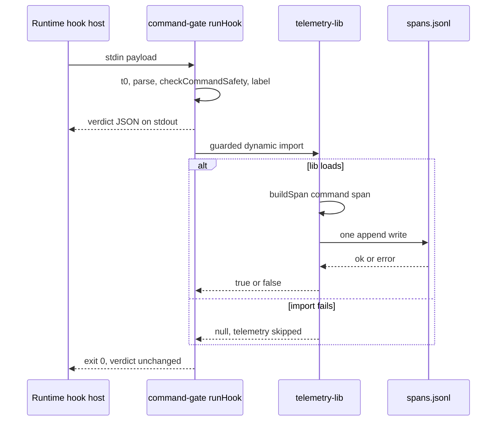
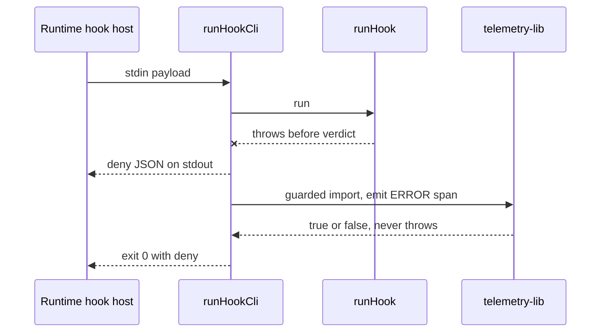
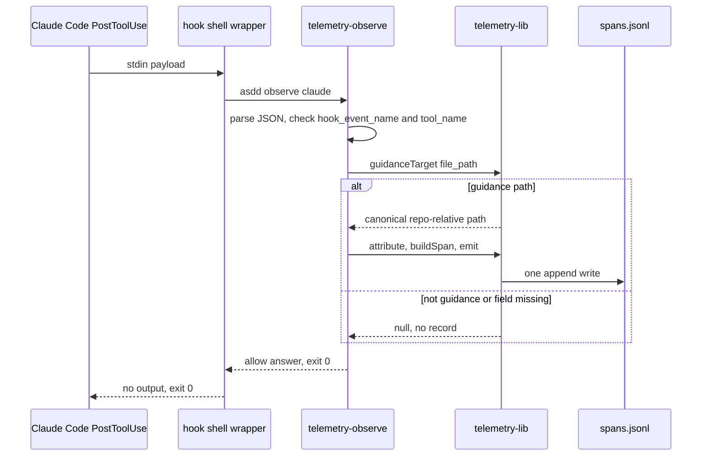
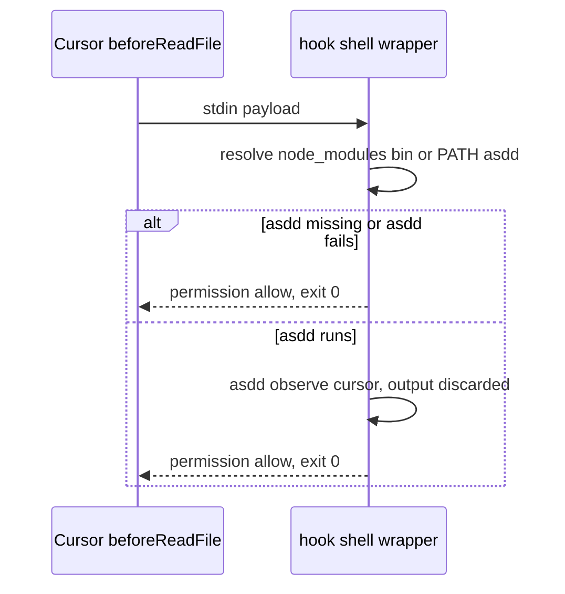
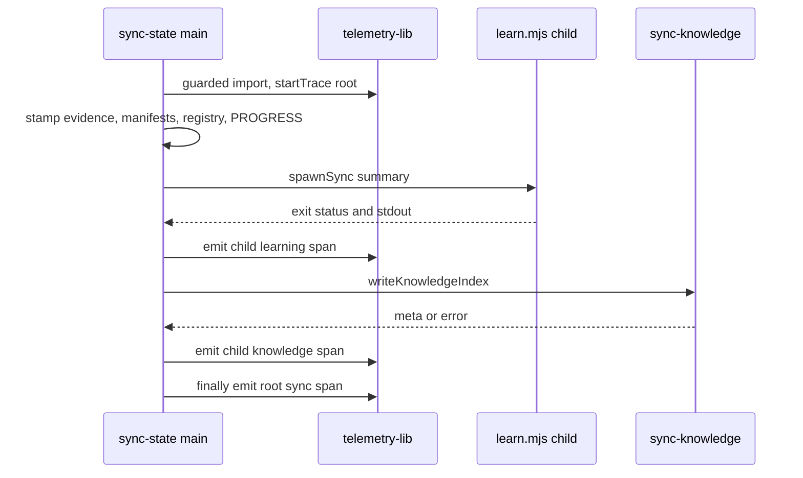
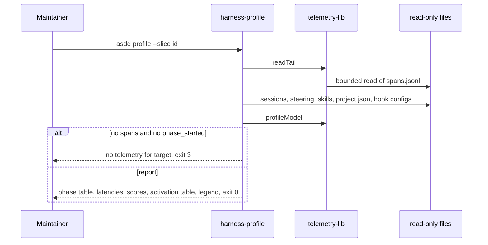

# Design: Fail-open telemetry emitters, guidance activation records, and the `asdd profile` readout

**Author:** asdd-design-agent
**Model/Tool:** claude-opus-5-5 (Claude Code sub-agent)

Design version: 1.0.0
Status: READY
Requirements version: 1.1.0
Domain model version: `docs/architecture/domain-model.md`, Telemetry section (Domain phase 2026-11-16, TEL-1…TEL-9)
Design confidence score: 0.86
Uncertainty Factors:
1. Hook payload shapes (A-01 Claude Code `PostToolUse` for `Read`/`Skill`, A-02 Cursor `beforeReadFile`) and each runtime's
   reaction to a non-zero hook exit are vendor-documented and unverified in this repo. The design makes fixture capture
   the first implementation task, and the parser may read only keys that a committed fixture contains (§12, ADR-004).
2. `asdd uninstall` (`cli/src/uninstall.mjs:15,21`) does not know the new hook command or the gitignore lines. Without a
   change there, the existing test `cli/test/install-lifecycle.test.mjs:123-150` fails. That file is outside Mapped
   files, so the PO must widen them (decision D-1, §14).
3. GOV-001 is still open: no human-authored TL session confirms the relayed PO decisions (AP-7 override, AR-3 deferral,
   Q-14, KPI-1, OI-7).

Last updated: 2026-11-16
Owner: Tech Lead (squad; PO decisions by eencinas, 2026-11-16, relayed by the orchestrator)

**Inputs:** `requirements.md` 1.1.0 (READY, REQ-001…REQ-025), `spec-validation-report.md` v1.1 (PASSED),
`capability.md`, `glossary.md`, `anti-patterns.md`, `intent.md` (Mapped files with two widenings dated 2026-11-16),
`docs/architecture/domain-model.md` § Telemetry, `docs/knowledge-base/profiling-proposals/v2.md` §4, §5, §8.2 (AR-1…AR-10),
`.harness/state/telemetry/telemetry.schema.json` 1.0 (fixed: **no schema change**), steering `domain-layer.md` +
`domain-layer.project.md`, `quality-gates.phases.md` (QG-DES-*), `structure.md`, `manifest.md`.
**PO/TL decisions applied (2026-11-16, relayed):**
- Second command `asdd observe`: hook-only and fail-open.
- OI-7 = YES: an AR-5 missing-registration WARN, active only when `.harness/state/telemetry/` exists.
- Verify-on-Stop's own crash stays out of scope (KPI-1).
- AR-3 rotation, the rollup, and H-* findings are deferred.
- Self-report is deferred: hookless runtimes show `unknown`.

**ADR location:** `.harness/steering/structure.md:56`, the ADR index row, reads "none yet (decisions live in slice designs and the
README)". The ADRs of this slice are therefore inline in §11, in the `documentation-and-adrs` format. No ADR file is
written outside the slice folder.

---

## 1. Architecture Overview

The design follows the kit's layer flow (`domain-layer.project.md`: CLI / hook / MCP → `*-lib.mjs` → state files).
- **Domain service.** `cli/src/harness/telemetry-lib.mjs` holds all telemetry policy and has no harness imports, only
  `node:` built-ins:
  - span building and ids;
  - the fail-open `emit()`;
  - attribution;
  - guidance-path normalization;
  - the bounded tail reader;
  - a schema-subset validator;
  - the pure profile model.
- **Thin adapters.** Each producer (command gate, Verify-on-Stop, `asdd sync`) loads the library with a **guarded
  dynamic import** (ADR-001). It emits only after its own output is written, so no telemetry state can change a verdict.
- **Delivery.** Two delivery entry points:
  - `telemetry-observe.mjs`: the `asdd observe` load hook, fail-open;
  - `harness-profile.mjs`: the read-only `asdd profile`.

  `validators/telemetry.mjs` is a WARN-only sensor wired into `asdd check`.
- **Port.** The only durable port is `.harness/state/telemetry/spans.jsonl`: append-only, gitignored, under the fixed
  schema.

## 2. Component Map

| Component | Type (binding layer) | Responsibility |
|---|---|---|
| `cli/src/harness/telemetry-lib.mjs` (new) | Domain service (`*-lib.mjs`) | Constants, ids, `startTrace`/`buildSpan`, fail-open `emit()`, `attribute()` (REQ-017), `guidanceTarget()`/`skillTarget()` (REQ-015), `readTail()`, `validateSpan()` (schema subset), `phaseMarkers()`, profile model (percentiles, scores, activation rows) |
| `cli/src/harness/telemetry-observe.mjs` (new; **not** folded into the lib, ADR-003) | Adapter (runtime hook) + CLI entry `asdd observe <claude\|cursor>` | Parse the hook payload and recognize the event. Build at most one Activation record and emit it. Always write the runtime's allow answer and exit 0 |
| `cli/src/harness/harness-profile.mjs` (new) | Delivery (CLI) `asdd profile` | Parse arguments; read the tail, sessions, steering frontmatter, installed skills, `project.json` `runtimes`, and hook configs; call the lib model; render text or `--json`; exit 0/2/3; write nothing |
| `cli/src/harness/validators/telemetry.mjs` (new) | Sensor (validator) | WARN-only checks: schema file, tail lines (JSON, schema, ≤4,096 B, `trace_source`), and AR-5 registration (OI-7) |
| `cli/src/harness/command-gate.mjs` (changed) | Adapter (hook) | `runHook` measures the gate, writes the verdict, then emits one `command` span. `runHookCli`'s error path emits an `ERROR` span. **`checkCommandSafety` is untouched** (MCP path) |
| `cli/src/harness/verify-on-stop.mjs` (changed) | Adapter (hook) | Each exit path goes through `finish(outcome, attrs)`: write the payload (unchanged), emit one `hook` span, then `process.exit(0)` |
| `cli/src/harness/sync-state.mjs` (changed) | Delivery (CLI) | The `main()` run gets one root `sync` span plus child spans for the knowledge index and learning. `syncKnowledgeIndex`/`syncLearning` return an ok flag; their output is unchanged |
| `cli/src/harness/check-invariants.mjs` (changed) | Delivery (CLI) | Guarded dynamic import of `validators/telemetry.mjs` with a WARN-only ctx. Its WARNs are printed but **not** passed to `writeSensorSignal` (TEL-3) |
| `cli/src/harness/commands.mjs` (changed, append-only) | Delivery (registry) | Entries `profile` and `observe` |
| `cli/agents/_runtime-template.md` (changed; `.agents/agents/` copy via `asdd kit self`) | Guidance | One rule: load steering and skill bodies with the read or skill tool, never with a shell command. No span instruction |
| `cli/src/install/phases.mjs`, `runtimes.mjs`, `index.mjs` (changed) | Adapter (installer) | `observeCommand(ctx, runtime)` (fail-open resolver), Claude `PostToolUse` and Cursor `beforeReadFile` wiring, `HARNESS_FILES` directory row, telemetry gitignore lines |
| `cli/runtimes/cursor/hooks.json`, `.claude/settings.json`, `.cursor/hooks.json` (changed) | Hook config | Load-hook entries: no `failClosed`, timeout 10 s |
| `cli/scaffold/state/telemetry/{telemetry.schema.json,README.md}` (new; shipped source) | Port contract | Shipped contract. `.harness/state/telemetry/*` becomes its `kit self` copy (schema byte-identical) |
| `tools/{jev-gate,knowledge,spec-drift}/src/harness/telemetry-lib.mjs` (generated) | Vendored copy | Written only by `asdd kit vendor`. The closure follows the literal dynamic imports (`cli/src/kit/vendor.mjs:26-42`) |
| `cli/test/fixtures/telemetry/**` (new) | Test data | Captured hook payloads with provenance |
| `cli/src/uninstall.mjs` (**needs widening, D-1**) | Adapter (installer) | `KIT_HOOK` also matches the observe command, and `KIT_IGNORES` gains the two telemetry lines |

Dependency direction (no cycles):
- `telemetry-lib` imports nothing from the harness.
- The producers import `telemetry-lib` lazily.
- `harness-profile` imports `telemetry-lib`, `sync-state` (`readSessions`, `PHASES`), and `validators/steering-tags`
  (`parseSteeringFrontmatter`).
- `telemetry-lib` never imports `sync-state`. The reverse lazy edge would otherwise form a cycle.

## 3. Service Boundaries

### 3.1 `telemetry-lib.mjs` public contract

| Export | Contract |
|---|---|
| `TELEMETRY_DIR`, `STREAM_FILE`, `MAX_LINE_BYTES=4096`, `TAIL_MAX_LINES=500`, `TAIL_MAX_BYTES=262144` | Code constants (Q-10). No steering rule |
| `ATTRIBUTION_ENV = 'HARNESS_SLICE_ID'` | OI-1 |
| `startTrace({ env, honorEnv })` → `{ trace_id, span_id, parent_span_id, trace_source }` | When `honorEnv` is true and `HARNESS_TRACE_ID` matches `^[a-f0-9]{16,32}$`: `trace_source:"env"`, and `parent_span_id` = `HARNESS_SPAN_ID` when it matches `^[a-f0-9]{8,16}$`, else `null`. Otherwise self-minted: `trace_id` 32 hex, `span_id` 16 hex (`crypto.randomBytes`), `parent_span_id: null`, `trace_source:"self"`. `asdd observe` passes `honorEnv:false` (REQ-013/014 require `self`) |
| `childOf(root)` → ctx | Same `trace_id` and `trace_source`, new `span_id`, `parent_span_id = root.span_id` (REQ-005 child rule) |
| `buildSpan(ctx, fields)` → span object | Fills `schema_version:"1.0"`, ISO times, and `duration_ms ≥ 0`. **Omits** every `undefined`/`null` attribute (AR-7, TEL-8) |
| `emit(span, { root = process.cwd() })` → `boolean` | Never throws and never writes to stdout or stderr; leaves `process.exitCode` alone; synchronous (no promise, timer, or handle). Returns `false` when: the location is missing; `kind ∈ {phase, turn, subagent, test}`; a reserved attribute (`heuristic`, `trigger_span_id`, `source`) is present; serialization fails; the line exceeds 4,096 B including LF; open or write fails; or a short write occurs. Otherwise it does `openSync(path,'a')` → one `writeSync(fd, Buffer)` → `closeSync` (in `finally`) and returns `true`. It never creates the directory; it creates `spans.jsonl` when the directory exists |
| `attribute(root, env)` → `{ slice_id, phase }` | REQ-017. See §4.3 |
| `guidanceTarget(rawPath, root)` → canonical repo-relative path or `null` | REQ-015 and REQ-004. See §12.4 |
| `skillTarget(name, root)` → `.agents/skills/<name>/SKILL.md` or `null` | REQ-013 and REQ-004 |
| `readTail(root)` → `{ lines: [{ n, text }], fromStart: boolean, total }` | One `openSync` + `fstatSync` + `readSync` of the last `min(size, 262144)` bytes. When the read starts after byte 0 and the preceding byte is not LF, the first partial line is dropped. Keeps the last 500 lines. Never reads the whole file |
| `validateSpan(obj, schema)` → `string[]` | Interprets the draft-07 subset that the schema uses: `type`, `required`, `properties`, `const`, `enum`, `pattern`, `minimum`, `minLength`, `format: date-time`, `items`, `additionalProperties`. It reads `telemetry.schema.json`, so a later schema version is followed without a code change |
| `phaseMarkers(sessions)`, `percentile(values, p)`, `surfaceScores(...)`, `activationRows(...)`, `profileModel(...)` | Pure functions over arrays (§4.5, ADR-005) |

### 3.2 Producer contract (gate, Verify-on-Stop, sync)

```text
const tel = await import('./telemetry-lib.mjs').catch(() => null);   // ADR-001
try { if (tel) tel.emit(tel.buildSpan(...)) } catch {}                // after the producer's own output
```
- The `import()` literal is relative, so `vendor.mjs` follows it. `cli/src/kit/build.mjs` compiles every source file
  without bundling, so `dist/harness/telemetry-lib.mjs` sits next to the producer and the relative import also resolves in
  the npm package.
- A failure has three possible causes: a missing module, a throw at evaluation, or an `emit()` throw or `false`. Each one
  becomes a no-op, and the producer's output is already written.

### 3.3 Failure behaviour (summary)

| Component | Own failure | Telemetry failure |
|---|---|---|
| Command gate | Unchanged **fail-closed**. `runHookCli` catches and writes deny, exit 0 (`command-gate.mjs:145-159`); an `ERROR` span is emitted from that catch, after the deny is written | No effect: emit runs after the verdict write, inside `try`, after a guarded import |
| Verify-on-Stop | Unchanged. KPI-1 (own crash) is out of scope; telemetry adds no new crash path, because `finish()` wraps the import and emit in `try` | No effect on stdout, stderr, or exit |
| `asdd sync` | Unchanged. The root span is emitted in a `finally` around `main()`, which re-throws exactly as before | No effect |
| `asdd check` | Unchanged | The validator import, the validator throw, and a lib load failure are each caught; nothing is printed and no FAIL is added (AMB-010) |
| `asdd observe` | Fail-open in two layers: an in-process top-level `try` that always writes the allow answer and exits 0, and the shell wrapper of the hook entry (§12.2) | Same |
| `asdd profile` | Exit 0/2/3 (REQ-023). A malformed line is skipped | Not a producer: emits nothing |

## 4. Data Model

### 4.1 Entities and Persistence Models

| Domain Entity | Persistence Model | Table / Collection | Notes |
|---|---|---|---|
| Span (producer span) | One JSON line under `telemetry.schema.json` 1.0 | `.harness/state/telemetry/spans.jsonl` (append-only, gitignored) | `kind` `command` (gate), `hook` (Verify-on-Stop), `sync` (root and children) |
| Activation record (Span sub-type) | One JSON line, `kind:"tool"`, `writer:"runtime-hook"`, `process_name:"asdd-observe"` | same stream | One record per observed guidance load |
| Trace, Phase marker, Tail, Telemetry state, Activation state | none (derived per call) | none | TEL-5; computed in `telemetry-lib` |
| Profile report | none (stdout only) | none | REQ-022: writes nothing |
| Session (read) | existing session JSON | `.harness/state/slices/<id>/sessions/*.json` | Read through `readSessions` (`sync-state.mjs`); never written (TEL-3) |

### 4.2 Database Migrations Required

| Migration | Type | Description |
|---|---|---|
| None (schema) | — | `telemetry.schema.json` stays byte-identical. A test asserts its sha256 against the `telemetry-contract` landing. All new keys go in `attributes` (`additionalProperties: true`) |
| Contract source move | File layout | The canonical source moves to `cli/scaffold/state/telemetry/` (shipped). `.harness/state/telemetry/{schema,README}` become `kit self` copies. The README gets an additive "Phase 2 status" paragraph (emitters exist, rotation and rollup deferred); its contract text is unchanged |

### 4.3 Field decisions (OI-1, OI-3, OI-4)

**Span fields by producer.** `writer` = `process_name` except for `asdd observe`.

| Producer | `kind` | `process_name` / `writer` | `runtime` | `status` | `attributes` (OI-4 keys in **bold**) |
|---|---|---|---|---|---|
| Command gate | `command` | `command-gate` / `command-gate` | §5 rule (ACT-002) | `OK`; `ERROR` from the catch path | `trace_source`, **`verdict`** (`allow`\|`deny`), `command_label` (closed set + `override`, AMB-009; omitted on `ERROR` when not yet computed) |
| Verify-on-Stop | `hook` | `verify-on-stop` / `verify-on-stop` | `claude` when `hook_event_name==="Stop"`; `cursor` when the payload has a `status` key or `hook_event_name==="stop"`; else `cli` | `OK`; `ERROR` for `could-not-run` | `trace_source`, **`outcome`** (`pass`\|`block`\|`advisory`\|`guard-skip`\|`could-not-run`), `exit_code` and `violations_count` **only** when `check --live` returned a numeric status (count of lines matching `/^FAIL\s/m` in stdout+stderr) |
| `asdd sync` root | `sync` | `sync-state` / `sync-state` | `HARNESS_RUNTIME` when set, else `cli` | `OK`; `ERROR` when `main()` throws | `trace_source` |
| `asdd sync` child: knowledge | `sync` | `sync-state/knowledge-index` / `sync-state` | as root | `ERROR` when `writeKnowledgeIndex` throws | `trace_source` (= root's) |
| `asdd sync` child: learning | `sync` | `sync-state/learning` / `sync-state` | as root | `ERROR` when exit ≠ 0 or the output does not parse | `trace_source`, `exit_code` when numeric. No span when `learn.mjs` is absent |
| `asdd observe` | `tool` | `asdd-observe` / `runtime-hook` | `claude` \| `cursor` (§12) | `OK` | `trace_source:"self"`, `target_path`, `tool_name` (Claude only: `Read`\|`Skill`), **`runtime_session_id`**, **`agent_id`**, each only when present |

- All producers: `slice_id`/`phase` from `attribute()`, and no evaluator-reserved key.
- Key style is flat snake_case, like the declared keys `command_label` and `exit_code`.

**OI-1: attribution env var `HARNESS_SLICE_ID`.** It follows the kit's `HARNESS_*` env convention (`HARNESS_RUNTIME`,
`HARNESS_STOP_MODE`, `HARNESS_TRACE_ID`). `attribute(root, env)` works in this order:
1. If `HARNESS_SLICE_ID` is set: when it matches `^[a-z0-9_-]+$` and `.harness/state/slices/<id>/manifest.json` parses,
   the result is `{slice_id:id, phase:manifest.phase}`. Otherwise both are `null`. The function does not fall through to
   rule 2, because a wrong explicit value never yields a guess.
2. Otherwise, when `.harness/state/registry.json` lists exactly one slice with `status:"in_progress"`, the result is that
   slice and its manifest phase.
3. In every other case (zero or several in progress, or an unreadable registry or manifest) both are `null`.

A `phase` outside the schema enum → both `null`, so a span can never be schema-invalid. `trace_id`, `parent_span_id`, and
`HARNESS_TRACE_ID` are never read here (TEL-5). The README documents the launch form (`HARNESS_SLICE_ID=<id> claude`,
`HARNESS_SLICE_ID=<id> cursor .`).
Observation: the kit repo has 4 slices `in_progress` today (registry), so without the env var its spans stay
unattributed (RSK-002, §14).

**OI-3: `--json` absent vs `null`.** **Omitted.** An unmeasured dimension has no key (TEL-8, AR-7). For explicitness each
slice entry carries `not_measured: ["turn_latency","boot_tax","tokens","h_findings"]`. No `0` and no `null` stands for an
unmeasured value.

### 4.4 Validator line numbering (OI-5)

- The validator numbers lines **from the start of the tail**.
- When `readTail().fromStart` is true (the file fits in the bounds), tail numbers equal file numbers, and the WARN says
  `spans.jsonl line N`.
- When the byte or line bound applies, the WARN says
  `spans.jsonl tail line N (numbered from the start of the last M lines read; the file is longer)`.

Absolute numbering would need a full-stream scan (AR-3), so it is not used.

### 4.5 Phase windows: reuse vs. divergence from `pipeline-metrics.mjs:29-44` (ADR-005)

**Diverge.** A new pure function `phaseMarkers(sessions)` goes in `telemetry-lib`. `pipeline-metrics.mjs` is unchanged
(it is not mapped, and `asdd status --metrics` keeps its output).
- `phaseDurationsHours` takes the first `phase_started` that `sessions.find` returns, unsorted (`:37`). It also ignores
  `phase_started` events in the middle of a slice: `kit-hygiene` and `jev-module` have 4 each, after amends. The idle
  time between DONE and an amend would therefore count against the next phase.
- It works in hours, with per-phase arrays.

**Segment model.** Sort the slice's `phase_started` and `phase_completed` events by timestamp. Each `phase_completed(P)`
at `t_i` owns the segment `(t_{i-1}, t_i]`, where `t_{i-1}` is the previous phase event of any phase. A
`phase_started` is an anchor only, and `phase_blocked` is ignored.
- `duration(P)` is the sum of P's segments.
- `window(P)` = [start of P's first segment, end of P's last segment].
- `start_source` = `phase_started` when P's own `phase_started` opens a segment, else `previous_phase_completed`.

This matches how `derivePhase` (`sync-state.mjs:64-77`) treats a completion of phase N as the start of N+1.
- **Disjoint segments.** The slice's phase-time denominator for surface share is the sum of completed segments, never
  double counted.
- **Open phase.** A phase that has only `phase_started` (the current one) is listed as `open`, with no end and no
  duration, and is excluded from the denominator. Using "now" would break determinism (REQ-020).

REQ-020 asks for "each phase with a `phase_started` event". This model lists those phases plus every phase with a
completion. That is a superset, and its only inputs are session phase events.

### 4.6 Profile model

- **Latency (REQ-020).** Nearest-rank p50 and p95 of `duration_ms` per `kind` ∈ {command, hook, sync}. Only spans with
  `slice_id = target` count; the root and child sync spans are both included.
- **`bottleneck_score` (REQ-020).** For each surface ∈ {command, hook, sync}:
  `score = 0 (hits; OI-2) + ⌊ share / 0.10 ⌋`, where `share = Σ duration_ms(surface, slice) / Σ completed segment ms`.
  - When the denominator is 0, the share term is 0 and the report prints `share unknown`.
  - Surfaces are ordered by score descending, then by name ascending, a deterministic tie-break. v2's `wasted_ms`
    tie-break needs boot and stall data, which this slice does not measure.
- **`--bottlenecks`.** Ranks every slice that has attributed spans in the tail by max surface score, then by the sum of
  surface scores, then by `slice_id` ascending. Computed in memory.
- **Grouping keys.** Only `slice_id`, `phase`, `kind`, and `failure_signature` (AR-10, TEL-5). The renderer never reads
  `trace_id` or `parent_span_id`.
- **OI-2.** No H-* heuristic is evaluated in this slice. The hits term is the literal `0`, and the v2 §4 severity
  weights are **not** added to the code (no dead constants). AR-8 input exclusion applies when a later slice adds
  evaluation (TRC-005).
- **Activation rows (REQ-021).**
  - Expected steering per phase is every `.harness/steering/*.md` with `inclusion: always`, plus `auto` files whose
    `tags` include the phase, parsed with `parseSteeringFrontmatter` (`validators/steering-tags.mjs:15`). Installed
    skills are `.agents/skills/*/SKILL.md`.
  - Columns come from `.harness/config/project.json` → `runtimes` (key confirmed: `project.json:45`). When the key is
    absent, the report prints `runtimes not configured` and uses one column per runtime seen in the records.
  - Cell values: `observed (n)`; `not observed`, only for `claude`/`cursor` **when that runtime's hook config in the
    project contains the observe entry**; `unknown` (hookless runtime, or hook not wired, TEL-7); and
    `configured, not observed` rows for `CLAUDE.md` (claude), `.cursor/rules/*.mdc` with `alwaysApply: true` (cursor),
    and skill descriptions (`.harness/steering/skills.md` catalog / runtime skill index). These are computed when the
    report runs.
  - A missing `runtime_session_id` or `agent_id` renders as `unknown`. Records with `slice_id:null` are counted as
    unattributed.
  - The legend has three states. The phrase `not loaded` is never printed (a test greps for it).
- **Fixed footer.** "Test thrash (H-BOOT, H-LOOP inputs) is not measured; H-* findings are not reported in this
  version."

## 5. Sequence Diagrams

### 5.1 Command gate: happy path and telemetry failure



### 5.2 Command gate: gate crash stays fail-closed



### 5.3 `asdd observe`: Claude Code `Read` of a guidance file



### 5.4 `asdd observe`: asdd not resolvable (REQ-025)



### 5.5 `asdd sync` span tree



### 5.6 `asdd profile --slice`



## 6. API Interfaces

These are CLI and hook interfaces; there is no HTTP surface.

**`asdd observe <claude|cursor>`**
- Purpose: record one Activation record for a guidance load reported by a runtime hook.
- Auth: none. Local hook process.

| Request | Response | Error |
|---|---|---|
| stdin: hook payload JSON (§12); argv: runtime | `claude`: no stdout, exit 0. `cursor`: `{"permission":"allow"}\n`, exit 0. Missing or unknown argv: no stdout, exit 0, no span | None by design. Any throw → same answer, exit 0, no stderr |

**`asdd profile [--slice <id>] [--bottlenecks] [--json]`**
- Purpose: read-only report.
- Auth: none.
- Usage: no mode → usage on stderr, exit 2.

| Request | Response | Error |
|---|---|---|
| `--slice <id>`, `--bottlenecks`, `--json` (alone = all slices; combinable with `--slice`) | Text report, or one JSON document `{schema_version:"1.0", generated_at, slices:[{slice_id, phase_durations, latencies, activation, scores, unattributed_spans, not_measured}]}`; exit 0 | Unknown option or `--slice` without id → stderr usage, exit 2. Neither spans nor `phase_started` for the target → exit 3 + "no telemetry exists for <target>". Session phases but no attributed spans → phase table + `no attributed spans for <slice>` + unattributed count, exit 0 |

**Hook entries (installer output).** See §12.2.

## 7. Security Design

- **No network (REQ-004).** `telemetry-lib`, `telemetry-observe`, `harness-profile`, and `validators/telemetry` import
  only `node:fs`, `node:path`, `node:crypto` (lib), and harness modules.
  - A test greps these four files for `node:http`, `node:https`, `node:net`, `node:dgram`, `fetch(`, and `node:tls`,
    and requires 0 matches.
  - A test also runs each with a `globalThis.fetch` that throws.
- **Labels only (TEL-1, SEC-05).**
  - The gate span carries `command_label` from the closed set
    {denied pattern label, `sudo`, `allowlist`, `unmatched`, `empty`, `override`}, never command text.
  - Test: the marker `SECRET-MARKER-123` command → no token of the command in the line other than the label tokens.
  - `asdd observe` reads only the listed keys (§12). It never reads `transcript_path`, `cwd`, `tool_response`, or Cursor
    `content`, `attachments`, `user_email`, or `workspace_roots`.
  - Test: the fixture values of these keys never appear in the emitted line.
- **Paths.** Repo-relative only. Rejected: paths with a `..` segment, NUL, or `:` in the repo-relative result, and
  absolute paths outside the root. Skill names must match `^[A-Za-z0-9._-]+$` (no `/`, `:`, or `..`).
- **State isolation (TEL-3).**
  - `emit()` writes only `spans.jsonl`.
  - Telemetry WARNs are kept out of the learning signal (§2).
  - A test hashes `.harness/state/slices`, `registry.json`, `manifest.json`, `.harness/features`, and
    `.harness/state/learning` before and after each telemetry path.
  - `asdd profile` is hashed over the whole working tree (REQ-022).
- **Fail-closed gate preserved.** The verdict is computed and written before telemetry starts.
- **Opaque ids.** `runtime_session_id` and `agent_id` are stored as received when they are strings of ≤128 chars
  matching `^[A-Za-z0-9._:-]+$`. Otherwise they are omitted, never truncated or rewritten (A-10).
- Compliance with `.harness/steering/security-rules.md`: no secrets, local-only data, gitignored (data class Internal).

## 8. Observability Design

| Signal | Name | Emitted by | When | Payload |
|---|---|---|---|---|
| Span | `command` | `command-gate` (`runHook` / `runHookCli` catch) | Each hook invocation, after the verdict write | §4.3 |
| Span | `hook` | `verify-on-stop` `finish()` | Each exit path (5 outcomes) | §4.3 |
| Span | `sync` root + 2 children | `sync-state` | Each `asdd sync` run | §4.3 |
| Span | `tool` (Activation record) | `asdd observe` | Each recognized guidance load | §4.3 |
| WARN line | `TEL-W1` schema, `TEL-W2` line, `TEL-W3` registration | `validators/telemetry.mjs` | `asdd check`, only when the location exists | WARN text only, not a learning signal |
| Report | Profile report | `asdd profile` | On demand | stdout |

**TEL-W3 (OI-7, AR-5 sensor clause; all WARN).**
- (a) `.gitignore` lacks the exact line `.harness/state/telemetry/spans.jsonl` or `.harness/state/telemetry/slices/`.
- (b) `telemetry.schema.json` or `README.md` is missing from the location.
- (c) `project.json` `runtimes` contains `claude` (or `cursor`) and `.claude/settings.json` `PostToolUse`
  (`.cursor/hooks.json` `beforeReadFile`) has no observe entry.

> **Superseded by D-3 (2026-11-17):** Cursor is hookless for guidance loads, so the Cursor half of (c) is dropped;
> TEL-W3 (c) checks only `claude` / `PostToolUse`. See [`cli/test/fixtures/telemetry/cursor/README.md`](../../../cli/test/fixtures/telemetry/cursor/README.md) and requirements 1.1.1 errata (QA-F-002).

Each WARN names the fix (`asdd install .`).

## 9. Non-Functional Design

**Fail-open / fail-closed proof plan.** Each row is a test in `npm test`.

| Claim | Mechanism | Test (file → case) |
|---|---|---|
| Emit never throws or writes; exitCode unchanged (REQ-002) | `try` around every step; sync API | `telemetry-lib.test.mjs` → missing dir, read-only dir/file (chmod when uid≠0), **stream is a directory** (EISDIR, root-proof), oversized, circular, non-object, reserved key, forbidden kind |
| Load failure is caught (REQ-002) | Guarded `import()` | Each producer test copies `cli/src/harness` to a temp dir and replaces `telemetry-lib.mjs` with (i) `throw new Error('boom')` at top level and (ii) a deleted file, then compares stdout, stderr, and exit with a working-lib run |
| Gate verdict byte-identical (REQ-008) | Emit after the write | `command-gate.test.mjs` → corpus (all payloads of the file, including override, empty, Claude/Cursor shapes) × {4 telemetry states, load failure} → 0 differences |
| Gate crash still denies (REQ-008) | `runHookCli` catch | `command-gate.test.mjs` → inject a throwing `checkCommandSafety` through the exported `runHook({ readInput, write, safety })` seam → deny JSON, exit 0, one `ERROR` span |
| No span from `checkCommandSafety` (REQ-007) | Emit only in `runHook` | `command-gate.test.mjs` → call `checkCommandSafety` in a cwd with a telemetry dir → no `spans.jsonl` |
| Verify-on-Stop unchanged (REQ-009) | `finish()` | `verify-on-stop.test.mjs` (new) → stub `check-invariants.mjs`: pass, fail with 2 FAIL lines, missing, self-SIGKILL (null status); advisory (`HARNESS_STOP_MODE`); guard-skip (Cursor `status:"aborted"`, Claude `stop_hook_active`) × 4 states + load failure; unwritable stream + passing check → `{}` |
| Sync unchanged (REQ-010) | `finally` root | `sync-state.test.mjs` → span tree, learning absent, knowledge stub throws → child `ERROR`; stdout, manifests, registry, and `PROGRESS.md` byte-identical across states + load failure |
| Check exit unchanged (REQ-019, AMB-010) | Guarded import, WARN-only ctx | `validators/telemetry.test.mjs` + a check run: valid stream, malformed lines, no location, throwing validator, throwing lib → same exit code; the failure adds no output |
| Observe always allows (REQ-018) | Two-layer fail-open | `telemetry-observe.test.mjs` → every fixture × 4 states; invalid JSON, empty, unknown event, missing argv, throwing lib |
| Installed hook fail-open when asdd is absent (REQ-025) | Shell wrapper | `cli/test/install.sh` → run the installed Cursor and Claude observe commands with `PATH` without asdd → exit 0, Cursor prints the allow JSON |

> **Superseded by D-3 (2026-11-17):** the Cursor parts of the rows above (installed Cursor observe command, Cursor
> fixtures) and the two Cursor `beforeReadFile` latency classes below do not apply: no Cursor load hook is installed,
> and `asdd observe cursor` answers `{"permission":"allow"}` and records nothing. See [`cli/test/fixtures/telemetry/cursor/README.md`](../../../cli/test/fixtures/telemetry/cursor/README.md) and requirements 1.1.1 errata
> (QA-F-002).

**Latency proof.**
- **REQ-003.** `telemetry-lib.test.mjs` performs ≥1,000 emits of spans between 300 B and 4,096 B against a writable
  temp stream. Each call must grow the file by exactly its line length; the test fails on p99 > 50 ms.
- **REQ-018 / TRC-006.** `telemetry-observe.test.mjs` measures the exported `handleObserve(raw, runtime, deps)` from
  handler entry, after stdin bytes are in memory, to the answer written to an in-memory sink. Emit is included. Five
  classes, ≥200 samples each, p99 ≤ 50 ms:
  - Claude `Read` guidance;
  - Claude `Read` non-guidance;
  - Claude `Skill`;
  - Cursor `beforeReadFile` guidance;
  - Cursor `beforeReadFile` non-guidance (**TRC-006: fifth class**).

  Guidance classes use a writable stream. Whole-process wall time (`node cli/bin/asdd.mjs observe …`, 20 runs per
  class) is printed and not gated.
- **NFR-001.** The REQ-008 criterion (≤30 s hook timeout) is kept. In addition, `command-gate.test.mjs` gates the
  **added** telemetry segment: the time from the verdict write to emit return, through the `runHook` seam over the
  corpus × 50 runs, must have p99 ≤ 50 ms. This bounds the gate's telemetry cost by the REQ-003 budget instead of the
  loose 30 s.

**Reliability and volume (R-8).** The non-guidance early exit runs before any filesystem call other than path math. The
attribution reads (`registry.json` and one manifest) happen only for guidance paths.

**Vendoring and MCP builds (R-1).**
- `asdd kit vendor` writes `tools/{jev-gate,knowledge,spec-drift}/src/harness/telemetry-lib.mjs`. `command-gate.mjs`
  (jev-gate entry) and `sync-state.mjs` (in all three closures) reach it through literal `import('./telemetry-lib.mjs')`
  calls, which `IMPORT` (`vendor.mjs:26`) follows.
- The MCP servers never execute it: jev-gate calls only `checkCommandSafety`, and `sync-state`'s `main()` runs only from
  the stripped CLI block.
- **Rebuild:** yes, for build health but not for behaviour. The esbuild bundle (`tools/*/scripts/build-server.mjs`,
  `bundle: true`) needs the vendored file to resolve the dynamic import, and a stale gitignored `dist/` only lacks
  unreachable code.
- **Verification in the landing task:**
  1. `node cli/bin/asdd.mjs kit vendor --check` exits 0.
  2. `npm --prefix tools/<t> run build` and `npm --prefix tools/<t> test` exit 0 for each of the three tools.
  3. `grep -c telemetry-lib tools/*/dist/server/main.js` shows the module is bundled and inert.
  4. The `checkCommandSafety` no-span test above passes.

## 10. Requirements Traceability

| Requirement | Component(s) | Test (proof) |
|---|---|---|
| REQ-001 | telemetry-lib `emit` | `telemetry-lib.test.mjs`: single append, earlier bytes unchanged (prefix hash), 20 concurrent child processes → 20 parseable lines, no dir → `false` and no dir created |
| REQ-002 | telemetry-lib; producers' guarded import | `telemetry-lib.test.mjs` failure matrix; producer load-failure copies (§9) |
| REQ-003 | telemetry-lib | `telemetry-lib.test.mjs` 1,000-emit p99 + failure cases |
| REQ-004 | telemetry-lib, command-gate, telemetry-observe, validators/telemetry, harness-profile | Secret-marker test; transcript/cwd fixture test; path rejection table; no-network grep + fetch trap |
| REQ-005 | telemetry-lib `startTrace`/`childOf`/`buildSpan`/`emit` guard | Every emitted line in all producer tests passes `validateSpan` against the schema file; root/child rules; reserved keys and forbidden kinds → `false`; schema sha256 unchanged |
| REQ-006 | telemetry-lib (writes only the stream); check-invariants (WARNs not sent to learning) | State-hash test around each telemetry path |
| REQ-007 | command-gate `runHook`, `commandLabel()` | `command-gate.test.mjs`: one span, verdict, label set incl. `override` (AMB-009), runtime rule (ACT-002), `ERROR` path, no span from `checkCommandSafety`, no `test` kind |
| REQ-008 | command-gate | Byte-identity corpus × states; crash → deny; NFR-001 added-time p99 |
| REQ-009 | verify-on-stop `finish()` | `verify-on-stop.test.mjs` (new, added to `npm test`) |
| REQ-010 | sync-state `main` | `sync-state.test.mjs` span tree and byte-identity |
| REQ-011 | `cli/agents/_runtime-template.md` | `telemetry-lib.test.mjs` "runtime template" case: the read-tool sentence is present, and the `span`, `turn` span, and `subagent` span instructions are absent; `asdd kit self --check` |
| REQ-012 | Task plan (wave order §13) | Task Planning review: wave dependencies and the fixture task first |
| REQ-013 | telemetry-observe (Claude) | `telemetry-observe.test.mjs` over Claude fixtures: Read guidance, Skill installed, Skill not installed / namespaced, Bash `cat` → no record |
| REQ-014 | telemetry-observe (Cursor) | Cursor fixtures: record shape, `conversation_id`, allow answer for every payload |
| REQ-015 | telemetry-lib `guidanceTarget` | Table test: steering, `skills.md`, `SKILL.md`, `references/**`, the `.claude`, `.cursor`, and `.devin` aliases, absolute inside/outside root, non-guidance → no span, exit 0 |
| REQ-016 | telemetry-observe | Fixtures with keys removed: no session id → key absent; no path → no record + allow; empty/invalid/unknown event → no span; payload-keys-in-fixtures guard (§12.5) |
| REQ-017 | telemetry-lib `attribute` | Env names slice / unknown slice / one, zero, or two `in_progress` / unreadable manifest; phase follows the manifest; topology never read |
| REQ-018 | telemetry-observe; hook entries | Fail-open matrix; five latency classes (TRC-006); no `failClosed` assertion on installer output; provenance test |
| REQ-019 | validators/telemetry; check-invariants wiring | `validators/telemetry.test.mjs`: absent location silent; schema WARN; per-line WARNs with OI-5 numbering; bounded read (a 10 MB stream reads ≤256 KB via spied `readSync`); throw/load failure (AMB-010); TEL-W3 (OI-7) |
| REQ-020 | telemetry-lib `phaseMarkers`/`profileModel`; harness-profile | `harness-profile.test.mjs`: segment windows; p50/p95 vs precomputed fixture; scores deterministic; topology-only differences → same report; H-* footer |
| REQ-021 | telemetry-lib `activationRows`; harness-profile | Expected set via `parseSteeringFrontmatter`; runtime columns; `not observed`/`unknown`/`configured, not observed`; legend; no `not loaded`; unattributed count |
| REQ-022 | harness-profile, telemetry-lib `readTail` | Working-tree hash before = after; 500/262,144 constants; cut first line skipped; malformed skipped |
| REQ-023 | harness-profile | Exit 0/2/3 cases; `--json` shape, `not_measured`, no `0` (OI-3) |
| REQ-024 | commands.mjs, package.json, scaffold, `HARNESS_FILES`, gitignore, installer, recipes, vendored copies, versions, README | Merge checklist (§13); `npm test` including `kit vendor --check` and `kit self --check`; hand-edit of a vendored copy → `--check` fails; `npm pack --dry-run` has no `spans.jsonl` |
| REQ-025 | installer (`phases.mjs`, `runtimes.mjs`, `index.mjs`), `cli/runtimes/cursor/hooks.json` | `cli/test/install.sh`: location with schema and README, no `spans.jsonl`; gitignore lines once after 2 installs; hooks per runtime; hookless-only → no load hook; unresolvable asdd → exit 0 + allow |

## 11. Architecture Decision Records (ADRs)

These are inline per the kit convention (`structure.md:56`: "decisions live in slice designs"), in the
`documentation-and-adrs` format.

### ADR-001: Guarded dynamic import of the telemetry library in every producer

- **Status:** Accepted
- **Date:** 2026-11-16

**Context.** REQ-002, REQ-008, REQ-009, REQ-010, and REQ-019 require that no telemetry failure, including a load failure,
changes a producer.

Decision drivers:
- D1: fail-open on a missing or broken lib (REQ-002).
- D2: the gate stays fail-closed for its own logic (REQ-008).
- D3: vendoring must keep working (`vendor.mjs` closure; Q-5).
- D4: the dist and npm package resolve the module (`build.mjs` does not bundle).
- D5: emit latency is not inside the measured verdict path (REQ-007 `duration_ms`).

**Decision.** Each producer loads the lib with `await import('./telemetry-lib.mjs').catch(() => null)` *after* its own
output, and wraps `emit` in `try`. The specifier is a literal relative string.

**Alternatives Considered.**

| Option | D1 | D2 | D3 | D4 | D5 | Verdict |
|---|---|---|---|---|---|---|
| Guarded dynamic import after output (chosen) | yes | yes | yes (literal import followed) | yes | yes | Accept |
| Static `import` | no: a broken lib crashes the gate before the verdict; Verify-on-Stop has no top-level catch (KPI-1) | partial: `runHookCli` catches only `runHook` | yes | yes | yes | Reject (D1) |
| Child process `asdd emit` | yes | yes | n/a | yes | no: +40–80 ms Node start per span breaks REQ-003/018 budgets | Reject (D5) |
| Computed specifier (`import(url)`) | yes | yes | no: the vendor closure would miss it and esbuild would not bundle it | yes | yes | Reject (D3) |

**Strongest argument against:** a dynamic import costs one module evaluation per process (~1–2 ms). It is outside the
verdict path (D5), and the NFR-001 test bounds it.

**Consequences.**
- Every producer gains about 6 lines.
- The precedent (`check-invariants.mjs:106-115`, `command-gate.mjs:74-83`) is followed.
- Vendored copies appear in three tools.

**Steering consulted:** `domain-layer.md`, `domain-layer.project.md`, `tech.md`, `structure.md`.

### ADR-002: Activation detection is per runtime through native hooks, with a fail-open shell wrapper

- **Status:** Accepted
- **Date:** 2026-11-16

**Context.** MH-03 and REQ-013…REQ-018, REQ-021, REQ-025, with PO decisions Q-1, Q-2, and Q-8.

Decision drivers:
- D1: evidence only, never guess (TEL-7, TEL-8).
- D2: never block or fail the host (REQ-018, REQ-025).
- D3: ≤50 ms p99 handler time (Q-14).
- D4: works when asdd is missing or an older version lacks `observe`.
- D5: no command-text parsing (Q-8).

**Decision.**
- Claude Code: `PostToolUse` with matcher `Read|Skill`.
- Cursor: `beforeReadFile`.
- Both run `asdd observe <runtime>` inside a shell wrapper that always exits 0 and owns the runtime's reply. The
  runtime comes from the hook entry's argument, not from guessing.
- Hookless runtimes get nothing and show `unknown`.
- Details are in §12.

**Alternatives Considered.**

| Option | D1 | D2 | D3 | D4 | D5 | Verdict |
|---|---|---|---|---|---|---|
| Native load hooks + wrapper (chosen) | yes | yes | yes | yes (the wrapper answers even when asdd fails) | yes | Accept |
| `PreToolUse` on `Read` | yes | no: a pre-hook can deny or delay the read | yes | partial | yes | Reject (D2) |
| Parse `Bash` commands for `cat .harness/steering/…` | no: guessing | yes | yes | yes | no | Reject (D1, D5) |
| Transcript scan at Stop | partial | yes | no: transcript size | yes | yes; but `transcript_path` is forbidden by REQ-004 | Reject (D3, REQ-004) |
| Agent self-report | no | yes | yes | yes | yes | Deferred (Q-2) |

**Strongest argument against:** if Cursor's `beforeReadFile` does not fire for agent reads (A-02 false), the Cursor
column would say `not observed` where the truth is `unknown`. Mitigation: fixture capture is task 1. If it fails, Cursor
is treated as hookless, which needs a TL decision (§14 D-3).

**Consequences.**
- One new hook per hooked runtime.
- The wrapper doubles as the REQ-025 resolver.
- The runtime reply never depends on asdd's health.

**Steering consulted:** `security-rules.md`, `tech.md`, `product.md` (small context).

### ADR-003: `asdd observe` lives in its own adapter file, not in `telemetry-lib.mjs`

- **Status:** Accepted
- **Date:** 2026-11-16

**Context.** `intent.md` lets Design fold it.

Decision drivers:
- D1: binding layer flow (hook adapter → `*-lib`).
- D2: the vendored lib stays free of stdin and process code (it is copied into MCP servers).
- D3: testability of the handler.

**Decision.** The handler `handleObserve` lives in `telemetry-observe.mjs`. The lib keeps the policy (filter,
normalization, attribution, emit).

**Alternatives Considered.**

| Option | D1 | D2 | D3 | Verdict |
|---|---|---|---|---|
| Separate adapter (chosen) | yes | yes | yes | Accept |
| Fold into the lib | no: hook I/O in a domain service | no: stdin code inside MCP bundles | yes | Reject |

**Strongest argument against:** one more file to register. It is already mapped and costs one `commands.mjs` entry
either way.

**Consequences.** `telemetry-observe.mjs` is not vendored (no MCP closure reaches it).

**Steering consulted:** `domain-layer.project.md`, `structure.md:63`.

### ADR-004: The payload parser reads only keys proven by committed fixtures

- **Status:** Accepted
- **Date:** 2026-11-16

**Context.** A-01, A-02, R-3, RSK-004, and OI-6. Payload shapes are vendor-documented only.

Decision drivers:
- D1: never guess (REQ-016).
- D2: an absent field is omitted (AR-7).
- D3: provenance (REQ-018).

**Decision.**
- `telemetry-observe.mjs` exports `PAYLOAD_KEYS` per runtime event, as ordered key paths.
- A test fails when a key path does not occur in at least one committed fixture under
  `cli/test/fixtures/telemetry/<runtime>/`.
- Fixtures are captured from real runtimes first (§12.5).
- A key missing in a payload means the attribute is omitted. A missing path means no record.

**Alternatives Considered.**

| Option | D1 | D2 | D3 | Verdict |
|---|---|---|---|---|
| Fixture-proven key list (chosen) | yes | yes | yes | Accept |
| Code to vendor docs now | no: unverified | yes | no | Reject |
| Multi-key fallbacks (`file_path` \|\| `path` \|\| …) | no: speculative | yes | no | Reject unless every alternative has a fixture |

**Strongest argument against:** implementation waits for a manual capture session. That is accepted: REQ-012 already
orders the capture first.

**Consequences.** A runtime upgrade that renames a key degrades to "no record" or "omitted", never to wrong data.

**Steering consulted:** `quality-gates.md`, `security-rules.md`.

### ADR-005: Phase windows by disjoint segments; diverge from `pipeline-metrics.phaseDurationsHours`

- **Status:** Accepted
- **Date:** 2026-11-16

**Context.** REQ-020, the Domain phase pointer, and Phase marker (DOM-005).

Decision drivers:
- D1: determinism (REQ-020).
- D2: no double counting in the surface-share denominator.
- D3: honor mid-slice `phase_started` (amends).
- D4: do not change `asdd status --metrics` (not mapped).

**Decision.** A new `phaseMarkers()` in `telemetry-lib` (§4.5). `pipeline-metrics.mjs` stays unchanged. A follow-up may
move it onto `phaseMarkers`.

**Alternatives Considered.**

| Option | D1 | D2 | D3 | D4 | Verdict |
|---|---|---|---|---|---|
| New segment model (chosen) | yes (open phase has no "now") | yes | yes | yes | Accept |
| Reuse `phaseDurationsHours` | partial (unsorted `find`, `:37`) | yes | no | yes | Reject (D3) |
| Fix `pipeline-metrics` and reuse it | yes | yes | yes | no: changes the metrics output, file not mapped | Reject (D4) |
| Own-start windows (`phase_started` → `phase_completed` of the same phase) | yes | no: windows overlap on re-validation | yes | yes | Reject (D2) |

**Strongest argument against:** two phase-duration definitions coexist in the kit. This is documented here, and the
follow-up is listed in §14.

**Consequences.** Most slices have one `phase_started`, so later phases show
`start_source: previous_phase_completed`.

**Steering consulted:** `manifest.md` (event types), `domain-layer.md`.

### ADR-006: Telemetry validator is WARN-only and isolated from the learning signal

- **Status:** Accepted
- **Date:** 2026-11-16

**Context.** REQ-019, REQ-006, OI-7 (PO: yes), and AMB-010.

Decision drivers:
- D1: the `asdd check` exit never changes.
- D2: no learning signal from telemetry (TEL-3).
- D3: an AR-5 registration sensor only when the location exists.

**Decision.**
- Guarded import of the validator.
- The ctx `fail` is mapped to `warn`.
- Telemetry WARNs go to a separate list. It is printed with the `WARN` prefix and excluded from `writeSensorSignal`.
- TEL-W3 covers registration (§8).

**Alternatives Considered.**

| Option | D1 | D2 | D3 | Verdict |
|---|---|---|---|---|
| WARN-only, isolated (chosen) | yes | yes | yes | Accept |
| Plain `warn` into the shared list | yes | no: `--live` records them as signals | yes | Reject |
| FAIL on a malformed stream | no | — | — | Reject (D-6 v2) |

**Strongest argument against:** telemetry WARNs never feed the learning loop, so recurring corruption is not mined. It
stays visible in every `asdd check`.

**Consequences.** check-invariants holds one extra list.

**Steering consulted:** `quality-gates.learn.md`, `quality-gates.md`.

### ADR-007: Low findings resolved in design

- **Status:** Accepted
- **Date:** 2026-11-16

**Context.** Validation v1.1 delegated these findings to Design. Each resolution is chosen against REQ wording and the
code.
- **AMB-009.** `checkCommandSafety` returns `method:'override'` (`command-gate.mjs:85-87`) → label `override`. The
  closed set becomes {denied label, `allowlist`, `unmatched`, `empty`, `override`}. `commandLabel(command, verdict)` is
  new in `command-gate.mjs`: `override` → `override`; `no-command` → `empty`; `pattern-deny` → `deniedLabel()`;
  allowlist match → `allowlist`; else `unmatched`.
- **ACT-002.** Gate `runtime`:
  - `claude` when `hook_event_name==="PreToolUse"`;
  - `cursor` when the payload is Cursor-shaped (a top-level `command` key, or `hook_event_name==="beforeShellExecution"`);
  - else `cli` (direct CLI, CI, or tests).

  This narrows REQ-007's "cursor otherwise" for payloads that are neither shape. The spec agent should record it as
  REQ-007 1.1.1 errata (§14 D-2).

  > **D-2 recorded (2026-11-17):** requirements 1.1.1 errata amends REQ-007 c2 to this rule (`cli` for a direct CLI
  > call), so the §4.3 "§5 rule (ACT-002)" runtime entry and REQ-007 now agree (QA-F-001).
- **NFR-001.** Kept, and tightened by the added-time p99 ≤ 50 ms test (§9).
- **AMB-010.** Baseline = the same exit code as with the validator working, and no output added by the failure (§9).
- **TRC-006.** Fifth latency class: Cursor non-guidance (§9).

**Strongest argument against (ACT-002):** "cursor otherwise" matched the gate's own output protocol for empty payloads.
But labeling CI runs `cursor` would put false runtime columns in the profile (TEL-7 honesty). The `cli` label wins.

**Steering consulted:** `quality-gates.phases.md`.

## 12. Load detection per runtime (MH-03)

### 12.1 Summary table

> **Superseded by D-3 (2026-11-17):** the **Cursor** row below is not shipped. Cursor is hookless for guidance loads:
> no `beforeReadFile` hook is installed, `asdd observe cursor` answers `{"permission":"allow"}` and records nothing,
> and the profile shows Cursor loads as `unknown` (never `not observed`). See [`cli/test/fixtures/telemetry/cursor/README.md`](../../../cli/test/fixtures/telemetry/cursor/README.md) and requirements 1.1.1 errata
> (QA-F-002).

Status column: **V** = verified in the repo; **U** = vendor-documented and UNVERIFIED until the §12.5 fixtures land.

| Runtime | Hook event / matcher | Payload fields read | Path / skill normalization and filter | Session / agent id | Hook reply (OI-6) | Recorded as `unknown` |
|---|---|---|---|---|---|---|
| **Claude Code** | `PostToolUse`, matcher `Read\|Skill` (regex on tool name) in `.claude/settings.json` (U: event and matcher; V: the kit already uses `PreToolUse` / `Stop`, `runtimes.mjs:163-195`) | `hook_event_name` (must be `PostToolUse`), `tool_name` (`Read`\|`Skill`), `tool_input.file_path` (Read, absolute), `tool_input.skill` (Skill name), `session_id`, `agent_id` (U, all). **Never read:** `transcript_path`, `cwd`, `tool_response`, `tool_use_id`, `permission_mode` | Read: `guidanceTarget(file_path, process.cwd())` (§12.4). Skill: `skillTarget(name)` → record only when `.agents/skills/<name>/SKILL.md` exists; a name with `:` (plugin/namespaced), `/`, or `..` → no record | `session_id` → `runtime_session_id`; `agent_id` → `agent_id`, only when present (sub-agent context, U) | No stdout, exit 0. The wrapper discards observe's output and exits 0. Claude's reaction (U): exit 2 sends stderr to the model; another non-zero is a non-blocking error shown to the user; a timeout is non-blocking. The wrapper avoids all three | Shell reads (`Bash cat/sed/head`, Q-8); `Grep`/`Glob` content hits (not matched); `@file` mentions and context loaded without a tool call; the agent type/name of a sub-agent; any missing id; ambiguous slice/phase (`null`); a project whose settings lack the observe entry (whole column `unknown`) |
| **Cursor** | `beforeReadFile` in `.cursor/hooks.json` (U); no matcher; **no `failClosed`**, `timeout: 10` | `hook_event_name` (must be `beforeReadFile`), `file_path` (absolute), `conversation_id` (U). **Never read:** `content`, `attachments`, `workspace_roots`, `user_email`, `generation_id`, `model`, `cursor_version` | `guidanceTarget(file_path, process.cwd())`. Skills only as paths (`.cursor/skills/<n>/…` → canonical) | `conversation_id` → `runtime_session_id`; no agent id in the payload → `agent_id` omitted | stdout `{"permission":"allow"}`, exit 0, written by the wrapper always. Reaction to non-zero or timeout without `failClosed` (U): Cursor proceeds with the read (fail-open) | Whether the agent's read tool fires the hook (A-02, R-3); skill loads that are not reads; shell reads; the agent id (always); ambiguous slice/phase; `alwaysApply` rules = `configured, not observed` |
| **Devin** | none (V: `runtimes.mjs:264-268`) | — | — | — | — | Every load, in every row (never `not observed`, never `not loaded`) |
| **OpenCode, Kimi, Junie, Kiro** | none (V: `runtimes.mjs:230-275`) | — | — | — | — | Every load. Their skill aliases (`.opencode/skills`, `.kimi-code/skills`, `.junie/skills`, `.kiro/skills`) are outside REQ-015's alias list: a Claude or Cursor read through them gives no record (`unknown`) |
| **Direct CLI / CI** (`asdd observe` with no or unknown argv) | — | — | — | — | No stdout, exit 0, no span | n/a |

**Three-state vocabulary as rendered** (REQ-021, TEL-7):
- `not observed`: the runtime is `claude` or `cursor`, its observe hook entry is present in this project, and the tail
  holds no record for that file in that slice and phase.
- `unknown`: a hookless runtime, an observe entry missing from the project's hook config, a shell-mediated load, or a
  missing id value.
- `configured, not observed`: `CLAUDE.md`, Cursor `alwaysApply: true` rules, and skill descriptions. These enter context
  without a tool call, are computed when the report runs, and get no span (Q-9).

### 12.2 Hook entries

> **Superseded by D-3 (2026-11-17):** the Cursor entries below (project Cursor command, kit-self Cursor equivalent,
> `.cursor/hooks.json` `beforeReadFile`) are not installed; only the Claude entries ship. See [`cli/test/fixtures/telemetry/cursor/README.md`](../../../cli/test/fixtures/telemetry/cursor/README.md).

New helper in `phases.mjs`: `observeCommand(ctx, runtime)`. Its replies are fixed strings in the shell, so they do not
depend on asdd.
- **Project, Claude:**
  `b=node_modules/.bin/asdd; [ -x "$b" ] || b=asdd; command -v "$b" >/dev/null 2>&1 && "$b" observe claude >/dev/null 2>&1; exit 0`
- **Project, Cursor:**
  `b=node_modules/.bin/asdd; [ -x "$b" ] || b=asdd; command -v "$b" >/dev/null 2>&1 && "$b" observe cursor >/dev/null 2>&1; echo '{"permission":"allow"}'; exit 0`
- **Kit self (`ctx.self`):** `node cli/bin/asdd.mjs observe claude >/dev/null 2>&1; exit 0`, and the Cursor equivalent
  with the `echo`. The same strings are committed to `.claude/settings.json` and `.cursor/hooks.json`.
- **Entries:**
  - Claude: `PostToolUse: [{ matcher: "Read|Skill", hooks: [{ type: "command", command, timeout: 10 }] }]`.
  - Cursor: `beforeReadFile: [{ command, timeout: 10 }]`, with no `failClosed` (REQ-018).
- **Idempotency:** `isObserveCmd = /(asdd(\.mjs)?|"\$b") observe\b/`. Merge only when it is absent. Existing gate and
  stop entries are untouched (their resolver still exits 2, `phases.mjs:86-87`).
- Hookless runtimes get no entry.

### 12.3 Handler order (`handleObserve(raw, runtime, deps)`)

1. If the runtime argv is not in {claude, cursor}, return no answer and no span.
2. `JSON.parse` inside `try`. Invalid input → answer only.
3. Recognize the event: Claude requires `hook_event_name==="PostToolUse"` and `tool_name ∈ {Read, Skill}`; Cursor
   requires `hook_event_name==="beforeReadFile"`. Anything else → answer only.
4. Extract the path or name from `PAYLOAD_KEYS`. When it is missing → answer only.
5. Normalize (§12.4). `null` → answer only.
6. `attribute()`, `startTrace({honorEnv:false})`, `buildSpan`, `emit`.
7. Write the answer and return.

A top-level `try` around steps 2–7 always reaches step 7.

### 12.4 `guidanceTarget(raw, root)`

1. Reject a non-string, an empty string, or a string containing NUL.
2. Absolute path → `path.relative(root, raw)`. Relative → used as is. Reject when the result starts with `..` or is
   absolute.
3. Convert to POSIX separators. Reject any `..` segment or `:`. (Windows drive paths are therefore accepted only after
   relativization; see §14.)
4. Prefix rules:
   - `.harness/steering/**` → keep the path.
   - `.agents/skills/<n>/SKILL.md` or `.agents/skills/<n>/references/**` → keep.
   - `.claude|.cursor|.devin/skills/<n>/(SKILL.md|references/**)` → rewrite to `.agents/skills/<n>/…`.
   - Anything else → `null`.

Only string operations are used: no `realpath` and no `stat` (R-8 latency).

### 12.5 Fixture capture: the first implementation step

**Location.** `cli/test/fixtures/telemetry/<runtime>/<event>-<case>.json` holds
`{ "provenance": { "runtime", "runtime_version", "captured_at", "captured_by", "method" }, "payload": { … } }`, plus a
`README.md` with observations about reaction to non-zero exits (OI-6).

**Cases.**
- Claude:
  - Read steering;
  - Read non-guidance;
  - Read through `.claude/skills`;
  - Skill installed;
  - Skill namespaced or plugin;
  - a sub-agent Read (whether `agent_id` is present);
  - Read with offset/limit.
- Cursor:
  - beforeReadFile guidance;
  - beforeReadFile non-guidance;
  - beforeReadFile under `.cursor/skills`.
- The runtimes' behaviour when the hook exits 1 or times out, recorded in the README.

**Method.** A temporary, uncommitted capture hook: `cat > "$TMPDIR/cap-$(date +%s).json"`.

**Redaction before commit.**
- Absolute repo prefix → token `${REPO}`, substituted with the temp root by tests.
- `transcript_path` and `user_email` → placeholder values. They are kept so the "never copied" test has a value to look
  for.
- Cursor `content` → the same byte length of `x` (keeps the parse cost realistic).

**Fallback when a field is absent from real payloads.**
- The key is not added to `PAYLOAD_KEYS`, and the attribute is omitted on every record; the profile shows `unknown`.
- When the path field itself is absent, or Cursor does not fire for agent reads, that runtime's observe hook is not
  shipped, the runtime is rendered as hookless (`unknown`), and the TL is escalated (D-3). No guessed field is ever
  written.

## 13. Registration plan (AR-5, one atomic landing) and wave order

**Wave order for Task Planning (REQ-012).** Each wave depends on the previous one and lands behind green invariants:
- T0: fixture capture (§12.5);
- W1: `telemetry-lib` (+ test, REQ-001…006);
- W2: command gate;
- W3: Verify-on-Stop (+ new test);
- W4: `validators/telemetry` + check-invariants wiring (incl. TEL-W3);
- W5: `asdd sync`;
- W6: runtime template rule.

Then `asdd observe` (depends on T0 and W1), then `asdd profile` (depends on W1), then the registration landing R. No
wave claims coverage before it passes.

**Landing R (single commit or PR; checklist in `tasks.md`).**
1. `cli/src/harness/commands.mjs`: **append** two entries after `ui`. No reorder, because the file is shared with
   `skill-eval` and `asdd-ui` (R-5):
   - `profile: { script: 'harness-profile.mjs', help: 'read-only telemetry report: phase durations, gate/hook/sync latency, guidance activation [--slice <id>] [--bottlenecks] [--json]' }`
   - `observe: { script: 'telemetry-observe.mjs', help: 'the load hook (fail-open): records a steering/skill load as an activation record (stdin: hook payload) <claude|cursor>' }`
2. `package.json` `test` script: append `cli/src/harness/telemetry-lib.test.mjs`, `telemetry-observe.test.mjs`,
   `harness-profile.test.mjs`, `validators/telemetry.test.mjs`, and `verify-on-stop.test.mjs`.
   - `files[]` is unchanged: no `.harness/**` entry exists (Q-6), and `!cli/**/*.test.mjs` already excludes tests.
3. `cli/scaffold/state/telemetry/{telemetry.schema.json,README.md}` (schema bytes identical) and **one** `HARNESS_FILES`
   row `['.harness/state/telemetry', 'cli/scaffold/state/telemetry']`.
   - `installHarnessScaffold` copies a directory row with `ctx.copyTree` (the `copyShipped` idiom, `phases.mjs:117`).
   - `copyTree` never prunes, so an existing `spans.jsonl` survives.
4. Gitignore: `ctx.ensureGitignore('.harness/state/telemetry/spans.jsonl')` and `('.harness/state/telemetry/slices/')`
   in `installHarnessIgnores` (`index.mjs`). The kit `.gitignore` gets the same lines through `kit self`, or added once
   by hand if self-install skips ignores.
5. Hooks:
   - `installClaudeHooks` and `installCursorVerifyHook` add the observe entries;
   - `cli/runtimes/cursor/hooks.json` gains `beforeReadFile`;
   - `.claude/settings.json` and `.cursor/hooks.json` gain the self entries;
   - `index.mjs:243`: the log line names the new hook;
   - `cli/runtimes/claude/README.md`: one sentence about the PostToolUse hook.
6. `node cli/bin/asdd.mjs kit vendor` (generates the three `telemetry-lib.mjs` copies, plus the changed
   `command-gate.mjs` and `sync-state.mjs` copies). Then the MCP build check (§9 R-1).
7. `node cli/bin/asdd.mjs kit versions` regenerates `cli/versions.json` (scaffold files are walked by `versions.mjs:73-75`;
   `versions.mjs` itself needs **no change**). Never hand-edit it.
8. `node cli/bin/asdd.mjs kit self` refreshes `.agents/agents/_runtime-template.md`, `.harness/state/telemetry/*`, and
   `.harness/config/versions.json`.
9. `README.md`:
   - rows `asdd profile …` and `asdd observe <claude|cursor>` in the command table near `README.md:267`;
   - hook description lines `:187` and `:257`;
   - a short "Telemetry" paragraph with the `HARNESS_SLICE_ID` launch form.
10. `cli/src/uninstall.mjs` (**D-1, needs widening**): `KIT_HOOK` gains `|"\$b" observe (claude|cursor)\b|asdd\.mjs observe\b`, and `KIT_IGNORES`
    gains the two telemetry lines. Without this, `cli/test/install-lifecycle.test.mjs:141-148` fails (settings.json
    kept, `.gitignore` content differs).
11. `npm test` exits 0 and `npm pack --dry-run` lists no `spans.jsonl`.

**Narrowed Mapped files** (replaces the intent list for Task Planning; nothing else changes):
- **New:**
  - `cli/src/harness/telemetry-lib.mjs` + `telemetry-lib.test.mjs`;
  - `cli/src/harness/telemetry-observe.mjs` + `telemetry-observe.test.mjs`;
  - `cli/src/harness/harness-profile.mjs` + `harness-profile.test.mjs`;
  - `cli/src/harness/validators/telemetry.mjs` + `validators/telemetry.test.mjs`;
  - `cli/src/harness/verify-on-stop.test.mjs`;
  - `cli/test/fixtures/telemetry/**`;
  - `cli/scaffold/state/telemetry/telemetry.schema.json`, `cli/scaffold/state/telemetry/README.md`.
- **Changed:**
  - `cli/src/harness/command-gate.mjs`, `command-gate.test.mjs`;
  - `cli/src/harness/verify-on-stop.mjs`;
  - `cli/src/harness/sync-state.mjs`, `sync-state.test.mjs`;
  - `cli/src/harness/check-invariants.mjs`;
  - `cli/src/harness/commands.mjs`;
  - `cli/agents/_runtime-template.md`;
  - `cli/src/install/phases.mjs`, `cli/src/install/runtimes.mjs`, `cli/src/install/index.mjs`;
  - `cli/runtimes/cursor/hooks.json`, `cli/runtimes/claude/README.md`;
  - `.claude/settings.json`, `.cursor/hooks.json`;
  - `package.json` (`test` script only);
  - `.gitignore`;
  - `README.md`;
  - `cli/test/install.sh`.
- **Generated only:**
  - `tools/{jev-gate,knowledge,spec-drift}/src/harness/telemetry-lib.mjs`, plus the regenerated vendored
    `command-gate.mjs` / `sync-state.mjs` under `tools/*/src/harness/`;
  - `cli/versions.json`;
  - `.agents/agents/_runtime-template.md`;
  - `.harness/state/telemetry/{telemetry.schema.json,README.md}`;
  - `.harness/config/versions.json`.
- **Dropped from the intent list:** `cli/src/kit/versions.mjs` (no change needed); `package.json` `files[]` (no
  negation needed); any other file under `cli/src/install/**` and `cli/runtimes/**`.
- **Needs PO widening (D-1):** `cli/src/uninstall.mjs`.
- **Needs PO confirmation (D-4):** the vendored `command-gate.mjs`/`sync-state.mjs` copies and
  `.harness/config/versions.json` are generated consequences that the intent wording did not list.

## 14. Risks and decisions needing a human

| ID | Item | Recommendation |
|---|---|---|
| D-1 | `cli/src/uninstall.mjs` must change (KIT_HOOK + KIT_IGNORES), or `npm test` fails (`install-lifecycle.test.mjs:123-150`) and uninstall leaves residue. It is outside Mapped files | PO widens Mapped files by that one file before Task Planning |
| D-2 | ACT-002 narrows REQ-007 "cursor otherwise" to `cli` for non-Cursor-shaped payloads | Spec agent issues REQ-007 errata 1.1.1, or the TL acknowledges in the override session |
| D-3 | If fixtures show Cursor `beforeReadFile` does not fire for agent reads, or lacks `file_path` | TL decides to drop the Cursor load hook (Cursor = `unknown`) instead of shipping a misleading `not observed` |
| D-4 | Generated copies not named in the intent (vendored gate/sync copies, `.harness/config/versions.json`) | Confirm as "generated only" (same category as Q-5) |
| GOV-001 | No human-authored session confirms the relayed PO/TL decisions | TL writes an `override` session (`human` set) covering AP-7, AR-3 deferral, Q-14, KPI-1, OI-7, D-1, D-2 before Task Planning |
| R-1 | MCP rebuild | Needed for build health only; verification steps in §9 |
| R-3 / RSK-004 | Payload shapes | ADR-004 + §12.5 |
| RSK-002 | Attribution yield: 4 slices `in_progress` in the kit today → spans unattributed without `HARNESS_SLICE_ID` | Document the launch form; the profile shows the unattributed count |
| R-5 | `commands.mjs`, `package.json`, `README.md`, and `cli/versions.json` are shared with parallel slices | Append-only edits; rerun `kit versions` and `kit vendor` after rebase, never merge generated files by hand |
| R-9 (new) | Windows absolute paths: the `:` rule is applied after relativization | Accepted; a fixture from Windows is not required in this slice |
| F-1 (follow-up) | `pipeline-metrics.phaseDurationsHours` and `phaseMarkers` differ (ADR-005) | Follow-up slice to converge them |
| KPI-1 | Verify-on-Stop own crash | Out of scope (PO) |
