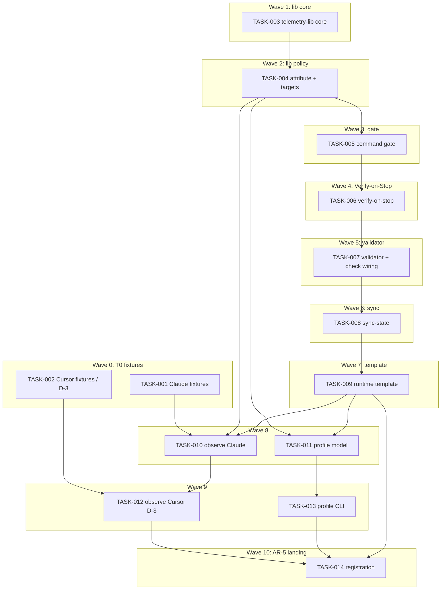

# Tasks: Fail-open telemetry emitters, guidance activation records, and the `asdd profile` readout

**Author:** asdd-task-planning-agent
**Model/Tool:** claude-opus-5-5 (Claude Code sub-agent)

Tasks version: 1.0.0
Design version: 1.0.0 (`design.md`, Status READY)
Requirements version: 1.1.0 (REQ-001…REQ-025)
Scope: slice `telemetry-emitters` (intent MH-01…MH-05; Mapped files narrowed by design §13)
Status: READY
Last updated: 2026-11-16
Task planning confidence score: 0.85 (QG-TPL-01 PASS; uncertainty factors in "Confidence" below)

---

## Working assumptions (orchestrator recommendations, to be confirmed by the human at checkpoint b)

These are **not** human decisions yet. They come from the design gate concerns (manifest `gates.design.concerns`) and
are applied here so the plan is complete. If the human rejects one, the named task is replanned before it starts.

| ID | Assumption applied in this plan | Task affected | If rejected |
|---|---|---|---|
| D-1 | `cli/src/uninstall.mjs` is in scope: `KIT_HOOK` matches the observe command and `KIT_IGNORES` gains the two telemetry lines | TASK-014 | `cli/test/install-lifecycle.test.mjs:123-150` fails; TASK-014 cannot pass. Re-shape needed |
| D-2 | Direct CLI gate calls (payload neither Claude- nor Cursor-shaped) get `runtime: "cli"` (ACT-002; REQ-007 errata 1.1.1 pending TL acknowledgement) | TASK-005 | Use `cursor` for the fallback; one test case and one branch change |
| D-3 | Cursor load hook ships only when TASK-002 commits a Cursor fixture that proves `beforeReadFile` fires for agent reads and carries `file_path`. Otherwise Cursor is treated as hookless (`unknown`) | TASK-002, TASK-012, TASK-014 | n/a (this is the design's own fallback; the human picks the branch at TASK-002) |
| D-4 | Vendored `tools/*/src/harness/{telemetry-lib,command-gate,sync-state}.mjs`, `cli/versions.json`, `.agents/agents/_runtime-template.md`, `.harness/state/telemetry/*` and `.harness/config/versions.json` are generated-only: written by `asdd kit vendor` / `kit versions` / `kit self`, never hand-edited | TASK-005, 008, 009, 011, 014 | Generated outputs would need hand-maintenance; not recommended |
| GOV-001 | Relayed PO/TL decisions still lack a human-authored override session | all | Implementation should not start before the human checkpoint records it |

## Plan-level rules (apply to every task)

1. **TDD, RED first.** Every behavioral task writes its failing test(s) first and runs them. The implementation agent
   records the RED run (command + failing case names + exit code) in the `evidence` of the `feature_started` session for
   that feature, then turns them GREEN. Proof tests that pin existing behavior (byte-identity, fail-closed) are shown to
   bite by a **mutation RED**: temporarily move the emit before the verdict write (or let `emit` throw unguarded), run
   the test, see it fail, revert. Record that run as the RED evidence. Skill: `.agents/skills/test-driven-development/SKILL.md`.
2. **Wave green (REQ-012).** A wave task is `passing` only when its own focused test, `npm test`, and
   `node cli/bin/asdd.mjs check` all exit 0 on that task's evidence. New test files are not in the `package.json`
   `test` script until TASK-014 (AR-5 single landing), so each task runs its new file with `node --test` explicitly.
3. **Generated copies stay fresh per wave (D-4).** `npm test` runs `kit vendor --check` and `kit self --check`. A task
   that changes a vendored source (`telemetry-lib.mjs` once it is imported by `command-gate.mjs`/`sync-state.mjs`,
   `command-gate.mjs`, `sync-state.mjs`) runs `node cli/bin/asdd.mjs kit vendor`; a task that changes
   `cli/agents/_runtime-template.md` runs `node cli/bin/asdd.mjs kit self`. The generated files are listed in that
   task's writable scope. Never hand-edit them. TASK-014 reruns all generators as the final landing.
4. **No coverage claims ahead of the wave (REQ-012).** No README, steering, or report text may claim telemetry for a
   process whose wave task is not `passing`. User-facing registration (commands, README, hooks, installer) happens only
   in TASK-014.
5. **Telemetry-only edits.** Producer tasks add emission after the producer's own output (ADR-001: literal
   `await import('./telemetry-lib.mjs').catch(() => null)` + `try { … } catch {}`). No other refactor in those files.
   `checkCommandSafety` and `pipeline-metrics.mjs` stay untouched.
6. **Schema is fixed.** `.harness/state/telemetry/telemetry.schema.json` sha256 must stay
   `14ffba1c44513a5d32a106d3345ba6ee62361009d26f446c4c6471e9e0853a1c` (landing `56b48f0`). TASK-003 pins it in a test.
7. **Boundary check (domain-layer.project.md).** `cli/src/harness/**` must not import `.agents`; the layer flow is
   hook / CLI → `telemetry-lib.mjs` → `.harness/state/telemetry/spans.jsonl`. `telemetry-lib.mjs` imports only `node:`
   built-ins and never `sync-state.mjs`. Gate command: `npm test`.

---

## Execution Waves

The waves follow REQ-012 / AR-2. Each wave is a barrier: it starts only when every task of the previous wave is
`passing`. Same-wave tasks have disjoint `scope_paths` and no dependency on each other, so they may run concurrently.

| Wave | AR-2 step | Tasks | Parallel |
|---|---|---|---|
| 0 | T0 fixture capture (before any payload parser) | TASK-001, TASK-002 | yes (disjoint fixture dirs) |
| 1 | W1 telemetry library: span core + stream port | TASK-003 | — |
| 2 | W1 telemetry library: attribution + guidance targets | TASK-004 | — |
| 3 | W2 command gate | TASK-005 | — |
| 4 | W3 Verify-on-Stop | TASK-006 | — |
| 5 | W4 telemetry validator + `check-invariants` wiring | TASK-007 | — |
| 6 | W5 `asdd sync` | TASK-008 | — |
| 7 | W6 runtime template rule | TASK-009 | — |
| 8 | `asdd observe` (Claude) and profile model | TASK-010, TASK-011 | yes (disjoint) |
| 9 | `asdd observe` (Cursor, conditional D-3) and `asdd profile` CLI | TASK-012, TASK-013 | yes (disjoint) |
| 10 | AR-5 registration landing R (single landing) | TASK-014 | — |

REQ-012 chain (each wave task depends on the task of the preceding wave):
TASK-004 (library) → TASK-005 (gate) → TASK-006 (Verify-on-Stop) → TASK-007 (validator wiring) → TASK-008 (sync) →
TASK-009 (runtime template). Fixture capture TASK-001/TASK-002 precedes the payload parsers TASK-010/TASK-012.

### Wave 0: Fixture capture (T0)

- [ ] TASK-001: Capture Claude Code `PostToolUse` hook payload fixtures with provenance
  - **Type:** test (fixture data)
  - **File(s):** `cli/test/fixtures/telemetry/claude/*.json` (new), `cli/test/fixtures/telemetry/README.md` (new)
  - **Writable scope:** `cli/test/fixtures/telemetry/claude/`, `cli/test/fixtures/telemetry/README.md`
  - **Description:** Capture real payloads from the running Claude Code session (this runtime) with a temporary,
    uncommitted capture hook (`PostToolUse`, matcher `Read|Skill`, command `cat > "$TMPDIR/cap-$(date +%s).json"`) in
    an uncommitted local settings file; remove it afterwards. Commit one file per case in the shape
    `{ "provenance": { "runtime", "runtime_version", "captured_at", "captured_by", "method": "live-capture" }, "payload": {…} }`,
    cases per design §12.5: `posttooluse-read-steering`, `posttooluse-read-nonguidance`, `posttooluse-read-claude-skills`,
    `posttooluse-skill-installed`, `posttooluse-skill-namespaced`, `posttooluse-read-subagent` (records whether
    `agent_id` is present), `posttooluse-read-offset-limit`. Redact before commit: absolute repo prefix → `${REPO}`,
    `transcript_path` → placeholder value (kept, so the "never copied" test has a value). The README records the
    provenance method, the redaction rules, and the observed Claude reaction to a hook exiting 1 and to a timeout (OI-6).
  - **Depends on:** none
  - **Acceptance:** Every committed Claude fixture parses as JSON with a complete `provenance` object and
    `method: "live-capture"`, and no file contains the absolute repo path.
  - **Requirement(s):** REQ-012, REQ-013, REQ-016, REQ-018
  - **TDD:** not behavioral (data). Verification is the parse/provenance command below.
  - **Sub-Agent Context:** Do not commit the capture hook or touch `.claude/settings.json`. If a case cannot be
    produced (for example no sub-agent `Read` fires the hook), commit no file for it and record the absence in the
    README; never hand-write a payload. A missing `agent_id` key is a valid, recorded outcome (attribute omitted).
  - **Verification:** `node -e "const fs=require('fs'),p='cli/test/fixtures/telemetry/claude/';const fx=fs.readdirSync(p).filter(f=>f.endsWith('.json'));if(!fx.length)process.exit(1);for(const f of fx){const j=JSON.parse(fs.readFileSync(p+f,'utf8'));for(const k of ['runtime','runtime_version','captured_at','captured_by','method'])if(!j.provenance||!j.provenance[k])throw new Error(f+' '+k);if(!j.payload)throw new Error(f)}"`;
    `! grep -rn "$(pwd)" cli/test/fixtures/telemetry/claude/`

- [ ] TASK-002: Obtain Cursor `beforeReadFile` fixtures or record the D-3 hookless outcome
  - **Type:** test (fixture data) + human decision point
  - **File(s):** `cli/test/fixtures/telemetry/cursor/*.json` (new), `cli/test/fixtures/telemetry/cursor/README.md` (new)
  - **Writable scope:** `cli/test/fixtures/telemetry/cursor/`
  - **Description:** Cursor is not the running runtime, so a live capture needs the human (same temporary capture
    hook on `beforeReadFile` in `.cursor/hooks.json`, not committed). Cases: `beforereadfile-guidance`,
    `beforereadfile-nonguidance`, `beforereadfile-cursor-skills`. Redaction: `${REPO}` prefix, `user_email` placeholder,
    `content` → same byte length of `x`. If only vendor documentation is available, a fixture may be committed with
    `provenance.method: "vendor-doc"` and the doc URL and date in the README, explicitly marked unverified. The README
    states the D-3 outcome: **ship** (a `live-capture` fixture proves the hook fires for agent reads with `file_path`)
    or **hookless** (no live capture, or the capture shows no `file_path` / no fire for agent reads).
  - **Depends on:** none
  - **Acceptance:** `cli/test/fixtures/telemetry/cursor/README.md` exists and states exactly one D-3 outcome (`ship` or
    `hookless`); every committed Cursor fixture has a complete `provenance` with `method` in {`live-capture`, `vendor-doc`}.
  - **Requirement(s):** REQ-012, REQ-014, REQ-016, REQ-018
  - **TDD:** not behavioral (data).
  - **Sub-Agent Context:** HUMAN-DEPENDENT. Recommendation: `ship` only with a `live-capture` fixture; a
    `vendor-doc` fixture alone means `hookless` unless the TL decides otherwise in a human-authored session. Never
    invent payload keys. This task never blocks Wave 1–7; it must be `passing` (either outcome) before TASK-012.
  - **Verification:** `test -f cli/test/fixtures/telemetry/cursor/README.md && grep -Eq "D-3 outcome: (ship|hookless)" cli/test/fixtures/telemetry/cursor/README.md`;
    `node -e "const fs=require('fs'),p='cli/test/fixtures/telemetry/cursor/';for(const f of fs.readdirSync(p).filter(f=>f.endsWith('.json'))){const j=JSON.parse(fs.readFileSync(p+f,'utf8'));if(!['live-capture','vendor-doc'].includes(j.provenance&&j.provenance.method))throw new Error(f)}"`

### Wave 1: Telemetry library, span core and stream port (AR-2 W1)

- [ ] TASK-003: `telemetry-lib.mjs` span core: ids, `buildSpan`, fail-open `emit`, `validateSpan`, `readTail`
  - **Type:** service (domain service `*-lib.mjs`)
  - **File(s):** `cli/src/harness/telemetry-lib.mjs` (new), `cli/src/harness/telemetry-lib.test.mjs` (new)
  - **Writable scope:** `cli/src/harness/telemetry-lib.mjs`, `cli/src/harness/telemetry-lib.test.mjs`
  - **Description:** Implement the design §3.1 exports `TELEMETRY_DIR`, `STREAM_FILE`, `MAX_LINE_BYTES=4096`,
    `TAIL_MAX_LINES=500`, `TAIL_MAX_BYTES=262144`, `ATTRIBUTION_ENV='HARNESS_SLICE_ID'`, `startTrace({env, honorEnv})`,
    `childOf(root)`, `buildSpan(ctx, fields)` (omits `undefined`/`null` attributes), `emit(span, {root})` (sync
    `openSync(path,'a')` → one `writeSync` → `closeSync` in `finally`; returns `false` on each listed failure; never
    throws, writes to stdout/stderr, or touches `process.exitCode`; never creates the directory), `validateSpan(obj,
    schema)` (draft-07 subset of §3.1), and `readTail(root)` (one bounded `readSync`, partial first line dropped,
    last 500 lines). Imports only `node:fs`, `node:path`, `node:crypto`.
  - **Depends on:** none (wave barrier: Wave 0 first)
  - **Acceptance:** `node --test cli/src/harness/telemetry-lib.test.mjs` exits 0 with the design §9/§10 cases for
    REQ-001, REQ-002, REQ-003, REQ-005, REQ-006 present and passing.
  - **Requirement(s):** REQ-001, REQ-002, REQ-003, REQ-004, REQ-005, REQ-006, REQ-022
  - **TDD:** RED first. Test cases: single append keeps earlier bytes (prefix hash); 20 concurrent child processes → 20
    parseable lines; missing dir → `false`, no dir created; read-only dir/file (chmod when uid≠0); stream is a directory
    (EISDIR); oversized line; circular object; non-object; reserved attribute (`heuristic`, `trigger_span_id`,
    `source`) and forbidden kind (`phase`, `turn`, `subagent`, `test`) → `false`; stdout/stderr/exitCode untouched;
    ≥1,000 emits of 300–4,096 B, each grows the file by exactly its line length, p99 ≤ 50 ms (REQ-003); `startTrace`
    env/self rules and `childOf`; every built span passes `validateSpan` against the schema file; schema sha256 equals
    the plan-level constant; `readTail` on a 10 MB file reads ≤ 262,144 bytes (spied `readSync`) and drops the cut
    first line; no-network grep (`node:http`, `node:https`, `node:net`, `node:dgram`, `node:tls`, `fetch(`) = 0 matches
    and a throwing `globalThis.fetch` changes nothing; state-hash of `.harness/state/slices`, `registry.json`,
    `.harness/features`, `.harness/state/learning` unchanged by `emit`.
  - **Sub-Agent Context:** Tests run in temp dirs only, never against the repo's `.harness/state/telemetry/`. Do not
    import `sync-state.mjs` (cycle rule). No profile-model or attribution functions here (TASK-004, TASK-011).
  - **Verification:** `node --test cli/src/harness/telemetry-lib.test.mjs`; `npm test`; `node cli/bin/asdd.mjs check`

### Wave 2: Telemetry library, attribution and guidance targets (AR-2 W1, completes the library wave)

- [ ] TASK-004: `telemetry-lib.mjs` policy: `attribute()`, `guidanceTarget()`, `skillTarget()`
  - **Type:** service
  - **File(s):** `cli/src/harness/telemetry-lib.mjs`, `cli/src/harness/telemetry-lib.test.mjs`
  - **Writable scope:** `cli/src/harness/telemetry-lib.mjs`, `cli/src/harness/telemetry-lib.test.mjs`
  - **Description:** Add `attribute(root, env)` with the three-rule order of design §4.3 (env `HARNESS_SLICE_ID` valid
    + manifest parses → that slice and its manifest phase, never falling through; else exactly one `in_progress` slice
    in `registry.json`; else both `null`; a phase outside the schema enum → both `null`; never reads trace ids). Add
    `guidanceTarget(raw, root)` per §12.4 (string operations only, no `stat`/`realpath`) and `skillTarget(name, root)`
    (`^[A-Za-z0-9._-]+$`, returns `.agents/skills/<name>/SKILL.md` only when it exists).
  - **Depends on:** TASK-003
  - **Acceptance:** `node --test cli/src/harness/telemetry-lib.test.mjs` exits 0 including the REQ-015 table and the
    REQ-017 attribution matrix.
  - **Requirement(s):** REQ-015, REQ-017, REQ-004, REQ-006
  - **TDD:** RED first. Cases: REQ-017 env names slice / env unknown slice / env invalid chars / one, zero, two
    `in_progress` / unreadable manifest / phase outside enum / phase follows the manifest / `HARNESS_TRACE_ID` set does
    not change the result. REQ-015 table: `.harness/steering/**`, `.harness/steering/skills.md`,
    `.agents/skills/<n>/SKILL.md`, `references/**`, `.claude|.cursor|.devin/skills/<n>/…` rewritten, absolute inside
    root, absolute outside root → `null`, `..` segment, NUL, `:` → `null`, non-guidance → `null`; skill names with `:`,
    `/`, `..`, or not installed → `null`. Attribution reads change no state (hash check).
  - **Sub-Agent Context:** Attribution uses fixture registries in temp dirs. Keep functions pure apart from the listed
    reads. The kit repo itself has 4 `in_progress` slices (RSK-002), so do not assert on the live repo.
  - **Verification:** `node --test cli/src/harness/telemetry-lib.test.mjs`; `npm test`; `node cli/bin/asdd.mjs check`

### Wave 3: Command gate (AR-2 W2)

- [ ] TASK-005: Command gate emits one `command` span after the verdict and stays fail-closed
  - **Type:** service (hook adapter)
  - **File(s):** `cli/src/harness/command-gate.mjs`, `cli/src/harness/command-gate.test.mjs`; generated by
    `kit vendor`: `tools/jev-gate/src/harness/command-gate.mjs`, `tools/jev-gate/src/harness/telemetry-lib.mjs`
  - **Writable scope:** `cli/src/harness/command-gate.mjs`, `cli/src/harness/command-gate.test.mjs`,
    `tools/jev-gate/src/harness/command-gate.mjs`, `tools/jev-gate/src/harness/telemetry-lib.mjs`
  - **Description:** Add `commandLabel(command, verdict)` (ADR-007 AMB-009: `override`, `empty`, denied pattern label,
    `allowlist`, `unmatched`) and the runtime rule (ACT-002, **D-2 assumption**: `claude` for
    `hook_event_name==="PreToolUse"`, `cursor` for a top-level `command` key or `beforeShellExecution`, else `cli`).
    Give `runHook` an injectable seam `runHook({ readInput, write, safety })`; it measures the gate, writes the verdict
    unchanged, then guarded-imports the lib and emits one `kind:"command"` span (§4.3 fields, `verdict`,
    `command_label`). `runHookCli`'s catch writes deny first, then emits one `ERROR` span. `checkCommandSafety` is
    unchanged and emits nothing. Then run `node cli/bin/asdd.mjs kit vendor`.
  - **Depends on:** TASK-004
  - **Acceptance:** `node --test cli/src/harness/command-gate.test.mjs` exits 0 with the gate rows of design §9
    (byte-identity, crash still denies, no span from `checkCommandSafety`, added-time p99) passing.
  - **Requirement(s):** REQ-007, REQ-008, REQ-002, REQ-004, REQ-005
  - **TDD:** RED first for new behavior: one span per hook call with `verdict` and the label set incl. `override`;
    runtime rule incl. `cli`; `ERROR` span from the catch path; secret-marker command `SECRET-MARKER-123` → no command
    token in the line. **Fail-closed / fail-open proofs (design §9), mutation RED:** (a) gate crash still denies:
    inject a throwing `safety` through the seam → deny JSON, exit 0, one `ERROR` span; (b) verdict byte-identical: the
    whole payload corpus of the test file (override, empty, Claude and Cursor shapes) × {location absent, stream absent,
    writable, unwritable} × load failure (temp copy of `cli/src/harness` with `telemetry-lib.mjs` replaced by a top-level
    `throw` and, separately, deleted) → 0 differences in stdout, stderr, exit; (c) `checkCommandSafety` in a cwd with a
    telemetry dir → no `spans.jsonl`; (d) NFR-001: verdict-write → emit-return time over corpus × 50 runs, p99 ≤ 50 ms.
    Every emitted line passes `validateSpan`.
  - **Sub-Agent Context:** Emit strictly after the verdict write; the `import()` specifier must be the literal
    `'./telemetry-lib.mjs'` (vendor closure, ADR-001). No `test` kind, no command text. Do not edit `tools/**` by hand.
  - **Verification:** `node --test cli/src/harness/command-gate.test.mjs`; `node cli/bin/asdd.mjs kit vendor --check`;
    `npm test`; `node cli/bin/asdd.mjs check`

### Wave 4: Verify-on-Stop (AR-2 W3)

- [ ] TASK-006: Verify-on-Stop emits one `hook` span per exit path through `finish()`
  - **Type:** service (hook adapter)
  - **File(s):** `cli/src/harness/verify-on-stop.mjs`, `cli/src/harness/verify-on-stop.test.mjs` (new)
  - **Writable scope:** `cli/src/harness/verify-on-stop.mjs`, `cli/src/harness/verify-on-stop.test.mjs`
  - **Description:** Route each exit path through `finish(outcome, attrs)`: write the payload exactly as today, then
    guarded-import the lib and emit one `kind:"hook"` span (`outcome` ∈ {pass, block, advisory, guard-skip,
    could-not-run}; `exit_code` and `violations_count` only when `check --live` returned a numeric status;
    `violations_count` = lines matching `/^FAIL\s/m` in stdout+stderr; runtime rule of §4.3), then `process.exit(0)`.
    `could-not-run` → `status:"ERROR"`. KPI-1 (own crash) stays out of scope; add no new crash path.
  - **Depends on:** TASK-005
  - **Acceptance:** `node --test cli/src/harness/verify-on-stop.test.mjs` exits 0 with every outcome × telemetry
    state × load failure producing stdout, stderr, and exit identical to a working-lib run.
  - **Requirement(s):** REQ-009, REQ-002, REQ-005
  - **TDD:** RED first (new test file): stub `check-invariants.mjs` for pass, fail with 2 FAIL lines, missing,
    self-SIGKILL (null status); advisory via `HARNESS_STOP_MODE`; guard-skip via Cursor `status:"aborted"` and Claude
    `stop_hook_active` — each × 4 telemetry states + load failure (lib copy with top-level throw / deleted). **Fail-open
    proof:** unwritable stream + passing check → stdout `{}`, exit 0, no stderr; span fields and `validateSpan` pass.
  - **Sub-Agent Context:** `verify-on-stop.mjs` is not vendored. Do not change messages, timeouts, or env handling.
    The new test file is registered in `package.json` only in TASK-014.
  - **Verification:** `node --test cli/src/harness/verify-on-stop.test.mjs`; `npm test`; `node cli/bin/asdd.mjs check`

### Wave 5: Telemetry validator and `check-invariants` wiring (AR-2 W4)

- [ ] TASK-007: WARN-only `validators/telemetry.mjs` wired into `asdd check`, isolated from learning signals
  - **Type:** service (sensor) + delivery wiring
  - **File(s):** `cli/src/harness/validators/telemetry.mjs` (new), `cli/src/harness/validators/telemetry.test.mjs`
    (new), `cli/src/harness/check-invariants.mjs`
  - **Writable scope:** `cli/src/harness/validators/telemetry.mjs`, `cli/src/harness/validators/telemetry.test.mjs`,
    `cli/src/harness/check-invariants.mjs`
  - **Description:** The validator is silent when `.harness/state/telemetry/` is absent; otherwise it emits WARN only:
    TEL-W1 schema file missing/unparseable, TEL-W2 per tail line (not JSON, `validateSpan` errors, > 4,096 B, missing
    `trace_source`) with OI-5 numbering (`spans.jsonl line N` when `readTail().fromStart`, else the tail-relative
    wording of §4.4), TEL-W3 registration (§8 a–c, each naming `asdd install .`). `check-invariants.mjs` loads it with a
    guarded dynamic import, maps ctx `fail` to `warn`, keeps its WARNs in a separate list printed with the `WARN`
    prefix, and never passes them to `writeSensorSignal`.
  - **Depends on:** TASK-006
  - **Acceptance:** `node --test cli/src/harness/validators/telemetry.test.mjs` exits 0, and `asdd check` returns the
    same exit code with a valid stream, a malformed stream, no location, a throwing validator, and a throwing lib.
  - **Requirement(s):** REQ-019, REQ-006, REQ-005
  - **TDD:** RED first: absent location → no output; schema WARN; per-line WARNs with both OI-5 numberings; bounded
    read of a 10 MB stream (≤ 256 KB via spied `readSync`); TEL-W3 (a) gitignore, (b) contract files, (c) runtime hook
    missing; AMB-010 baseline: throwing validator / lib load failure → same exit code as the working run and no added
    output; `check --live` with telemetry WARNs writes no learning signal (state-hash of `.harness/state/learning`).
  - **Sub-Agent Context:** The kit repo has no `spans.jsonl` and no telemetry gitignore lines yet; TEL-W3 may WARN on
    the kit itself until TASK-014. That is expected (WARN, exit 0). No FAIL path may be added.
  - **Verification:** `node --test cli/src/harness/validators/telemetry.test.mjs`; `npm test`;
    `node cli/bin/asdd.mjs check`

### Wave 6: `asdd sync` (AR-2 W5)

- [ ] TASK-008: `asdd sync` emits one root `sync` span with knowledge and learning child spans
  - **Type:** service (CLI delivery)
  - **File(s):** `cli/src/harness/sync-state.mjs`, `cli/src/harness/sync-state.test.mjs`; generated by `kit vendor`:
    `tools/{jev-gate,knowledge,spec-drift}/src/harness/{sync-state.mjs,telemetry-lib.mjs}`
  - **Writable scope:** `cli/src/harness/sync-state.mjs`, `cli/src/harness/sync-state.test.mjs`,
    `tools/jev-gate/src/harness/sync-state.mjs`, `tools/knowledge/src/harness/sync-state.mjs`,
    `tools/spec-drift/src/harness/sync-state.mjs`, `tools/jev-gate/src/harness/telemetry-lib.mjs`,
    `tools/knowledge/src/harness/telemetry-lib.mjs`, `tools/spec-drift/src/harness/telemetry-lib.mjs`
  - **Description:** Wrap `main()` in a `finally` that emits one root `kind:"sync"` span (`process_name`
    `sync-state`, runtime `HARNESS_RUNTIME` or `cli`, `ERROR` when `main()` throws; re-throw unchanged). Child spans via
    `childOf(root)`: `sync-state/knowledge-index` (`ERROR` when `writeKnowledgeIndex` throws) and `sync-state/learning`
    (`ERROR` on non-zero exit or unparseable output, `exit_code` when numeric; no span when `learn.mjs` is absent).
    `syncKnowledgeIndex`/`syncLearning` return an ok flag; their output is unchanged. Then run
    `node cli/bin/asdd.mjs kit vendor`.
  - **Depends on:** TASK-007
  - **Acceptance:** `node --test cli/src/harness/sync-state.test.mjs` exits 0 with the span-tree cases and with
    stdout, manifests, registry, and `PROGRESS.md` byte-identical across the 4 telemetry states and a load failure.
  - **Requirement(s):** REQ-010, REQ-002, REQ-005, REQ-006
  - **TDD:** RED first: root span + 2 children with `parent_span_id` = root `span_id` and root `parent_span_id: null`;
    `learn.mjs` absent → no learning child; knowledge stub throws → child `ERROR`; `main()` throws → root `ERROR` and the
    same throw; byte-identity matrix (mutation RED); all lines pass `validateSpan`.
  - **Sub-Agent Context:** The `import()` literal must be `'./telemetry-lib.mjs'`. Emission belongs in the CLI path
    (`main`), so MCP servers that call exported functions never emit. Do not edit `tools/**` by hand.
  - **Verification:** `node --test cli/src/harness/sync-state.test.mjs`; `node cli/bin/asdd.mjs kit vendor --check`;
    `npm test`; `node cli/bin/asdd.mjs check`

### Wave 7: Runtime template rule (AR-2 W6)

- [ ] TASK-009: `_runtime-template.md` tells agents to load guidance with the read or skill tool
  - **Type:** config (guidance)
  - **File(s):** `cli/agents/_runtime-template.md`, `cli/src/harness/telemetry-lib.test.mjs` (template case);
    generated by `kit self`: `.agents/agents/_runtime-template.md`
  - **Writable scope:** `cli/agents/_runtime-template.md`, `cli/src/harness/telemetry-lib.test.mjs`,
    `.agents/agents/_runtime-template.md`
  - **Description:** Add one rule to `cli/agents/_runtime-template.md`: load steering files and skill bodies with the
    read tool or the skill tool, never with a shell command (`cat`, `sed`, `head`). Add no span, turn-span, or
    subagent-span instruction. Then run `node cli/bin/asdd.mjs kit self` to refresh the `.agents/agents/` copy.
  - **Depends on:** TASK-008
  - **Acceptance:** The "runtime template" test case in `telemetry-lib.test.mjs` passes (read-tool sentence present;
    `span`, `turn` span, and `subagent` span instructions absent) and `node cli/bin/asdd.mjs kit self --check` exits 0.
  - **Requirement(s):** REQ-011
  - **TDD:** RED first: the template test case fails on the current template, passes after the edit.
  - **Sub-Agent Context:** One rule only; keep the agents-lint limits (`npm test` runs `kit agents-lint`). If `kit self`
    rewrites any file outside the writable scope, stop and report it (do not commit it).
  - **Verification:** `node --test cli/src/harness/telemetry-lib.test.mjs`; `node cli/bin/asdd.mjs kit self --check`;
    `node cli/bin/asdd.mjs kit agents-lint`; `npm test`; `node cli/bin/asdd.mjs check`

### Wave 8: `asdd observe` (Claude) and the profile model

- [ ] TASK-010: `telemetry-observe.mjs` handler: Claude activation records, fail-open answer
  - **Type:** service (runtime-hook adapter)
  - **File(s):** `cli/src/harness/telemetry-observe.mjs` (new), `cli/src/harness/telemetry-observe.test.mjs` (new)
  - **Writable scope:** `cli/src/harness/telemetry-observe.mjs`, `cli/src/harness/telemetry-observe.test.mjs`
  - **Description:** Export `PAYLOAD_KEYS` (only key paths present in a committed TASK-001 fixture) and
    `handleObserve(raw, runtime, deps)` following §12.3: unknown argv → no answer, no span; invalid JSON → answer only;
    Claude requires `hook_event_name==="PostToolUse"` and `tool_name ∈ {Read, Skill}`; `Read` → `guidanceTarget`,
    `Skill` → `skillTarget`; then `attribute()`, `startTrace({honorEnv:false})`, `buildSpan` (`kind:"tool"`,
    `writer:"runtime-hook"`, `process_name:"asdd-observe"`, `target_path`, `tool_name`, `runtime_session_id`,
    `agent_id` only when present and matching `^[A-Za-z0-9._:-]+$`, ≤128 chars), `emit`. A top-level `try` always
    reaches the answer. For argv `cursor` this task writes `{"permission":"allow"}\n` and emits **no** span (hookless
    default until TASK-012). The CLI block reads stdin and exits 0.
  - **Depends on:** TASK-001, TASK-004, TASK-009
  - **Acceptance:** `node --test cli/src/harness/telemetry-observe.test.mjs` exits 0 including the
    payload-keys-in-fixtures guard and the four Claude/Cursor-default latency classes at p99 ≤ 50 ms.
  - **Requirement(s):** REQ-013, REQ-015, REQ-016, REQ-018, REQ-004, REQ-005, REQ-006
  - **TDD:** RED first: every Claude fixture × 4 telemetry states → exit 0 and correct answer; Read guidance → one
    record; Skill installed → one record; Skill not installed / namespaced → none; non-guidance → none; keys removed
    (no `session_id` → attribute absent; no `file_path` → no record + answer); empty stdin, invalid JSON, unknown event,
    missing argv, throwing lib → answer, exit 0, no stderr; `transcript_path`, `cwd`, `tool_response` fixture values
    never appear in the line; `PAYLOAD_KEYS` guard (every key path occurs in ≥1 fixture); latency classes Claude Read
    guidance, Claude Read non-guidance, Claude Skill (≥200 samples each, in-memory sink, p99 ≤ 50 ms); whole-process
    wall time `node cli/src/harness/telemetry-observe.mjs claude` (20 runs) printed, not gated; no-network grep.
  - **Sub-Agent Context:** Never read `transcript_path`, `cwd`, `tool_response`, `tool_use_id`, `permission_mode`. No
    multi-key fallbacks (ADR-004). The non-guidance early exit runs before any filesystem call. `commands.mjs` is not
    edited here (TASK-014), so tests invoke the script file, not `asdd observe`.
  - **Verification:** `node --test cli/src/harness/telemetry-observe.test.mjs`; `npm test`; `node cli/bin/asdd.mjs check`

- [ ] TASK-011: `telemetry-lib.mjs` profile model: `phaseMarkers`, `percentile`, `surfaceScores`, `activationRows`, `profileModel`
  - **Type:** service (pure functions)
  - **File(s):** `cli/src/harness/telemetry-lib.mjs`, `cli/src/harness/telemetry-lib.test.mjs`; generated by
    `kit vendor`: `tools/{jev-gate,knowledge,spec-drift}/src/harness/telemetry-lib.mjs`
  - **Writable scope:** `cli/src/harness/telemetry-lib.mjs`, `cli/src/harness/telemetry-lib.test.mjs`,
    `tools/jev-gate/src/harness/telemetry-lib.mjs`, `tools/knowledge/src/harness/telemetry-lib.mjs`,
    `tools/spec-drift/src/harness/telemetry-lib.mjs`
  - **Description:** Add the pure functions of §4.5–§4.6: disjoint-segment `phaseMarkers(sessions)` (ADR-005; open
    phase listed with no end/duration, excluded from the denominator, `start_source`); nearest-rank `percentile`;
    `surfaceScores` (`0 + ⌊share/0.10⌋`, `share unknown` when the denominator is 0, order by score desc then name asc);
    `activationRows` (three states, `not observed` only for a hooked runtime with its observe entry present,
    `configured, not observed` rows, missing ids → `unknown`, unattributed count); `profileModel` grouping only by
    `slice_id`, `phase`, `kind`, `failure_signature`. No H-* weights or constants. Then run `node cli/bin/asdd.mjs kit vendor`.
  - **Depends on:** TASK-004, TASK-009
  - **Acceptance:** `node --test cli/src/harness/telemetry-lib.test.mjs` exits 0 with the model cases below.
  - **Requirement(s):** REQ-020, REQ-021
  - **TDD:** RED first: segment windows over amended slices (mid-slice `phase_started`), open phase, unsorted input;
    p50/p95 against a precomputed fixture; scores deterministic across runs; topology-only differences (`trace_id`,
    `parent_span_id`) → identical model; activation states for claude/cursor/hookless and missing ids; the model never
    yields the string `not loaded`.
  - **Sub-Agent Context:** Pure functions over arrays: no filesystem, no clock (`now` is never used). Do not import
    `sync-state.mjs` or `pipeline-metrics.mjs`. Concurrent with TASK-010, which only imports existing exports.
  - **Verification:** `node --test cli/src/harness/telemetry-lib.test.mjs`; `node cli/bin/asdd.mjs kit vendor --check`;
    `npm test`; `node cli/bin/asdd.mjs check`

### Wave 9: `asdd observe` (Cursor, conditional D-3) and the `asdd profile` CLI

- [ ] TASK-012: Cursor branch of `asdd observe` (conditional on the TASK-002 D-3 outcome)
  - **Type:** service (runtime-hook adapter)
  - **File(s):** `cli/src/harness/telemetry-observe.mjs`, `cli/src/harness/telemetry-observe.test.mjs`
  - **Writable scope:** `cli/src/harness/telemetry-observe.mjs`, `cli/src/harness/telemetry-observe.test.mjs`
  - **Description:** **If D-3 = ship:** add Cursor `PAYLOAD_KEYS` from the TASK-002 fixtures; recognize
    `hook_event_name==="beforeReadFile"`, read `file_path` → `guidanceTarget`, `conversation_id` →
    `runtime_session_id`, no `agent_id`; emit one Activation record; the answer stays `{"permission":"allow"}\n` for
    every payload. **If D-3 = hookless:** keep the TASK-010 default (allow, no span) and add the tests that prove it;
    TASK-014 then wires no Cursor load hook.
  - **Depends on:** TASK-002, TASK-010
  - **Acceptance:** `node --test cli/src/harness/telemetry-observe.test.mjs` exits 0 and the TASK-002 README outcome
    matches the behavior under test (record emitted for `ship`, no record for `hookless`; allow answer in both).
  - **Requirement(s):** REQ-014, REQ-016, REQ-018, REQ-004
  - **TDD:** RED first. `ship`: every Cursor fixture × 4 states → allow answer, exit 0; guidance → record with
    `conversation_id`; non-guidance → none; `.cursor/skills` path rewritten; `content`, `attachments`, `user_email`,
    `workspace_roots` values never in the line; latency classes Cursor guidance and Cursor non-guidance (TRC-006),
    ≥200 samples, p99 ≤ 50 ms. `hookless`: allow answer and zero lines for every Cursor fixture and for an empty payload.
  - **Sub-Agent Context:** Read the D-3 outcome from `cli/test/fixtures/telemetry/cursor/README.md`; do not decide it.
    Never read Cursor `content`, `attachments`, `workspace_roots`, `user_email`, `generation_id`, `model`, `cursor_version`.
  - **Verification:** `node --test cli/src/harness/telemetry-observe.test.mjs`; `npm test`; `node cli/bin/asdd.mjs check`

- [ ] TASK-013: `harness-profile.mjs`: read-only `asdd profile` with modes, rendering, and exit codes
  - **Type:** controller (CLI delivery)
  - **File(s):** `cli/src/harness/harness-profile.mjs` (new), `cli/src/harness/harness-profile.test.mjs` (new)
  - **Writable scope:** `cli/src/harness/harness-profile.mjs`, `cli/src/harness/harness-profile.test.mjs`
  - **Description:** Parse `--slice <id>`, `--bottlenecks`, `--json` (no mode or unknown option → usage on stderr,
    exit 2). Read the tail (`readTail`), sessions (`readSessions`, `PHASES` from `sync-state.mjs`), steering frontmatter
    (`parseSteeringFrontmatter`), installed skills, `project.json` `runtimes`, and the hook configs; call
    `profileModel`; render text (three-state legend, fixed H-* footer, `runtimes not configured`, `share unknown`) or
    one `--json` document (§6: `not_measured` list, unmeasured keys omitted, no `0`/`null` stand-ins). Exit 3 with
    "no telemetry exists for <target>" when there are neither spans nor `phase_started` events; phase table + "no
    attributed spans for <slice>" + unattributed count, exit 0, when only sessions exist. Writes nothing.
  - **Depends on:** TASK-011
  - **Acceptance:** `node --test cli/src/harness/harness-profile.test.mjs` exits 0, including the working-tree hash
    equality before and after every invocation.
  - **Requirement(s):** REQ-020, REQ-021, REQ-022, REQ-023, REQ-004
  - **TDD:** RED first: exit 0/2/3 cases; `--json` shape and `not_measured`; `--bottlenecks` ranking and tie-break;
    malformed and cut lines skipped; 500 / 262,144 bounds; `grep -c "not loaded"` on every output = 0; legend has three
    states; working-tree hash unchanged (REQ-022); no-network grep + throwing `fetch`.
  - **Sub-Agent Context:** The renderer never reads `trace_id` or `parent_span_id`. Not a producer: emits nothing.
    Tests invoke the script file; `asdd profile` is registered in TASK-014.
  - **Verification:** `node --test cli/src/harness/harness-profile.test.mjs`; `npm test`; `node cli/bin/asdd.mjs check`

### Wave 10: AR-5 registration landing R (single landing)

- [ ] TASK-014: Register every telemetry surface in one landing (commands, tests, scaffold, installer, uninstall, hooks, README, generators, MCP build check)
  - **Type:** infra
  - **File(s):** see Writable scope. **Exception to the 3-file limit:** REQ-024 / AR-5 requires one atomic landing;
    the steps are a fixed checklist with no design choices.
  - **Writable scope:** `cli/src/harness/commands.mjs`, `package.json`, `README.md`, `.gitignore`,
    `cli/src/install/phases.mjs`, `cli/src/install/runtimes.mjs`, `cli/src/install/index.mjs`, `cli/src/uninstall.mjs`
    (D-1), `cli/runtimes/cursor/hooks.json`, `cli/runtimes/claude/README.md`, `.claude/settings.json`,
    `.cursor/hooks.json`, `cli/scaffold/state/telemetry/`, `cli/test/install.sh`; generated only (D-4):
    `.harness/state/telemetry/`, `cli/versions.json`, `.harness/config/versions.json`,
    `tools/jev-gate/src/harness/`, `tools/knowledge/src/harness/`, `tools/spec-drift/src/harness/`
  - **Description (checklist, in this order; design §13):**
    1. RED: extend `cli/test/install.sh` (REQ-025): installed project has `.harness/state/telemetry/` with schema and
       README and no `spans.jsonl`; gitignore lines present once after 2 installs; Claude `PostToolUse` `Read|Skill` and
       (only if D-3 = ship) Cursor `beforeReadFile` entries without `failClosed`, timeout 10; hookless-only install → no
       load hook; installed observe commands run with a `PATH` lacking asdd → exit 0, Cursor prints the allow JSON.
       Run it and record the failure.
    2. `cli/scaffold/state/telemetry/telemetry.schema.json` (byte-identical copy, sha256 constant above) and
       `README.md` (contract text unchanged + additive "Phase 2 status" paragraph); one `HARNESS_FILES` row
       `['.harness/state/telemetry', 'cli/scaffold/state/telemetry']` in `phases.mjs`.
    3. `observeCommand(ctx, runtime)` in `phases.mjs` with the exact shell strings of §12.2 (project and `ctx.self`);
       `installClaudeHooks` / `installCursorVerifyHook` in `runtimes.mjs` merge the observe entry when
       `isObserveCmd = /(asdd(\.mjs)?|"\$b") observe\b/` is absent; `cli/runtimes/cursor/hooks.json` gains
       `beforeReadFile` (only if D-3 = ship); `index.mjs` `installHarnessIgnores` adds the two gitignore lines and the
       hook log line (`index.mjs:243`) names the new hook.
    4. `cli/src/uninstall.mjs` (**D-1 assumption**): `KIT_HOOK` also matches the observe commands; `KIT_IGNORES` gains
       `.harness/state/telemetry/spans.jsonl` and `.harness/state/telemetry/slices/`.
    5. `.claude/settings.json` and `.cursor/hooks.json` (Cursor only if D-3 = ship) gain the kit-self entries;
       kit `.gitignore` gains the two lines (by `kit self` if it writes ignores, else once by hand).
    6. `commands.mjs`: **append** `profile` and `observe` after `ui` with the exact help strings of design §13 item 1
       (no reorder; shared with other slices, R-5).
    7. `package.json` `test` script: append `cli/src/harness/telemetry-lib.test.mjs`,
       `cli/src/harness/telemetry-observe.test.mjs`, `cli/src/harness/harness-profile.test.mjs`,
       `cli/src/harness/validators/telemetry.test.mjs`, `cli/src/harness/verify-on-stop.test.mjs` to the `node --test`
       list. `files[]` unchanged.
    8. `README.md`: command-table rows `asdd profile …` and `asdd observe <claude|cursor>` (near `:267`), hook lines
       (`:187`, `:257`), a short "Telemetry" paragraph with the `HARNESS_SLICE_ID=<id> claude` launch form;
       `cli/runtimes/claude/README.md`: one sentence on the `PostToolUse` hook.
    9. Generators: `node cli/bin/asdd.mjs kit vendor`, `node cli/bin/asdd.mjs kit versions`,
       `node cli/bin/asdd.mjs kit self`. Never hand-edit their outputs.
    10. MCP build check (R-1), only if `git diff --name-only main -- tools/*/src/harness` is non-empty: with
        `PATH=$HOME/.nvm/versions/node/v24.22.3/bin:$PATH`, for each of `jev-gate`, `knowledge`, `spec-drift`:
        `pnpm --dir tools/<t> install --frozen-lockfile && pnpm --dir tools/<t> build && pnpm --dir tools/<t> test`;
        then `grep -c telemetry-lib tools/*/dist/server/main.js` (bundled and inert).
  - **Depends on:** TASK-003, TASK-004, TASK-005, TASK-006, TASK-007, TASK-008, TASK-009, TASK-010, TASK-011, TASK-012, TASK-013
  - **Acceptance:** `npm test` exits 0 with the five new test files in the `test` script, and `npm pack --dry-run`
    lists no `spans.jsonl`.
  - **Requirement(s):** REQ-024, REQ-025, REQ-018, REQ-012
  - **TDD:** RED first via `cli/test/install.sh` (step 1) and `cli/test/install-lifecycle.test.mjs` (uninstall leaves
    no observe hook and no telemetry gitignore lines). Also: hand-edit of a vendored copy → `kit vendor --check` fails
    (then revert).
  - **Sub-Agent Context:** Every edit is append-only or a fixed string from the design; no other refactor. Rebase
    before landing and rerun `kit vendor` / `kit versions` instead of merging generated files (R-5). If D-1 is
    rejected at checkpoint b, stop before step 4 and escalate. Node 24.22.3 is needed only for the `tools/*` builds.
  - **Verification:** `bash cli/test/install.sh`; `node --test cli/test/install-lifecycle.test.mjs`;
    `node cli/bin/asdd.mjs kit vendor --check`; `node cli/bin/asdd.mjs kit self --check`; `npm test`;
    `npm pack --dry-run 2>&1 | grep -c spans.jsonl | grep -qx 0`; `node cli/bin/asdd.mjs check`

---

## Dependency Graph (Waves)

The graph is acyclic. No task depends on a task in its own or a later wave.

## Requirements Coverage

| Requirement | Task(s) |
|---|---|
| REQ-001 | TASK-003 |
| REQ-002 | TASK-003, TASK-005, TASK-006, TASK-007, TASK-008 |
| REQ-003 | TASK-003 |
| REQ-004 | TASK-003, TASK-004, TASK-005, TASK-010, TASK-012, TASK-013 |
| REQ-005 | TASK-003, TASK-005, TASK-006, TASK-007, TASK-008, TASK-010 |
| REQ-006 | TASK-003, TASK-004, TASK-007, TASK-008, TASK-010 |
| REQ-007 | TASK-005 |
| REQ-008 | TASK-005 |
| REQ-009 | TASK-006 |
| REQ-010 | TASK-008 |
| REQ-011 | TASK-009 |
| REQ-012 | TASK-001, TASK-002, TASK-014 (wave order of this plan; reviewed at Task Planning) |
| REQ-013 | TASK-001, TASK-010 |
| REQ-014 | TASK-002, TASK-012 |
| REQ-015 | TASK-004, TASK-010 |
| REQ-016 | TASK-001, TASK-002, TASK-010, TASK-012 |
| REQ-017 | TASK-004 |
| REQ-018 | TASK-001, TASK-002, TASK-010, TASK-012, TASK-014 |
| REQ-019 | TASK-007 |
| REQ-020 | TASK-011, TASK-013 |
| REQ-021 | TASK-011, TASK-013 |
| REQ-022 | TASK-003, TASK-013 |
| REQ-023 | TASK-013 |
| REQ-024 | TASK-014 |
| REQ-025 | TASK-014 |

All 25 REQs are covered.

## Fail-open / fail-closed proof map (design §9)

| Claim | Task |
|---|---|
| Emit never throws or writes; exitCode unchanged | TASK-003 |
| Load failure is caught (lib top-level throw / deleted) | TASK-005, TASK-006, TASK-007, TASK-008, TASK-010 |
| Gate verdict byte-identical (corpus × 4 states × load failure) | TASK-005 |
| Gate crash still denies (+ one `ERROR` span) | TASK-005 |
| No span from `checkCommandSafety` | TASK-005 |
| Verify-on-Stop output unchanged on every outcome; unwritable stream + pass → `{}` | TASK-006 |
| Sync output byte-identical | TASK-008 |
| Check exit unchanged (throwing validator / lib) | TASK-007 |
| Observe always allows | TASK-010, TASK-012 |
| Installed hook fail-open when asdd is absent | TASK-014 |

## Confidence

Task planning confidence 0.85 (QG-TPL-01: PASS, design READY). Uncertainty factors (QG-DEC-10):
1. **Cursor fixtures need the human (D-3).** TASK-002 cannot be completed by the agent alone. The plan defaults Cursor
   to hookless (TASK-010) so nothing ships on guessed keys; TASK-012/TASK-014 branch on the recorded outcome.
2. **Generated copies are refreshed per wave, not only in landing R.** `npm test` runs `kit vendor --check` and
   `kit self --check`, so REQ-012's "green per wave" forces `kit vendor` in TASK-005/008/011 and `kit self` in
   TASK-009. This splits the generator runs that the orchestrator placed in R; R still reruns them all. Under D-4 these
   are generated-only writes, but the human should confirm this reading at checkpoint b.
3. **TASK-014 exceeds the 3-file limit** by REQ-024 / AR-5 design (one atomic landing).
4. **Unconfirmed assumptions D-1, D-2, D-4 and open GOV-001** (see Working assumptions).
5. The TASK-001 live capture assumes a temporary `PostToolUse` hook takes effect in a running Claude Code session; if it
   needs a restart, the human restarts it.

Tools used: `asdd knowledge search` (scope collision with prior features: none); registry check of the other
`in_progress` slices (`cost-metrics`, `ui-gate-decisions`, `ui-insights`: no non-passing feature scopes); targeted
reads of `cli/src/kit/vendor.mjs`, `package.json:36`, `cli/src/uninstall.mjs:15,21`, `cli/src/harness/commands.mjs:70`,
`tools/*/src/harness/`. Codegraph: no `.codegraph/` index in this repo, so it was skipped.
