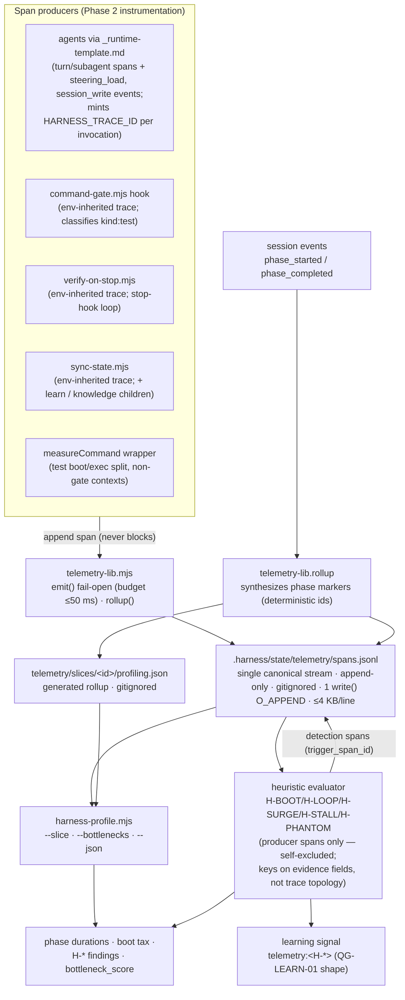

# Harness Profiling v2 — Ratified Telemetry Architecture, Span Schema & Bottleneck-Detection Contract

**Status:** draft — proposal v2 (documentation-contract posture; **no kit file is modified in Phase 1** — Phase 1 lands the ratified contract, schema, audit, and mock trace; instrumentation is Phase 2 under guardrails). Self-contained; resolves 100% of `v1.review.md` findings (2nd and final cycle under the convergence cap).
**Author:** Devin (proposal-author pass) · **Model/Tool:** Devin CLI · SWE-2 Max
**Companions (declared, not inherited):** [[@asdd/proposals/skills/v7|skills/v7.md]] (**CONVERGED** — kit profile-doc pattern, installer collision-guard precedent, explicit-list install/stamp trap precedent); [[@asdd/proposals/agents/v2|agents/v2.md]] (**CONVERGED at `v2`** — `_runtime-template.md` mounted-contract disposition, subagent dispatch contract); [[@asdd/proposals/harness.steering/v1|harness.stearing/v1.md]] (declared **IN-FLIGHT** in `_prompt.md`; `v1.review` verdict **CONVERGED** — v1 header itself retains draft posture pending ratification; budget model D-5, tag vocabulary D-4, Phase-2 active-turn-measurement overlap); `@asdd/proposals/initial/` (isolated predecessor — §P16 cited from `generated.md`, the pinned file where the P16 finding lives; P-numbers are reallocated across that lineage's `generated.v1–v3` and are **not** equivalent); `@draftly/refactors/asdd.refactor.v1.md` (Tier-3 declared context — the measured `book-crud-api` baseline P16 summarizes).
**Reference baseline:** `asdd-harness-kit` `main` @ `5b72f21` (v3.8.1) at `/Users/ougarte/Developer/github/eencinasq/asdd-harness-kit` — clean working tree; every `file:line` below was read and verified in the current tree; no git-history claims.
**Scope rule:** Phase 1 ratifies the profiling contract — span grammar (`telemetry.schema.json`), storage layout, derived metrics, `H-*` bottleneck heuristics, `harness-profile.mjs` CLI contract, and governance wiring — plus the code-verified process inventory × bottleneck audit and a worked mock trace. Kit scripts are **not** instrumented, wrapped, or edited in Phase 1.

## Changes from v1 (traceability — `v1.review.md` findings)

| Finding | Severity | Resolution — `v2.md` section |
| --- | --- | --- |
| **RV1-IC-1** | Medium | Trace model rebuilt: `trace := one producer invocation` correlated by env contract (`HARNESS_TRACE_ID`/`HARNESS_SPAN_ID` inherited by child processes; no env ⇒ own root). `phase` spans are synthesized **window markers** (own `trace_id`, `parent_span_id:null`) — phase grouping is a read-time derivation on `(slice_id, phase)`, never stored parent links — §2.1, §2.2 (`trace_source`), §2.3, §4, D-1 |
| **RV1-IC-2** | Low | Synthesized spans derive `span_id`+`trace_id` deterministically (content hash of `slice_id`+`phase`+window) — re-synthesis yields identical lines; consumers dedupe by `span_id` — §2.1, D-1 EARS |
| **RV1-IC-3** | Low | §2.1 archetypes reworded — env inheritance decides root-vs-child: inherited `HARNESS_TRACE_ID` ⇒ child span of that invocation; absent ⇒ own trace root |
| **RV1-AR-1** | Phase 2 Medium | Env correlation declared **best-effort display grouping** — `H-*` detection keys on `(slice_id, phase, failure_signature)` evidence fields, never trace topology — §4, D-4 EARS, new guardrail `AR-10` |
| **RV1-DM-1** | Low | §11 stearing row gains `check-guidance` kit-maintainer-only parenthetical |

`v1.md`'s 32 `v0.review` resolutions carry forward **verbatim** except where the trace-model rework touches them (§2.1/§2.3/D-1/D-4); each remains satisfied under the new model (noted per-section).

---

## Goal

> **Every harness lifecycle process produces — or is declared unable to produce, with the boundary named — an append-only, fail-open telemetry span under `.harness/state/telemetry/`, from which `harness-profile.mjs` derives phase duration, turn latency, test-boot tax, context expansion, and diagnose-fix loop counts without perturbing a single agent turn.**

1. **Contract before instrumentation** — the span grammar, storage model, and heuristic thresholds are ratified as a documentation contract first; Phase 2 implementation cannot improvise a second grammar.
2. **Zero-Heisenbug, fail-open** — telemetry emission is a single ≤4 KB `O_APPEND` write budgeted at ≤50 ms (proven by conformance test), never alters exit codes, never blocks a command, gate, session, or sync; a broken profiler degrades to silence, never to a slice failure.
3. **Derived metrics, not raw timestamps** — the contract's value is the derived layer (boot tax, loop count, surge rate, stall detection) that converts P16's manual archaeology into an automated, repeatable report.

---

## 1. Current-state inventory (code-verified)

### 1.1 Empirical baseline — P16 (`@asdd/proposals/initial/generated.md`)

Measured on slice `book-crud-api` (full ASDD, 2026-11-10, `ai-messager.sandbox`) — an ~300-LOC feature took **~225 min (~3h45m)** end-to-end (`generated.md:193-201`; corroborated by `asdd.refactor.v1.md:26-42` which notes the session timestamps are hand-written, granularity ±5 min):

| ASDD phase | Window | Duration | Share | Dominant cost |
| --- | --- | --- | --- | --- |
| Discovery → Design | 14:37→15:25 | ~48 min | 21% | Phantom-architecture reads from stale steering; 6 sequential LLM turns |
| Task Planning | 15:25→15:32 | ~7 min | 3% | Feature projection |
| **Implementation** | 15:32→17:30 | **~118 min** | **53%** | **7 sequential fail→diagnose→fix rounds, each paying full test-boot cost** |
| QA | 17:30→18:10 | ~40 min | 18% | Coverage report, OCR delegate, refactor retries |
| Knowledge | 18:10→18:20 | ~10 min | 4% | Session sync, bookkeeping |

Root causes ranked by recoverable cost (`generated.md:213-219`; the sibling refactor doc carries an additional RC-7 "context loading ~2,600 lines steering + ~100K skill references" at `asdd.refactor.v1.md:70`):

- **RC-1** stale steering bindings → phantom-architecture reads, import hallucinations.
- **RC-2** undocumented integration contracts → trial-and-error discovery (~1h+/feature).
- **RC-3** serial DI error surfacing — one missing provider per ~1-min test boot × N rounds.
- **RC-4** subprocess test-runner latency — `npx nx test` rebuilds project graphs + restarts Jest/ts-jest each TDD iteration.
- **RC-5** late schema enforcement — `features.json`/`registry.json` verified only at the end by `check-invariants --live`.
- **RC-6** process overhead — full 9-phase ASDD on a small feature (lite exists for this).

**Observability gap evidenced:** the §1.1 table itself was produced by *hand-diffing session timestamps* — `asdd.refactor.v1.md:42` ("session timestamps are hand-written per schema-2.0 convention; granularity ±5 min. WP-5 proposes making this measurement automatic"). No phase duration, turn latency, test-boot split, loop count, or context-size number exists anywhere in kit state today.

### 1.2 Kit process inventory × bottleneck vulnerability matrix

Observability legend: **None** = no record of the execution · **Timestamp** = a timestamp exists but no duration/latency field · **Status** = outcome recorded (PASS/FAIL/verdict) without timing.

| # | Lifecycle process | Executing path (`file:line`, verified) | Observability today | Bottleneck failure mode (→ P16 RC) | Vulnerability |
| --- | --- | --- | --- | --- | --- |
| P-1 | Slice init — session dir, `001-initial.json`, spec dir, tasks stub, features file, global manifest update, sync spawn | `init-slice.mjs:51-65` (mkdir + write), `:89-97` (`spawnSync sync-state --slice`), `:99-110` (global manifest) | Timestamp (session `timestamp`) | Init spawn cost invisible; first-session latency unmeasured | **Low** — runs once per slice |
| P-2 | Session append — agent writes `sessions/NNN-*.json` at every significant action | `manifest.md:40-59` (v1.0 schema, 9 event types); `_runtime-template.md:24` ("write a session file"); `session-loop.md:66-68` | Timestamp | **Turn latency invisible** — session timestamps are the only clock, and they mark *events*, not work duration. P16's phase table was reconstructed by hand from these (→ G-TEL-1) | **High** |
| P-3 | State sync — `sync-state.mjs` regenerates manifest.json + registry.json + PROGRESS.md, then runs `learn.mjs --summary` and `sync-knowledge.mjs` children | `sync-state.mjs:357-368` (`syncSlice`), `:385-395` (`spawnSync learn.mjs --summary`, `timeout: 60000`), `:372-380` (`syncKnowledgeIndex` — rescans `.harness/` SoT into JSONL+sqlite every run) | Status (console `SYNC` lines only) | **Every session write fans out to manifest + learn + knowledge regen** — sync cost grows with state size and is paid at every checkpoint, not amortized. P-3 is invoked by P-1, P-2 callers, P-9, and every handoff | **High** |
| P-4 | Invariant gate — `check-invariants.mjs` runs 9 validators serially; `--live`/`--record` writes a learning signal | `check-invariants.mjs:71-79` (paths, manifest, features, **skills**, steering-tags, lite-escalation, phase-chain, spec-drift, learning), `:85-93` (lazy `writeSensorSignal`), `:94-98` (exit 1 on FAIL) | Status (FAIL/WARN lines) | Validator cost unmeasured; `validators/skills.mjs:5-19` itself **spawnSyncs 3 linter subprocesses** per run — nested fan-out inside the gate | **Medium** |
| P-5 | Verify-on-Stop loop — stop hook respawns `check-invariants --live` until exit 0 or loop limit | `verify-on-stop.mjs:72-77` (`spawnSync … --live`, `timeout: 30000`), `:54-59` (Claude `stop_hook_active` guard), `.cursor/hooks.json` (`stop` hook `timeout: 60`, **`loop_limit: 3`**, `failClosed: true`) | Status (block verdict; FAIL text clipped into prompt at `:90-97`) | **Loop iterations unmetered** — up to 3 invariant runs per stop, each ≤30 s; exhaustion is silent in state (→ G-TEL-3) | **High** |
| P-6 | Command gate — every `beforeShellExecution` (Cursor) / `PreToolUse` (Claude) passes the safety verdict | `command-gate.mjs:12-18` (dual hook contract), `:111-143` (`runHook`), `:37-51` (allowlist incl. `/^npm\s+test/`, `/^node\s+--test/`, `/^node\s+\.harness\/scripts/`), `:75-84` (`recordDenial` → `writeCommandSignal`) | Status — **denials only**; allowed commands record nothing | The gate **already sees every shell command** (incl. every test run) yet emits no span — the single best instrumentation seam in the kit is unexploited (→ G-TEL-2's data source) | **High** |
| P-7 | Spec-drift sensor — `check-spec-drift.mjs` → `runDrift` (DRIFT-01…07, `drift-lib.mjs`) | `check-spec-drift.mjs:20-28` (invocation), `:33-43` (FAIL lines + exit code); `validators/spec-drift.mjs` (folds findings into invariants) | Status | `git diff` scan cost scales with branch distance; runs inside every invariant pass AND standalone | **Medium** |
| P-8 | Skill linters — `check-skills-index.mjs`, `check-skill-profile.mjs`, `check-skill-fleet.mjs` | `validators/skills.mjs:5-19` (spawned ×3 per invariants run); `check-skill-profile.mjs:1-12` (S-*/P-* rule port) | Status | 3 subprocess boots per gate run — adds to P-4/P-5 latency | **Low–Medium** |
| P-9 | Escalation — `escalate-slice.mjs` appends `checkpoint` session `mode: escalated` + `escalation_reasons`, then syncs | `escalate-slice.mjs:66-84` (session write), `:87-94` (sync spawn), `:57-64` (already-full/escalated refusal) | Timestamp + Status | None — precedent for the D-7 telemetry-triggered checkpoint | **Low** |
| P-10 | Learning loop — signals → patterns (`LP-*`) → steering proposals (`SP-*`); runs inside check-invariants (validator) and as a child of every sync-state | `learn.mjs:1-18` (contract), `learning-lib.mjs:38` (`SIGNALS_DIR = .harness/state/learning/signals`), `:105` (`writeSensorSignal`), `:119` (`writeCommandSignal`); `quality-gates.md:199` (Learning Gate inside `check-invariants`), `:203-211` (QG-LEARN-01…09) | Status (patterns.json open/noise/escape) | Signal files are episodic; **latency of the loop itself unmeasured**; pattern opens surface only via WARN | **Low–Medium** |
| P-11 | Knowledge index regen — `.harness/knowledge/` JSONL + sqlite sidecar rewritten on every `sync-state` | `sync-knowledge.mjs:1-26` (contract — nodes/edges/chunks/meta; embeddings preserved, never requested from sync-state); called at `sync-state.mjs:372-380` | Status (`SYNC knowledge → N nodes / M chunks`) | Full SoT rescan each sync — grows with slice/spec count; paid inside P-3 | **Medium–High** |
| P-12 | Subagent dispatch — parent agent spawns context-fresh sub-agents via the runtime's Task tool | `_runtime-template.md:29` (parallel work rule); `agents/v2.md` G-14 — `asdd-implementation-agent.md:116-133` dispatches with **no declared envelope** | **None** | Dispatch latency + context hydration invisible (JIT steering per subagent — `_runtime-template.md:10-16`); wave barriers unmeasured | **High** |
| P-13 | Test-runner subprocess — `npm test`, `node --test`, Nx/Jest/Vitest boots inside TDD loops | `command-gate.mjs:48-50` (these commands pass the gate); P16 RC-3/RC-4 — `generated.md:216-217` (~1 min/round × 7 rounds) | **None** | **Boot vs execution indistinguishable** — a slow suite and a slow runner are the same black box (→ G-TEL-2) | **High** |
| P-14 | Steering JIT load — `inclusion`/`tags` frontmatter selects per-phase files; context bytes enter every turn | `_runtime-template.md:10-16`; `harness.stearing/v1.md:122` — worst-case measured active turn **~59,155 bytes ≈14.8K tokens** | None at runtime (the only byte check is `scripts/check-guidance.mjs:98-100` — **kit-maintainer tooling**, REQ-010 at `:10`; verified absent from `install-into.sh`, `generate-versions.mjs`, and `.github/workflows/` — consumers never receive it) | **Context expansion unmonitored per turn** (→ G-TEL-5); pseudo-always files hide 6,954 B (stearing G-1) | **High** |
| P-15 | Codegraph / knowledge MCP calls — `codegraph_explore`, `knowledge_*` tools | `_runtime-template.md:19-20` | **None** | Phantom-architecture read loops (RC-1); MCP round-trip latency invisible | **Medium** |
| P-16 | Manual failure log — `docs/agent-failure-log.md` signature entries feeding the 3-occurrence learning gate | `quality-gates.md:193-195` (QG-DEB-05/06 signature rule); `agent-failure-log.md` — 17 incident entries, incl. 6× `planning:shared-files-across-serial-tasks`, 5× `drift:done-slice-features-reopened` | Status (signed entries only) | Reactive — a failure class must recur before detection; no latency data | **Low** |
| P-17 | Feature tracker writes — `.features.json` status/evidence flips | `session-loop.md:36-56` (item shape + rules); `feature.schema.json` | Timestamp (implicit) | Loop proxy exists only as status churn — test-run counts absent (`asdd.refactor.v1.md:120` proposes them) | **Medium** |

**Instrumentation scope declaration** (per-process disposition — every lifecycle process is instrumented or declared out): P-1/P-3/P-10/P-11 emit `sync`/`command`-class spans around their script and child invocations; P-2 emits agent-appended `turn` spans via the `_runtime-template.md` contract; P-4/P-7/P-8 emit `sensor` spans (`spec-drift` and the three skill linters are children of the P-4 gate run; standalone runs surface via `command` spans); P-10 legitimately emits in **two contexts** — `sensor` spans for the learning validator inside P-4, `sync`-child spans for `learn.mjs --summary` inside P-3; P-5 emits `hook` spans per loop iteration; P-6/P-13 emit `command`/`test` spans at the gate seam — the gate classifies test-matching commands as `kind:"test"` directly (one execution → one span; P-13's boot/exec split comes from `measureCommand`-instrumented child runs where measurable, or gate-side timing otherwise); P-9 emits `command` spans at the gate plus its existing `checkpoint` session record; P-12 emits `subagent` spans via the runtime contract with dispatch latency where the runtime reports it; P-14 is recorded as `steering_load` **events** on `turn` spans (byte counts per loaded file). **Declared out of dedicated span coverage:** P-15 — MCP-internal round-trips are not observable at the harness boundary (`tool` spans are emitted only where the runtime reports tool calls; D-8 boundary); P-16 — manual human-authored document, its detection function is superseded by `H-LOOP` signals (§4, D-7); P-17 — status churn is derivable from sessions, and the missing test-run counts are already covered by `test` spans — no dedicated span kind.

### 1.3 State & telemetry storage surface (verified)

| Surface | Reference | Current behavior | Phase 1 disposition |
| --- | --- | --- | --- |
| Session logs | `.harness/state/slices/<id>/sessions/*.json` — `manifest.md:40-59`; **git-tracked** (116 files under `.harness/state/` in `git ls-files`) | Append-only `schema_version: "1.0"`, 9 event types; single `timestamp`, no duration/latency fields | **Schema unchanged** (D-2) |
| Generated views | `manifest.json` / `registry.json` / `PROGRESS.md` — `sync-state.mjs:286-355` | Derived from sessions on every sync; `session_log` summary in manifest (`:316`) | Unchanged; profiling rollup lands in a **separate** generated file (D-2) |
| Learning signals | `.harness/state/learning/signals/` — `learning-lib.mjs:38`, gitignored via `install-into.sh:1467` (`ensure_gitignore`) + `.gitignore:15` | Episodic raw JSON, compacted weekly into committed summaries (`learn.mjs` header; QG-LEARN-01) | **Precedent adopted** for telemetry stream (D-2) |
| Knowledge index | `.harness/knowledge/` — `.gitignore:14` | Generated, gitignored | Same local-only class as telemetry |
| npm publish boundary | `package.json` `files[]` — `.harness/**/*` included; negations `!.harness/knowledge/**`, `!.harness/state/slices/*/**`, `!.harness/state/learning/**`, `!.harness/state/registry.json` (`package.json:18-27`) | `.harness/state/telemetry/` is **not** excluded | **G-TEL-7** — Phase 2 *surgical* negation: `!.harness/state/telemetry/*.jsonl` + `!.harness/state/telemetry/slices/**` (stream+rollups out; `telemetry.schema.json`/`README.md` stay packaged so the installer can copy them) |
| Installer provisioning | `install-into.sh:500-545` (explicit `copy_file` list — a new script not listed **silently never installs**), `:548` (state manifest template), `:551-556` (`mkdir` `specs features state/slices state/archive`), `:1467` (gitignore for signals) | No telemetry dir, no telemetry script, no gitignore entry | **G-TEL-6** — Phase 2 registration list (D-5/D-6) |
| Version stamping | `generate-versions.mjs:81-98` (explicit `.harness/scripts` list); `:101-103` (`validators/` **walked**) | New top-level scripts need list registration; validators auto-stamp | Same explicit-list trap as installer → G-TEL-8 |
| Project config | `.harness/config/project.json` — `commands` map (`invariants`, `verify_on_stop`, `spec_drift`), `paths` map, `capabilities` (`codegraph`, `orca`, `jev`), `drift.contract: warn` | No telemetry capability or command declared | D-5 adds `commands.profile` + `capabilities.telemetry` in Phase 2 |

### 1.4 Declared-sibling surfaces (evidence, not inheritance)

| Sibling | Verified fact used here | Use |
| --- | --- | --- |
| `skills/v7.md` (CONVERGED, `:6`) | Explicit-list install/stamp trap (its own G-12 at `:356` — a skills copy row missing from `install-into.sh`; the landed guard now sits at `install-into.sh:678`/`:1634`); `check-skills-index.mjs` subprocess-validation pattern; Bloom `[Cn×Type]` standard (its D-4, `:116`,`:371`) | Pattern reuse for D-5/D-6 wiring and §10.8 |
| `agents/v2.md` (CONVERGED, `:6`) | `_runtime-template.md` is the ratified mounted contract (its D-3); `implementation-agent` orchestrates with undeclared envelope (G-14) | P-12 dispatch analysis; D-8 runtime-boundary rule |
| `harness.stearing/v1.md` (review verdict CONVERGED — `v1.review.md:8,58`; v1 header retains draft posture) | Worst-case measured active turn ~59,155 B ≈14.8 K tokens (`v1.md:122`); D-5 ordering guardrail lands **active-turn measurement into `check-guidance.mjs`** before any reclassification (`v1.md:200`) | H-SURGE calibration; §11 ripple — `turn` spans + `steering_load` events are the data source its Phase-2 metric needs |
| `initial/generated.md` (status `superseded`, `:6`) | §P16 evidence (`:193-201` table, `:213-219` RCs) + WP-1…WP-5 harmonized proposal (`generated.md:223-230`); P16 in `generated.v3` is a *different* finding (broken cross-refs — `generated.v3.md:43,313`) | This proposal **is** WP-5 taken to full contract depth |
| `asdd.refactor.v1.md` | WP-5 `phase-durations.mjs` sketch (`:118-120`); open question 4 (`:154` — "per-phase timestamps sufficient, or tool-call/test-run counts per phase?") — the seed of `Q-P1` | Granularity precedent; measure scope |
| — | Rule §7 comparison trigger: **no converged sibling covers telemetry scope** (skills v7 = skill profiles; agents v2 = agent profiles; stearing v1 = steering conformance) | `*.comparison.md` **not required** — recorded per DM-2 |

---

## 2. Target telemetry architecture & span grammar

### 2.1 Model — traces, spans, and the correlation contract

Telemetry vocabulary follows OpenTelemetry: a **trace** groups causally-related spans; each **span** is a timed operation with `trace_id`, `span_id`, `parent_span_id`, timestamps, attributes, status, events. GenAI semantic conventions (`gen_ai.operation.name`, `gen_ai.agent.name`, `gen_ai.request.model`, `gen_ai.usage.input_tokens`, `gen_ai.usage.output_tokens`, `error.type`) govern the model/token attributes — **adapted to `_est` suffixes** because the kit observes estimates, never provider-billed truth (Q-P3, D-8).

```text
trace  := ONE producer invocation — an agent turn OR a single script run.
          Correlation contract: the turn context sets HARNESS_TRACE_ID (and
          HARNESS_SPAN_ID for the nearest parent) once per invocation; child
          processes (command-gate, verify-on-stop, sync-state, measureCommand,
          subagent turns) inherit env and emit under it. A process with no env
          emits its own root (parent_span_id:null, self trace_id).
          Env correlation is BEST-EFFORT display grouping (AR-10) — never
          load-bearing for detection.
span   := one timed unit of work under the trace
kinds  := phase | turn | command | test | sensor | hook | sync | subagent | tool   (9 kinds)
events := named, timestamped annotations inside a span —
          steering_load (per-file byte counts on a turn span),
          session_write (carries session_file once the session lands)
```

**Span-tree shape:** inside one invocation, `turn`/`sync`/`hook`/`command`/`sensor` is the root (`parent_span_id:null` when it started the trace; env-derived `parent_span_id` when it inherited one) with `command`/`test`/`tool`/`sensor`/`subagent` children.

**`phase` spans are synthesized window markers, not trace roots:** `telemetry-lib.rollup` derives one `phase` span per `<slice_id, phase>` window from the slice's existing `phase_started`/`phase_completed` session events (`manifest.md:40-59`) — `writer:"rollup"`, `attributes.source:"session_events"`, **own deterministic `trace_id` + `span_id`** (content hash of `slice_id`+`phase`+window bounds, so re-synthesis yields byte-identical lines; consumers dedupe by `span_id`, and rollup skips ids already present in the stream). Its `parent_span_id` is always `null`. Because it is created post-hoc, **no producer span can or should claim it as parent** — authoritative phase grouping is a read-time derivation on `(slice_id, phase)` plus window bounds, never stored parent links. This is the only synthesized span kind (A-6).

### 2.2 `telemetry.schema.json` — the Phase-1 worked artifact (draft-07)

```json
{
  "$schema": "http://json-schema.org/draft-07/schema#",
  "$id": "urn:asdd-harness-kit:schemas:telemetry:1.0",
  "title": "ASDD Harness Telemetry Span",
  "description": "One JSONL line in .harness/state/telemetry/spans.jsonl — the single canonical stream. Append-only; writers never edit prior lines.",
  "type": "object",
  "required": [
    "schema_version", "trace_id", "span_id", "kind",
    "process_name", "start_time_iso", "end_time_iso",
    "duration_ms", "status"
  ],
  "properties": {
    "schema_version": { "type": "string", "const": "1.0" },
    "trace_id":  { "type": "string", "pattern": "^[a-f0-9]{16,32}$",
      "description": "per-invocation grouping id — env-propagated (HARNESS_TRACE_ID) or self-minted" },
    "span_id":   { "type": "string", "pattern": "^[a-f0-9]{8,16}$" },
    "parent_span_id": { "type": ["string", "null"], "pattern": "^[a-f0-9]{8,16}$",
      "description": "env-inherited HARNESS_SPAN_ID when present, else null — best-effort within one invocation" },
    "kind": { "type": "string", "enum": [
      "phase", "turn", "command", "test", "sensor",
      "hook", "sync", "subagent", "tool"
    ] },
    "slice_id": { "type": ["string", "null"], "pattern": "^[a-z0-9_-]+$" },
    "phase": { "type": ["string", "null"], "enum": [
      "discovery", "spec", "validation", "domain", "design",
      "task_planning", "implementation", "qa", "refactor", "knowledge", null
    ] },
    "process_name": { "type": "string", "minLength": 1,
      "description": "kit process name — e.g. init-slice, sync-state, check-invariants, verify-on-stop, command-gate, test-runner, subagent-dispatch" },
    "runtime": { "type": ["string", "null"],
      "description": "cursor | claude | cli | ci | …; mirrors HARNESS_RUNTIME semantics (check-invariants.mjs:89)" },
    "start_time_iso": { "type": "string", "format": "date-time" },
    "end_time_iso":   { "type": "string", "format": "date-time" },
    "duration_ms":    { "type": "number", "minimum": 0 },
    "status": { "type": "string", "enum": ["OK", "ERROR", "TIMEOUT"] },
    "attributes": {
      "type": "object",
      "description": "kind-scoped attribute bag; unknown keys permitted, namespaced by kind",
      "properties": {
        "trace_source":           { "type": "string", "enum": ["env", "self", "synthesized"],
          "description": "how trace_id/span_id were obtained — env-inherited, self-minted, or deterministically synthesized" },
        "test_runner":            { "type": "string" },
        "boot_duration_ms":       { "type": "number", "minimum": 0 },
        "execution_duration_ms":  { "type": "number", "minimum": 0 },
        "passed_count":           { "type": "integer", "minimum": 0 },
        "failed_count":           { "type": "integer", "minimum": 0 },
        "test_path":              { "type": "string" },
        "failure_signature":      { "type": "string",
          "description": "stable dedup key — test:<test_path> | sensor:<validator>:<check> | command:<label>" },
        "model":                  { "type": "string" },
        "gen_ai.usage.input_tokens_est":  { "type": "integer", "minimum": 0 },
        "gen_ai.usage.output_tokens_est": { "type": "integer", "minimum": 0 },
        "context_bytes_loaded":   { "type": "integer", "minimum": 0 },
        "tool_name":              { "type": "string" },
        "target_path":            { "type": "string" },
        "target_path_exists":     { "type": "boolean" },
        "result_size_bytes":      { "type": "integer", "minimum": 0 },
        "sensor_name":            { "type": "string" },
        "exit_code":              { "type": "integer" },
        "violations_count":       { "type": "integer", "minimum": 0 },
        "session_file":           { "type": "string" },
        "source":                 { "type": "string",
          "description": "synthesized-span provenance — e.g. session_events; absent on producer-emitted spans" },
        "command_label":          { "type": "string",
          "description": "pattern-class LABEL only — never raw command text (command-gate.mjs:18,63-72 precedent)" },
        "heuristic":              { "type": "string", "enum": ["H-BOOT","H-LOOP","H-SURGE","H-STALL","H-PHANTOM"],
          "description": "detection spans only — producers never set this" },
        "trigger_span_id":        { "type": "string", "pattern": "^[a-f0-9]{8,16}$",
          "description": "detection spans only — the producer span that tripped the rule" },
        "consecutive_failures":   { "type": "integer", "minimum": 0 },
        "dedup_window_min":       { "type": "integer", "minimum": 0 },
        "bottleneck_score":       { "type": "number", "minimum": 0 }
      },
      "additionalProperties": true
    },
    "events": {
      "type": "array",
      "items": {
        "type": "object",
        "required": ["time_iso", "name"],
        "properties": {
          "time_iso": { "type": "string", "format": "date-time" },
          "name":     { "type": "string",
            "description": "e.g. steering_load (attrs: files, bytes), session_write (attrs: session_file)" },
          "attributes": { "type": "object" }
        }
      }
    },
    "writer": { "type": "string",
      "description": "emitting process — e.g. command-gate, verify-on-stop, telemetry-lib, runtime-hook, rollup, heuristic-evaluator" }
  },
  "additionalProperties": false
}
```

**Serialization contract:** one span per line, LF-terminated, `JSON.stringify` compact form. Each line is written by a **single `write()` syscall under `O_APPEND`** — the actual atomicity guarantee (offset allocation + contiguous data for one syscall); the **≤4,096-byte/line** bound keeps each span inside one syscall under Node's write buffering, so concurrent writers can never interleave mid-line — the JSONL analog of `session-loop.md:24-28`'s append-only concurrency argument. Writers open the file append-mode per write; no locks, matching "No locks" (`manifest.md:64`).

### 2.3 Worked mock trace — 4-line excerpt, simulated `implementation` phase test thrash

Excerpt from a simulated 7-round implementation loop (P16 §1.1 shape): one turn invocation `trace_id a91f03c2d77e4b01` containing `turn` root `f04bd812` (with `steering_load` + `session_write` events) and its gate-emitted `test` child `aa17c6d0`; the **synthesized** `phase` window marker `e5c2a91f` carries its own deterministic `trace_id`; and the `kind:"sensor"` **detection span** `d3e07b41` — its own `self`-minted trace — records the `H-LOOP` firing keyed on `failure_signature`, pointing back at `aa17c6d0` via `trigger_span_id` (never via topology):

```jsonl
{"schema_version":"1.0","trace_id":"a91f03c2d77e4b01","span_id":"f04bd812","parent_span_id":null,"kind":"turn","process_name":"agent-turn","runtime":"cli","start_time_iso":"2026-11-10T16:41:12.000Z","end_time_iso":"2026-11-10T16:52:33.540Z","duration_ms":681540,"status":"OK","attributes":{"trace_source":"self","model":"inherit","context_bytes_loaded":61840,"gen_ai.usage.input_tokens_est":15460,"gen_ai.usage.output_tokens_est":2210},"writer":"runtime-hook","events":[{"time_iso":"2026-11-10T16:41:12.000Z","name":"steering_load","attributes":{"files":7,"bytes":31400}},{"time_iso":"2026-11-10T16:52:33.540Z","name":"session_write","attributes":{"session_file":"sessions/087-fix-round-3.json"}}]}
{"schema_version":"1.0","trace_id":"a91f03c2d77e4b01","span_id":"aa17c6d0","parent_span_id":"f04bd812","kind":"test","process_name":"command-gate/test-runner","runtime":"cli","start_time_iso":"2026-11-10T16:50:01.114Z","end_time_iso":"2026-11-10T16:51:09.802Z","duration_ms":68688,"status":"ERROR","attributes":{"trace_source":"env","test_runner":"jest","command_label":"test:nx","boot_duration_ms":58120,"execution_duration_ms":10568,"passed_count":11,"failed_count":1,"test_path":"libs/books/src/lib/books.service.spec.ts","failure_signature":"test:libs/books.service.spec.ts","exit_code":1},"writer":"command-gate","events":[]}
{"schema_version":"1.0","trace_id":"b22c9f01e83a5d67","span_id":"e5c2a91f","parent_span_id":null,"kind":"phase","slice_id":"book-crud-api","phase":"implementation","process_name":"asdd-implementation","runtime":"cli","start_time_iso":"2026-11-10T15:32:04.101Z","end_time_iso":"2026-11-10T17:30:41.902Z","duration_ms":7117801,"status":"OK","attributes":{"trace_source":"synthesized","source":"session_events","feature_id":"TASK-003"},"writer":"rollup","events":[]}
{"schema_version":"1.0","trace_id":"c70aa19b4fe22d09","span_id":"d3e07b41","parent_span_id":null,"kind":"sensor","slice_id":"book-crud-api","phase":"implementation","process_name":"heuristic-evaluator","runtime":"cli","start_time_iso":"2026-11-10T16:51:10.010Z","end_time_iso":"2026-11-10T16:51:10.118Z","duration_ms":108,"status":"OK","attributes":{"trace_source":"self","heuristic":"H-LOOP","trigger_span_id":"aa17c6d0","failure_signature":"test:libs/books.service.spec.ts","consecutive_failures":3,"dedup_window_min":30},"writer":"heuristic-evaluator","events":[]}
```

Audit readout (what `harness-profile.mjs --slice book-crud-api` derives): `phase` window from marker `e5c2a91f` (`source:"session_events"` — provenance honest, and re-synthesizing it yields the same deterministic ids); test span `aa17c6d0` — `boot_duration_ms 58,120 / duration_ms 68,688 = 84.6% > 50%` **flags** it for `H-BOOT`; the evaluator **fires** `H-BOOT` (its own detection span) only once the slice median boot share over ≥3 test spans exceeds 50% — flag ≠ firing. Detection span `d3e07b41` records the `H-LOOP` firing at `consecutive_failures: 3` on `failure_signature` `test:libs/books.service.spec.ts`, referencing the third trigger via `trigger_span_id` — producer spans are never annotated post-hoc (append-only). Turn `f04bd812` context `61,840 B ≈ 15.5 K est tokens` — under the `H-SURGE` 80 KB byte bar (§4); had the previous `turn` span for `slice_id:book-crud-api` + `phase:implementation` (by `start_time` order, across invocations/traces) loaded `≤41,226 B`, the `+50%` delta clause would fire `H-SURGE` instead.

### 2.4 4-Tuple Schema & Naming Map (span fields → landing surfaces)

| Entity & Field (new) | Schema location | Export / alias | Persistence / index / migration impact |
| --- | --- | --- | --- |
| `telemetry.schema.json` (the contract file) | `.harness/state/telemetry/telemetry.schema.json` (committed; colocated with the stream per `feature.schema.json` precedent at `.harness/features/`) | none (JSON Schema artifact) | Committed file inside a partially-gitignored dir — gitignore covers `*.jsonl` + `slices/` rollups, **not** `telemetry.schema.json`/`README.md`; npm `files[]` keeps it packaged (surgical negation, D-2/G-TEL-7) so `install-into.sh` can copy it |
| `spans.jsonl` stream | `.harness/state/telemetry/spans.jsonl` — **single canonical stream** | none | **Gitignored** + `files[]` negation `*.jsonl` (Phase 2 G-TEL-7); append-only, one `write()`/`O_APPEND`/line ≤4 KB (§2.2) |
| `profiling.json` rollup (generated, per slice) | `.harness/state/telemetry/slices/<id>/profiling.json` | consumed by `harness-profile.mjs`, never by `check-invariants` FAIL | Generated, gitignored, never hand-edited — same class as `manifest.json`/`registry.json` but local-only |
| Session `evidence` phase summary | existing `schema_version "1.0"` field (`manifest.md:50-52`) | none | **Committed aggregate** — the human/agent-written phase close-out MAY quote profile numbers; no schema change (D-2) |
| `manifest.profiling` | — | — | **Rejected** in Phase 1: extending `manifest.json` touches `sync-state.mjs` + `schema_version "3.0"`; rollup lives beside it instead (D-2) |
| `attributes.*` (kind-scoped) | `telemetry.schema.json` `properties.attributes` | OTel names kept where truth exists (`gen_ai.*`); `_est` suffix where estimated | `additionalProperties: true` inside `attributes` — kind extensions do not bump `schema_version` |
| `trace_id` / `parent_span_id` / `trace_source` | top-level ids + `attributes.trace_source` | env `HARNESS_TRACE_ID`/`HARNESS_SPAN_ID` | **Best-effort correlation** — display grouping only; detection keys on `(slice_id, phase, failure_signature)` (AR-10); absent env ⇒ self-minted root |
| `heuristic` + `trigger_span_id` | `attributes` (detection spans only) | `H-*` IDs + span ref | Detection = **new append** (never mutates the triggering span — append-only); evaluators excluded from `H-*` inputs (§4/D-4) |
| `failure_signature` | `attributes` | `test:<path>` / `sensor:<validator>:<check>` / `command:<label>` | Dedup key for H-LOOP + learning-signal export (`telemetry:<H-*>:<signature>`) |
| `source` + deterministic ids | `attributes` | `session_events` | Marks synthesized spans (`phase` markers); `span_id`/`trace_id` are content-hashes → idempotent re-synthesis |
| `steering_load` / `session_write` | `events[].name` | event names on `turn` spans | Events, not kinds — recorded inside the turn span's `events[]` at write time |

### 2.5 Domain model alignment & findings (`DOM-*`)

| ID | Status | Finding | Resolution |
| --- | --- | --- | --- |
| **DOM-001** | Active — Phase 1 | `turn` means "one agent invocation" in telemetry vocabulary but is not a kit state term — kit knows *sessions* (append-only files) and *phases*. Risk: reviewers read "turn span" as "session file". | §2.1 defines the mapping explicitly; `turn` spans correlate to sessions via `trace_id`+`slice_id` plus the `session_write` event carrying `session_file` — never by filename |
| **DOM-002** | Active — Phase 1 | `signal` already means learning-loop records (`learning-lib.mjs:38`, QG-LEARN-01); reusing it for telemetry would collide. | Telemetry emits **spans** and **detection spans**; when it feeds the learning loop it does so through `writeSensorSignal`-shaped records under signature namespace `telemetry:<H-*>` (D-7) — the words never merge |
| **DOM-003** | Active — Phase 1 | `session` v1.0 has a fixed 9-event enum (`manifest.md:59`); telemetry needs `checkpoint`-grade events it does not own (e.g., stall detection). | Detection in Phase 1 writes spans + signals only — never forges session events (Invariant 7); a Phase-2 `checkpoint` emission uses `escalate-slice.mjs`'s existing mechanism (D-7, AR-4) |
| **DOM-004** | Active — Phase 1 | `runtime` field name exists in `HARNESS_RUNTIME` (`check-invariants.mjs:89`) with values `cursor|claude|ci|cli` — telemetry adopts the same value source. | `runtime` in spans mirrors that semantics verbatim; new runtimes extend the value set, not the field |
| **DOM-005** | Active — Phase 1 | `command_label` must never carry raw command text (secrets/`target_path` leakage into a committed-adjacent artifact). | Pattern-label only, per `command-gate.mjs:18` + `deniedLabel` (`:63-72`) precedent; spans stay gitignored regardless (D-2) |
| **DOM-006** | Active — Phase 1 | Two new vocabulary items need explicit owners: `writer:"rollup"`/`attributes.source:"session_events"` (synthesized spans) and `writer:"heuristic-evaluator"` (detection spans) — without reservation, a producer could forge provenance. | `source`/`heuristic`/`trigger_span_id` are **evaluator-reserved** attributes — producers SHALL NOT set them (§2.2 descriptions + Invariant 9) |
| **DOM-007** | Active — Phase 1 | `trace` in OTel implies strict causal topology, but env propagation makes kit traces best-effort — a stale/forged `HARNESS_TRACE_ID` could falsely link spans. | Env ids are **display grouping only** (`trace_source` records provenance); detection/rollup key on `(slice_id, phase, failure_signature)` evidence fields (AR-10, DOM-007) |

---

## 3. Target architecture & flow



**Fail-open spine:** every producer calls `telemetry-lib.emit(span)` — a single ≤4 KB `O_APPEND` write budgeted at ≤50 ms (conformance-proven p99 by the AR-1 test) — a missing dir, full disk, or malformed span logs nothing and throws nothing (Invariant 1/2). The gate paths (`command-gate`, `verify-on-stop`, `check-invariants`) keep their existing `failClosed` semantics — telemetry rides *beside* them, never inside their verdict path.

---

## 4. Automated bottleneck-detection heuristics

All thresholds are **ratified Phase-1 constants**; changes go through a steering proposal (controls precedence — `controls.md` referenced by `quality-gates.md:211` QG-LEARN-07: thresholds are not tuned inside agent prompts).

**Evaluator input rules (AR-4/AR-10):** `H-*` evaluates **producer spans only** — spans whose `writer` ∈ {`heuristic-evaluator`, `harness-profile`, `validators/telemetry.mjs`} are excluded from all inputs (findings must never feed findings). Detection keys on **evidence fields** — `(slice_id, phase, failure_signature)` — never on `trace_id`/`parent_span_id` topology, which is ambient env data (AR-10). A heuristic **fires** by appending a `kind:"sensor"` detection span (`writer:"heuristic-evaluator"`, own self-minted trace) carrying `heuristic` + `trigger_span_id` + the rule's evidence attributes — producer spans are never rewritten/annotated (append-only). **Dedup:** at most one detection span per `(heuristic, failure_signature, slice_id)` within a 30-min window (the learning loop's existing dedup, `QG-LEARN-01`).

| ID | Rule (falsifiable) | Data source | Firing condition | Severity | Maps to |
| --- | --- | --- | --- | --- | --- |
| **H-BOOT** | A `kind:test` span is *flagged* when `boot_duration_ms / duration_ms > 0.50` | test spans (gate `kind:test` / `measureCommand`) | Median flagged-share over the slice's ≥3 most recent test spans `> 50%` → fire (flag is per-span; firing needs the median clause) | High | RC-3/RC-4 (~1-min boot × 7 rounds, `generated.md:216-217`) |
| **H-LOOP** | Consecutive spans with identical `failure_signature` and `status:ERROR` (`test`: `failed_count>0`; `sensor`/`hook`: ERROR verdict) **without** an intervening `status:OK` on that signature — grouped by `slice_id`+`phase`, not trace | test + sensor + hook spans | `consecutive_failures ≥ 3` on one `failure_signature` | High | P16's 7 fail→diagnose→fix rounds; verify-on-stop `loop_limit: 3` is the existing analog bound (`.cursor/hooks.json`) |
| **H-SURGE** | `turn` span `context_bytes_loaded > 80,000` (≈20 K tokens at ~4 B/token — `A-1`) **or** `Δcontext_bytes > +50%` vs the **previous `turn` span for the same `slice_id`+`phase`** (ordered by `start_time`, across invocations/traces) | `turn` spans (+ `steering_load` events for per-file detail) | either clause true on ≥1 turn | Medium | RC-7 context loading (`asdd.refactor.v1.md:70`); stearing v1 `:122` measured 59,155 B worst case — the 80 KB bar sits above it deliberately so today's worst file-set stays unflagged |
| **H-STALL** | For a `slice_id` whose latest session phase event is `phase_started` without a matching `phase_completed` (still active): `now − max(span.end_time_iso ∪ events[].time_iso ∪ session timestamps for that slice+phase) > 15 min` at evaluation time | span/event timestamps + session events vs eval `now` | active slice+phase silent >15 min | Medium | Hung turns / dead sessions — detection by *absence* of new records (append-only spans can't be "open") |
| **H-PHANTOM** | `kind:tool` spans with `tool_name ∈ {Read,Grep,Glob}` and `target_path_exists: false` | tool spans (where the runtime reports read targets) | `≥2` phantom reads in one turn | Medium | RC-1 phantom-architecture reads (`generated.md:214`) |

**Derived metrics (the contract's computed layer):**
- `phase_duration_ms` — sum of `kind:phase` marker spans per `slice_id` (the automated §1.1 table; markers are synthesized from session events, so this metric also works on pre-instrumentation state).
- `turn_latency_ms` — per-`turn` `duration_ms` distribution (p50/p95).
- `test_boot_tax` — `Σ boot_duration_ms / Σ test duration_ms` per slice.
- `context_expansion_rate` — `Δ context_bytes_loaded / turn` linear slope over consecutive turn spans for a `slice_id`+`phase`.
- `diagnose_fix_loop_count` — count of `H-LOOP` detection spans per phase.
- **`bottleneck_score`** — deterministic ranking for `--bottlenecks`: `score(surface) = Σᵢ (severity_weightᵢ × hitsᵢ)` with weights `High=3, Medium=2, Low=1`, plus `+1` per 10% of total slice span-time the surface consumes (rounded down). Surfaces sorted desc; ties broken by `wasted_ms` (boot tax + stall time) desc.

---

## 5. CLI inspection & reporting contract (`harness-profile.mjs`)

Phase 1 ratifies the interface; Phase 2 implements (`telemetry-lib.mjs` + this CLI).

```bash
node .harness/scripts/harness-profile.mjs --slice <id>     # per-slice readout
node .harness/scripts/harness-profile.mjs --bottlenecks  # cross-slice hotspot report
node .harness/scripts/harness-profile.mjs --json         # machine-readable dump
```

| Invocation | Output contract | Exit semantics |
| --- | --- | --- |
| `--slice <id>` | Phase-duration table (the automated §1.1 shape: phase, window, duration, share%) · turn-latency p50/p95 · test-boot tax ratio · `H-*` findings with span refs · per-surface `bottleneck_score` | `0` on a successful report; `3` when `spans.jsonl` is absent/empty for the slice (distinct from "report succeeded"); `2` on usage error |
| `--bottlenecks` | All slices ranked by `bottleneck_score` · open `H-STALL` items · loop hotspots (`failure_signature` × count) · context-surge turns | same |
| `--json` | `{ schema_version, generated_at, slices[{slice_id, phase_durations, turn_latency, boot_tax, heuristics[], scores[]}] }` — feed for `tools/drift-dashboard` (Phase 2) | same |

Reads are bounded-tail by contract (§8.2 AR-3 rotation/bounded-read guardrail — gate-time checks never scan the whole stream). Non-goals for the CLI in Phase 1 contract: no mutation of slice state, no session writes, no manifest fields, no network I/O (Invariant 3).

---

## 6. Gap analysis per surface (`G-*`)

- **G-TEL-1 · Turn-level latency invisible:** session v1.0 carries a single `timestamp` per event (`manifest.md:40-59`); no duration field exists anywhere in state — P16's phase table required manual diffing (`asdd.refactor.v1.md:42`). *Phase 1:* `turn`/`phase` span kinds ratified (§2.1). *Phase 2:* `_runtime-template.md` gain + `harness-profile` derivation.
- **G-TEL-2 · Test-boot cost is a black box:** `command-gate.mjs` sees every `npm test`/`node --test` (`:48-50`) and records only denials (`:75-84`); nothing splits boot vs execution — RC-3/RC-4's multiplier invisible. *Phase 1:* test-span attribute contract (`boot_duration_ms`, `execution_duration_ms`, `failure_signature`) + gate-side `kind:test` classification (D-3). *Phase 2:* `measureCommand` runner-aware parsers for non-gate contexts.
- **G-TEL-3 · Stop-hook loop unmetered:** `verify-on-stop.mjs` respawns `check-invariants --live` under `loop_limit: 3` + 30 s timeout (`:72-77`, `.cursor/hooks.json`); each retry is invisible — exhaustion surfaces only as a blocked stop. *Phase 1:* `hook` span kind + `violations_count`/`exit_code`/`failure_signature` attrs. *Phase 2:* hook emits spans per iteration.
- **G-TEL-4 · No thrash detector:** nothing counts repeated fail→diagnose→fix on the same signature; `agent-failure-log.md` requires a *human/agent to notice* and append (`QG-DEB-05`, `quality-gates.md:193`). *Phase 1:* `H-LOOP` on `failure_signature` ratified. *Phase 2:* detection emits `telemetry:H-LOOP` learning signals — automating the recurrence count the failure log does by hand.
- **G-TEL-5 · Context expansion unmonitored:** the only byte check is `scripts/check-guidance.mjs:98-100` — **kit-maintainer tooling**, absent from installer/stamp/CI (`GT-1` verified: no hits in `install-into.sh`, `generate-versions.mjs`, `.github/workflows/`); consumer turns have zero automated measurement; stearing v1 measured a 59,155 B worst case by hand (`v1.md:122`). *Phase 1:* `context_bytes_loaded` + `steering_load` events + `H-SURGE`. *Phase 2:* feeds stearing's deferred active-turn metric (§11).
- **G-TEL-6 · Installer does not provision telemetry:** `install-into.sh` has no telemetry dir in `:551-556`, no script in `:500-545`, no gitignore line (signals precedent at `:1467`). *Phase 2 (AR-5):* register `telemetry/` dir + `*.jsonl`/`slices/` gitignore + `harness-profile.mjs`/`telemetry-lib.mjs` copies + surgical `files[]` negation — the explicit-list trap that skills/v7 (R4-7/G-12) and stearing (portable-list G-*) already burned once each.
- **G-TEL-7 · npm publish boundary leaks state:** `package.json` `files[]` includes `.harness/**/*` with negations only for `knowledge/**`, `state/slices/*/**`, `state/learning/**`, `state/registry.json` (`:18-27`) — a `state/telemetry/` tree would publish to npm. *Phase 2 (AR-5):* add `!.harness/state/telemetry/*.jsonl` + `!.harness/state/telemetry/slices/**` — **surgical**: `telemetry.schema.json`/`README.md` must remain packaged or the installer loses its copy source.
- **G-TEL-8 · Explicit-list stamp trap:** `generate-versions.mjs:81-98` stamps `.harness/scripts/` by **name list** (validators auto-walked at `:101-103`) — a new `harness-profile.mjs`/`telemetry-lib.mjs` never stamps or ships unless registered. *Phase 2 (AR-5):* both scripts + the schema file added to the list; `test-lifecycle.sh` gains a telemetry smoke row.
- **G-TEL-9 · Sync cost grows silently:** every session append fans out to manifest + `learn.mjs` + full knowledge rescan (`sync-state.mjs:372-395`) — the cost is paid per checkpoint, invisible today. *Phase 1:* `sync` span kind + `sensor` children. *Phase 2:* sync-state emits spans around its children; `harness-profile` exposes sync share.
- **G-TEL-10 · Subagent dispatch black box:** `_runtime-template.md:29` delegates to the runtime subagent tool (`Task`/`invokeSubAgent`) with no envelope and no record (agents/v2 G-14). *Phase 1:* `subagent` span kind ratified with `dispatch_latency_ms`/`context_bytes_loaded` attrs — *boundary declared:* dispatch metadata is only observable where the runtime reports it; see D-8/Q-P3.

---

## 7. Decisions (`D-*`)

*No ADR promotion — the kit repo has no ADR registry (`docs/architecture/` holds only `domain-model.md`); decisions land as this ratified contract + Phase-2 artifacts. Vault ADR registries belong to `ai-messager` — out of scope (skills v7 and agents v2 precedents).*

### ADR Mapping & Supersession Table

| Decision | ADR | Lands as | Phase 1 rule summary |
| --- | --- | --- | --- |
| D-1 | — | this proposal §2 + `telemetry.schema.json` | Ratified span grammar — 9 kinds, env-correlation ids, deterministic synthesized ids, `urn:` `$id` |
| D-2 | — | §3 storage model | Adapted Option C: canonical `spans.jsonl` + generated local `profiling.json` + committed `evidence` summaries; session/manifest schemas untouched; **surgical** publish negation |
| D-3 | — | emit contract (Phase 2 `telemetry-lib.mjs`) | Single `write()`/`O_APPEND` ≤4 KB/line; ≤50 ms conformance budget (AR-1 p99); gate-side `kind:test` classification; label-only command capture |
| D-4 | — | §4 table + `bottleneck_score` + evaluator exclusion | `H-*` rules + derived metrics; findings live on detection spans (`trigger_span_id`); producer-only inputs + 30-min dedup + evidence-field keys |
| D-5 | — | §5 CLI contract | `harness-profile.mjs` interface ratified; implementation Phase 2 |
| D-6 | — | validator contract | `validators/telemetry.mjs` schema-validity check → WARN-class, bounded tail read |
| D-7 | — | escalation wiring | Contract: detection → `telemetry:<H-*>` learning signals only; never slice-state mutation; checkpoint emission is a Phase-2 guarded option |
| D-8 | — | runtime-boundary rule | Instrument the harness-boundary observable set; `*_est` fields are estimates, never billed truth |

### D-1 · Ratified profiling & telemetry architecture + `telemetry.schema.json`
- **Context:** zero observability beyond session timestamps and PASS/FAIL status (§1.2); P16 demands a profiling architecture; OTel supplies the span model, GenAI conventions the model/token vocabulary.
- **Decision:** adopt the §2 grammar as the kit telemetry contract — OTel `trace_id`/`span_id`/`parent_span_id`/timestamps/`attributes`/`events`/`status` spine; **9 kit kinds** (`phase|turn|command|test|sensor|hook|sync|subagent|tool` — `steering_load` and `session_write` are **events** on `turn` spans, not kinds); **trace := one producer invocation** correlated by env contract (`HARNESS_TRACE_ID`/`HARNESS_SPAN_ID`; absent ⇒ self-minted root); `phase` spans are synthesized window markers with **deterministic** `span_id`/`trace_id` (content hash — idempotent re-synthesis); `gen_ai.*` names kept where truth exists, `_est`-suffixed where estimated; evaluator-reserved attributes (`heuristic`, `trigger_span_id`, `source`); `telemetry.schema.json` lands at `.harness/state/telemetry/` as the committed contract beside the gitignored stream, `$id` `urn:asdd-harness-kit:schemas:telemetry:1.0`.
- **Consequences:** every Phase-2 emitter conforms to one schema; `additionalProperties:false` at top level prevents vocabulary forks; `attributes` stays open-namespaced for kind growth without schema bumps; trace correlation is honestly declared best-effort — the contract never pretends topology it can't guarantee.
- **EARS:** WHEN a telemetry span is emitted or synthesized, it SHALL validate against `telemetry.schema.json` (`required` keys, enums, `additionalProperties:false` at top level); it SHALL be serialized as one LF-terminated JSON line ≤4,096 bytes written by a single `write()` under `O_APPEND`; it SHALL NOT record raw command text (label-only per `command_label`); `schema_version` SHALL be `"1.0"` until a `D-*` bumps it; producer spans SHALL NOT set the evaluator-reserved attributes `heuristic`, `trigger_span_id`, or `source`; `trace_source` SHALL be set (`env`/`self`/`synthesized`) on every span; synthesized spans SHALL derive `span_id`+`trace_id` deterministically so re-synthesis yields identical lines.

### D-2 · Telemetry storage layout — adapted Option C
- **Context:** `_prompt` asks to resolve session-embed (A) vs dedicated stream (B) vs hybrid (C). Verified facts: sessions are **git-tracked** append-only `schema_version "1.0"` with a fixed 9-event enum (`manifest.md:40-59`); `session_log` is derived into `manifest.json` (`sync-state.mjs:316`) so embedded spans would bloat every generated view; `.harness/state/learning/signals/` already runs the gitignored append-only raw→summary pattern (`learning-lib.mjs:38`, `.gitignore:15`, `install-into.sh:1467`); `.harness/state/telemetry/` is currently **inside** the npm publish boundary (`package.json:18-27` gap — G-TEL-7) — and a blanket `telemetry/**` negation would exclude the schema/README the installer needs to copy.
- **Evaluation (C5 — criteria × options):**
  | Criterion | (A) embed in sessions | (B) `spans.jsonl` only | (C) hybrid |
  | --- | --- | --- | --- |
  | Session schema stability | ✗ breaks enum/schema assumptions | ✓ untouched | ✓ untouched |
  | Manifest bloat | ✗ `session_log` ingests every span | ✓ none | ✓ none |
  | Crash resilience / concurrency | ~ file-per-event is fine for spans but explodes file count | ✓ atomic single-write appends | ✓ |
  | Committed aggregate for humans | ✗ only raw | ✗ none | ✓ `evidence` summary + optional local rollup |
  | **Verdict** | **Rejected** | **Rejected** (no committed roll-up path) | **Adopted (adapted)** |
- **Decision:** Option **C adapted** — (i) raw spans → the **single canonical stream** `.harness/state/telemetry/spans.jsonl`, append-only JSONL (no writer-scoped sibling streams — one stream keeps the §5 no-data check and rotation contract unambiguous), gitignored via `ensure_gitignore` covering `*.jsonl` + `slices/` rollups, **with** `telemetry.schema.json`/`README.md` committed in the same dir (the `feature.schema.json` colocation precedent); (ii) derived rollup → generated `.harness/state/telemetry/slices/<id>/profiling.json`, local-only, never hand-edited; (iii) committed aggregate → the phase-close `phase_completed` session's existing `evidence` field MAY quote profile numbers — **session schema stays `"1.0"`, manifest stays `"3.0"`** (no `manifest.profiling` field in Phase 1; counter-case: a manifest field would force `sync-state` + every consumer of schema v3.0 to parse it before evidence justifies the churn).
- **Consequences:** kit git cleanliness preserved (raw streams + rollups local; committed surface = schema + evidence text); the `files[]` fix is **surgical** — `!.harness/state/telemetry/*.jsonl` + `!.harness/state/telemetry/slices/**` only, so the contract files ship in the package and `install-into.sh` can copy them (G-TEL-7); rollup regeneration is derivable — a deleted `profiling.json` costs one re-run of `harness-profile`.
- **EARS:** WHEN telemetry is written, spans SHALL land only in `.harness/state/telemetry/spans.jsonl` (the single canonical stream — no sibling `*.jsonl` streams); session files SHALL remain `schema_version "1.0"` with the 9-event enum and SHALL NOT embed span objects; generated rollups SHALL NOT be hand-edited; `*.jsonl` and `telemetry/slices/` outputs SHALL be gitignored while `telemetry.schema.json`/`README.md` remain tracked **and** packaged.

### D-3 · Low-overhead emit contract (`telemetry-lib.mjs` / `measureCommand`)
- **Context:** the ≤50 ms Zero-Heisenbug budget (`_prompt` Invariant) must survive on the hottest path — `command-gate` runs on *every* shell command inside a `failClosed` 30 s hook (`.cursor/hooks.json`). A synchronous `write()` cannot literally "abandon mid-call" — the budget is a **conformance requirement proven by test**, not a per-call abort.
- **Decision:** Phase 2 emits via one shared lib: `emit(span)` → single `open(O_APPEND)+write+close`, ≤4 KB, synchronous-small (a queue adds a crash-loss window and a dependency). Missing/unwritable telemetry dir ⇒ emit returns `false` silently. **Single-span-per-execution:** when a shell command matches the test-runner pattern class at the gate seam, the gate emits `kind:"test"` directly (boot/exec attrs when measurable) — `measureCommand(cmd, run)` wraps child processes **only in non-gate contexts** (CI, direct `node --test` outside hook runtimes), preventing the double-count scenario. Trace/parent ids come from env inheritance (§2.1); absent env ⇒ self-minted root with `trace_source:"self"`.
- **Consequences:** worst-case added latency is one ≤4 KB append (~1–5 ms typical; the 50 ms figure is a p99 conformance bound the AR-1 test must prove); `command-gate` stays inside its 30 s hook timeout with **≥600×** headroom.
- **EARS:** WHEN `emit()` is called, it SHALL perform at most one ≤4 KB `O_APPEND` write and SHALL NOT throw, reject, alter `process.exitCode`, or change any gate verdict; the AR-1 conformance test SHALL demonstrate p99 emit latency ≤50 ms; WHEN `command-gate` processes a test-matching command, it SHALL emit exactly one `kind:"test"` span (never a paired `command`+`test` for the same execution); spans SHALL carry `command_label` (never raw text), `trace_source`, and `failure_signature` where a failure occurs; `measureCommand` SHALL carry `boot_duration_ms`/`execution_duration_ms` when a runner parser exists, else omit them; telemetry failure SHALL produce zero output on the command's normal channels.

### D-4 · Bottleneck heuristics + derived metric taxonomy
- **Context:** raw timestamps don't surface P16's failure classes; the five `H-*` rules needed calibration against verified surfaces (H-SURGE bar vs stearing's measured 59,155 B; H-LOOP bound vs `loop_limit: 3`; H-STALL vs the impossibility of "open" spans in an append-only stream).
- **Decision:** ratify §4 verbatim — thresholds (`H-BOOT >50%` flag + ≥3-span median firing, `H-LOOP ≥3` on `failure_signature`, `H-SURGE >80,000 B or +50%Δ` vs previous same-slice+phase turn, `H-STALL >15 min` silence on an active slice+phase, `H-PHANTOM ≥2`), the six derived metrics, `bottleneck_score = Σ(severity_weight × hits) + ⌊surface_share_of_slice_time/10%⌋`, and the **evaluator input-exclusion + 30-min dedup + evidence-field keys** rules.
- **Consequences:** detection is falsifiable — each rule maps a span pattern to a severity; findings are append-only detection spans (`heuristic` + `trigger_span_id`), so the stream remains a faithful causal record; self-referential amplification and trace-topology forgery are structurally excluded.
- **EARS:** WHEN the heuristic evaluator runs, it SHALL ingest only producer spans (excluding `writer` ∈ {`heuristic-evaluator`, `harness-profile`, `validators/telemetry.mjs`}); each rule SHALL fire only on its §4 condition with its §4 severity by appending a `kind:"sensor"` detection span carrying `heuristic`, `trigger_span_id`, and the rule's evidence attributes; detection SHALL key on `(slice_id, phase, failure_signature)` evidence fields — never on `trace_id`/`parent_span_id` topology alone; it SHALL emit at most one detection span per `(heuristic, failure_signature, slice_id)` per 30-min window; `bottleneck_score` SHALL be computed exactly per §4's formula (no model judgment); heuristic findings SHALL be labeled `telemetry:<H-*>` when exported to the learning loop; the evaluator SHALL NOT annotate, rewrite, or delete producer spans.

### D-5 · `harness-profile.mjs` CLI contract
- **Context:** §5 interface must be ratified so Phase 2 can't drift the UX; it also must not become a silent install/stamp gap (G-TEL-6/8).
- **Decision:** adopt §5 — three modes (`--slice`, `--bottlenecks`, `--json`), exit codes `0` (successful report) / `2` (usage error) / `3` (absent-or-empty `spans.jsonl` — a distinct "no data" condition, not a failure), read-only semantics, bounded-tail reads; Phase-2 registration list: `install-into.sh` copy rows, `generate-versions.mjs:81-98` stamp rows, `project.json` `commands.profile`, surgical `files[]` negation, telemetry dir creation, gitignore lines (kit `.gitignore` **and** consumer `ensure_gitignore`) — one atomic landing (AR-5).
- **Consequences:** humans get the §1.1 table on demand; `--json` reserves the dashboard feed without coupling Phase 1 to `tools/drift-dashboard` internals.
- **EARS:** WHEN `harness-profile.mjs` runs, it SHALL exit `0` on a successful report, `3` when no telemetry exists for the target, and `2` on usage error; it SHALL NOT write to slice sessions/manifest/registry, SHALL NOT make network calls, and SHALL emit `--json` conforming to the §5 shape; WHEN Phase 2 lands the script, it SHALL be installed, stamped, gitignored-data-aware, and covered by a `test-lifecycle.sh` smoke row.

### D-6 · Invariant/CI integration — schema-validity validator, WARN-class
- **Context:** `check-invariants.mjs` is the sensor host (`:71-79`) and `validators/skills.mjs` is the precedent for folding subprocess linter FAILs (`:5-19`); a telemetry FAIL inside invariants would violate Zero-Heisenbug (telemetry problems must never gate a slice).
- **Decision:** Phase 2 adds `validators/telemetry.mjs` — validates `telemetry.schema.json` parses + sampled `spans.jsonl` lines validate + dir hygiene; **all findings are `warn`, never `fail`** (mirroring `drift.contract: warn` posture, `project.json`); reads are bounded to the stream tail (last ~500 lines / ~256 KB per AR-3); schema-invalid spans don't block — they surface on the `harness-profile` report and as WARN lines.
- **Consequences:** malformed telemetry can't wedge Verify-on-Stop; CI still sees drift via `--record` signals.
- **EARS:** WHEN `check-invariants.mjs` runs with telemetry present, the validator SHALL warn (not fail) on schema violations and SHALL NOT fail on absent `.harness/state/telemetry/` (pre-instrumentation state is legal); a malformed span line SHALL produce one WARN naming the line number; the validator SHALL NOT read more than the bounded tail (defined in AR-3) needed for its checks.

### D-7 · Detection → learning-signal wiring; no autonomous state mutation
- **Context:** `Q-P4` asks whether detection can trigger an automated escalation checkpoint; `escalate-slice.mjs:69-84` shows the mechanism exists (harness-authored `checkpoint` with `mode:'escalated'`); learning signals already aggregate recurrences (`QG-LEARN-01`, `learning-lib.mjs:105,119`).
- **Decision:** the Phase-1 contract routes detection to **learning signals only** — `telemetry:<H-*>` signatures (same file shape as `writeSensorSignal`) so the 3-occurrence gate can open patterns like `telemetry:H-LOOP:test:<path>`; the contract **never** mutates slice state. (Emission itself is Phase-2 instrumentation — "signals only" describes the contract's output vocabulary, not Phase-1 runtime behavior.) Phase 2 option (AR-4): a persistent `H-*` MAY emit a `checkpoint` session carrying `concerns` via the `escalate-slice` mechanism — gated on a human/agent decision chain, never on the heuristic alone.
- **Consequences:** the learning loop gains objective recurrence data without a second counting system; slice state remains exclusively event-sourced by agents/humans (Invariant 7).
- **EARS:** WHEN a heuristic fires, a learning-signal record SHALL be appended under signature `telemetry:<H-*>:<surface-label>` (label, never raw text); detection SHALL NOT write `sessions/*.json`, `manifest.json`, `registry.json`, `.features.json`, or `mode` fields; IF Phase 2 enables checkpoint emission, it SHALL route through the existing `checkpoint` event with `concerns` + `escalation_reasons` — never an autonomous `mode:'escalated'` flip without the standard escalation flow.

### D-8 · Runtime-boundary observability — instrument what's real, estimate what's not
- **Context:** `Q-P3` — subagent turns and in-LLM latency aren't observable at the harness boundary on every runtime; `_runtime-template.md:29` dispatches are runtime-native (Cursor `Task`, Claude Code `Task`, Kiro `invokeSubAgent` — verified at `:29`; `_prompt` also names Junie, which is **not** present in the mounted contract).
- **Decision:** Phase 1 (and Phase 2 wave 1) instruments only the **harness-boundary observable set**: `command`/`test` spans at `command-gate` + test wrappers, `hook` spans at `verify-on-stop`, `sensor` spans inside `check-invariants`, `sync` spans in `sync-state`, and agent-appended `turn`/`subagent` spans written through the mounted runtime contract (Phase 2 `_runtime-template.md` rule, mirroring its existing session-write rule at `:24`). Turn spans record `steering_load` events (per-file bytes) and a `session_write` event carrying `session_file` once the session lands. Token fields are `*_est` estimates from `context_bytes_loaded` (≈4 B/token, `A-1`) — never billed truth; runtimes that expose real usage may fill `gen_ai.usage.*` verbatim (unsuffixed = measured).
- **Consequences:** claims stay honest — we never assert per-token truth we can't see; coverage gaps are *declared* (DOM-001/D-8 boundary) rather than silently missing.
- **EARS:** WHEN a span carries token or context numbers, estimated values SHALL use `_est`-suffixed attributes and measured values SHALL use unsuffixed `gen_ai.*` names; a runtime that cannot report a dimension SHALL omit the attribute (never `0`); turn/subagent spans SHALL be emitted through the `_runtime-template.md` contract or not at all — never synthesized by post-hoc inference on session files (synthesis is reserved for `phase` markers only, marked `source:"session_events"`).

---

## 8. Phase plan

### 8.1 Phase 1 — Contract & schema ratification (this proposal's landing)
- [ ] **1. Ratify this contract:** span grammar §2 (9 kinds, `failure_signature`, `trace_source`, synthesized `phase` markers, `urn:` `$id`), storage D-2 (canonical `spans.jsonl` + surgical `files[]` negation), heuristics D-4 (evaluator exclusion + dedup + evidence-field keys), CLI D-5, wiring D-6/D-7/D-8 — human ratification of the `A-*`/`Q-P*` dispositions in §9.
- [ ] **2. Land `telemetry.schema.json`:** the committed contract at `.harness/state/telemetry/telemetry.schema.json` (+ `README.md` one-pager pointing here) — schema file only, no emitters; **no** `.gitignore`/`files[]` edits needed yet (no span data can exist without emitters).
- [ ] **3. Worked-artifact verification:** validate the §2.3 4-line mock excerpt against the schema (lines SHALL pass `additionalProperties:false` at top level); record the audit readout (H-BOOT flag + H-LOOP firing via detection span) as the conformance exemplar.
- [ ] **4. Register decisions:** §7 dispositions recorded; companion ripple §11 notes issued (stearing active-turn metric dependency, `_runtime-template.md` Phase-2 rule).
- [ ] **5. Keep Phase-1 file delta minimal:** this proposal + schema + README — **zero** edits to `.harness/scripts/*`, `_runtime-template.md`, `install-into.sh`, `package.json`, `.gitignore` (all Phase 2, guardrailed).

### 8.2 Phase 2 (Deferred) — Mandatory Blocker Guardrails
- [ ] **Guardrail `AR-1` (Blocker) — Zero-Heisenbug proof:** WHEN `telemetry-lib.mjs` lands, a conformance test SHALL prove p99 `emit()` latency ≤50 ms and fail-open on missing dir / read-only FS / malformed span, and SHALL prove `command-gate` verdicts byte-identical with and without telemetry. *Scenario:* a slice whose `spans.jsonl` is unwritable must still pass Verify-on-Stop.
- [ ] **Guardrail `AR-2` (Blocker) — Instrumentation wave ordering:** instrument in this order only — `telemetry-lib` → `command-gate` (command spans + gate-side `kind:test` classification) → `verify-on-stop` (hook spans) → `check-invariants`/`validators/telemetry.mjs` → `sync-state` (sync spans) → `_runtime-template.md` turn/subagent rule (+ `measureCommand` for non-gate contexts). Each wave lands behind green invariants; partial waves SHALL NOT declare coverage.
- [ ] **Guardrail `AR-3` (High→Blocker) — `harness-profile.mjs` + rollup + stream rotation/bounded-read:** implement §5 + `profiling.json` per slice; WHEN `spans.jsonl` exceeds a size/age bound, the implementation SHALL rotate to `spans.<seq>.jsonl` (or fold into weekly compaction per the `learn.mjs` summaries precedent) and `harness-profile`/validators SHALL read bounded tails (defined N — e.g., ~500 lines / ~256 KB) — never the whole stream for gate-time checks. EARS: WHEN `--slice` runs on instrumented state, output SHALL contain phase table + `H-*` findings + scores per §5.
- [ ] **Guardrail `AR-4` (Medium) — Escalation emission option:** IF checkpoint-on-detection is enabled, it SHALL use `escalate-slice.mjs`'s `checkpoint`+`concerns`+`escalation_reasons` shape and SHALL require the standard human/agent escalation path — a heuristic SHALL NOT itself set `mode:'escalated'` (D-7). *Scenario:* an `H-LOOP` storm on a lite slice must page attention via signal + checkpoint concerns, not silently flip mode.
- [ ] **Guardrail `AR-5` (High) — Registration atomicity:** one landing adds: installer copy rows for `harness-profile.mjs`/`telemetry-lib.mjs`/`telemetry.schema.json`/`README.md`, `mkdir .harness/state/telemetry`, `ensure_gitignore` for `*.jsonl`+`slices/`, `generate-versions.mjs` stamp rows, `package.json` `!.harness/state/telemetry/*.jsonl` + `!.harness/state/telemetry/slices/**`, `project.json` `commands.profile` + `capabilities.telemetry`, `test-lifecycle.sh` smoke row, **kit `.gitignore` telemetry lines** (kit is a first-party `.harness` consumer). EARS: WHEN any one is missing, `check-invariants`/`check-project-config` SHALL flag it (extend config schema accordingly).
- [ ] **Guardrail `AR-6` (Medium) — CI latency thresholds:** regression budgets (e.g., sync-state p95, check-invariants p95) live in CI only after ≥2 slices of baseline data; thresholds SHALL derive from measured baselines, never guessed constants.
- [ ] **Guardrail `AR-7` (Low) — Runtime adapter depth:** per-runtime turn/usage capture (Cursor hook payloads, Claude `Stop`/`PreToolUse` fields) extends coverage opportunistically; any runtime that cannot report SHALL omit attributes per D-8 — no inferred fabrication.
- [ ] **Guardrail `AR-8` (High) — Evaluator input exclusion + dedup:** WHEN the heuristic evaluator ingests spans, it SHALL exclude spans whose `writer` ∈ {`heuristic-evaluator`, `harness-profile`, `validators/telemetry.mjs`} and SHALL emit at most one detection span per `(heuristic, failure_signature, slice_id)` per 30-min window (learning's dedup rule, `QG-LEARN-01`). *Scenario:* an `H-LOOP` detection span must never feed H-STALL's inactivity window or signature counting — findings never generate findings.
- [ ] **Guardrail `AR-9` (Medium) — Single-span-per-execution invariant:** a span-count audit SHALL prove one execution produces exactly one span (gate-side `kind:test` classification for gate-visible commands; `measureCommand` for non-gate contexts only). *Scenario:* `npx nx test api` seen at the gate seam produces one `test` span — never a `command` span plus a `test` span attributing the same 68.7 s twice.
- [ ] **Guardrail `AR-10` (Medium) — Env-correlation honesty:** WHEN spans are correlated via `HARNESS_TRACE_ID`/`HARNESS_SPAN_ID`, env-derived ids SHALL be treated as best-effort display grouping only; `H-*` detection and `bottleneck_score` SHALL key on `(slice_id, phase, failure_signature)` evidence fields — never on trace topology alone. *Scenario:* a stale `HARNESS_TRACE_ID` inherited by a shell child must not misattribute its span into a previous turn's trace for detection purposes.

---

## 9. Assumptions (`A-*`) & Open Questions (`Q-P*`)

| ID | Type | Question / Assumption | Status / Resolution |
| --- | --- | --- | --- |
| **Q-P1** | Question | Telemetry granularity — individual file reads or coarse tool/command/test spans? | **Resolved (D-3/D-8):** coarse — `command`/`test`/`tool` spans at harness seams. `target_path`/`target_path_exists` attrs keep `H-PHANTOM` possible where a runtime reports read targets; per-file read tracing is rejected (span volume vs value). Traces `asdd.refactor.v1.md:154` open q4. |
| **Q-P2** | Question | Spans committed to git or gitignored? | **Resolved (D-2):** gitignored raw + rollups (`learning/signals` precedent); committed surface = `telemetry.schema.json` + `README` + agent-written `evidence` summaries — subject to the same review gate as all `D-*` dispositions. |
| **Q-P3** | Question | How to hook black-box subagent turns across Cursor/Claude/Junie/CLI? | **Resolved (D-8):** boundary rule — instrument harness-visible seams now; agent-appended `turn`/`subagent` spans via the mounted contract in Phase 2; `*_est` honesty rule; per-runtime adapters opportunistic (AR-7). (Junie is prompt-named; the mounted contract at `_runtime-template.md:29` names Cursor/Claude `Task` + Kiro `invokeSubAgent`.) |
| **Q-P4** | Question | Can detection trigger an automated `checkpoint mode: escalated`? | **Resolved (D-7):** the contract routes detection to signals only, zero state mutation; Phase 2 guarded checkpoint-emission option (AR-4) — never heuristic-alone mode flip. |
| **Q-P5** | Question | Does `sync-state.mjs` compute profiling summaries into `manifest.json`/`PROGRESS.md`? | **Resolved (D-2/D-5):** rollup lands in generated `profiling.json` (local), **not** manifest — schema v3.0 unchanged; `harness-profile` computes on demand regardless, so `sync-state` rollup generation is optional Phase-2 convenience (AR-3). |
| **A-1** | Assumption | ~4 bytes ≈ 1 token for `context_bytes_loaded`→token estimation | **Declared:** consistent with stearing v1's measured 59,155 B ≈ "14.8K tokens" (`v1.md:122`); H-SURGE uses bytes anyway — the conversion is display-only. |
| **A-2** | Assumption | Session `timestamp` granularity stays ±~min (hand/agent-written — `asdd.refactor.v1.md:42`); span `duration_ms` is ms-precise for instrumented processes only | **Ratified (D-8):** never backfill span precision onto session-derived numbers; §1.1-style tables carry `est` provenance. |
| **A-3** | Assumption | Kit repo is both producer and consumer of the harness — telemetry dirs/signals behave like `learning/signals` under install | **Verified-pattern (D-2/AR-5):** `ensure_gitignore` + explicit copy/stamp registration required — installer precedent confirmed at `install-into.sh:1467`, `:500-545`. |
| **A-4** | Assumption | `.harness/state/` slice data is git-committed in consumer repos as it is here (116 files tracked) — hence rollups stay local-only rather than "committed via state" | **Verified:** `git ls-files` on this baseline; consumers inherit the same `.gitignore` via `ensure_gitignore`. |
| **A-5** | Assumption | The `Q-P*` namespace (not `Q-R*`) is intentional per `_prompt.md` conventions for this lineage | **Declared:** kept verbatim; reviewer should flag if `Q-R*` is the fleet standard to converge on. |
| **A-6** | Assumption | `phase` spans may be synthesized from existing session `phase_started`/`phase_completed` events — making `phase_duration_ms` computable on pre-instrumentation state | **Ratified (D-1/D-8):** synthesis is the *only* permitted derived span, marked `writer:"rollup"` + `attributes.source:"session_events"` + deterministic ids; all other spans are producer-emitted. |
| **A-7** | Assumption | Env propagation (`HARNESS_TRACE_ID`/`HARNESS_SPAN_ID`) reaches hook/script child processes where the runtime exports env — **best-effort**, since runtime env passing varies | **Declared (D-1/D-8):** correlation is display grouping; absent or stale env degrades to self-minted roots — detection never depends on it (AR-10). |

---

## 10. Invariants

1. **Zero-Heisenbug:** telemetry capture is one ≤4 KB `O_APPEND` write per span, budgeted ≤50 ms p99 (conformance-proven); never perturbs agent behavior, exit codes, gate verdicts, or session semantics. A broken profiler degrades to silence (D-3).
2. **Fail-open always:** emit never throws; `harness-profile` never gates (exit 0 on report); validator findings WARN-class only (D-6).
3. **Local-first, zero egress:** all spans, durations, and token accounting stay under `.harness/state/`; nothing is transmitted (QG-LEARN-09's export discipline applies — `learn.mjs --export` covers only generic fields, nothing automatic).
4. **Append-only, crash-resilient:** `spans.jsonl` is the single canonical append-only stream; one span per LF-terminated ≤4 KB line written by a single `write()` under `O_APPEND` (atomic vs concurrent writers); an aborted turn can lose at most its in-flight span, never corrupt history; no span is ever annotated or rewritten after append — detection is a new span.
5. **Session & manifest schema stability:** sessions remain `schema_version "1.0"` (9-event enum); manifest `"3.0"` unchanged — telemetry never rides inside the state machine it observes (D-2).
6. **`.harness/` sole SoT:** telemetry lives at `.harness/state/telemetry/`; `.kiro/*` remains banned (`validators/paths.mjs`).
7. **Detection is read-only in Phase 1:** heuristics derive findings from spans; they write detection spans + learning signals only — never sessions, manifests, features, or `mode` (D-7).
8. **Bloom discipline:** this proposal keeps one dominant cognitive level per section — §1 is C4 (cited decomposition), §3/D-2's option table is C5 (criteria + verdict + rejected counter-case), §2/§7 are C6 (contract checklist). Protocol text in any Phase-2 emitter docs carries `[Cn×Type]` step tags per the ratified fleet standard (skills v7 D-4).
9. **Estimate honesty + provenance:** `*_est` marks estimates; unsuffixed `gen_ai.*` marks measured truth; absent data is omitted, never zeroed or inferred (D-8); `source:"session_events"` marks the only synthesized span kind (`phase` markers) — evaluator-reserved attributes (`heuristic`, `trigger_span_id`, `source`) are never producer-set; `trace_source` records correlation provenance (`env`/`self`/`synthesized`).
10. **Immutability:** `_prompt.md` frozen; `v0.md`/`v0.review.md`/`v1.md`/`v1.review.md` frozen; `v2.md` frozen once `v2.review.md` begins; `**Author:**`/`**Model/Tool:**` attribution on every generated file.

---

## 11. Companion Ripple Queue

| Companion note | Conflict / Supersession | Required sync action |
| --- | --- | --- |
| [[@asdd/proposals/harness.stearing/v1|harness.stearing/v1.md]] | Its Phase-2 ordering guardrail ("active-turn measurement lands in `check-guidance.mjs` before reclassification", `v1.md:200`) needs per-turn context data — which only telemetry turn spans + `steering_load` events can supply. (`check-guidance.mjs` itself is kit-maintainer-only tooling — not installed to consumers, GT-1-verified — so its eventual sensor home for consumers is a stearing follow-on either way) | On convergence: note that `turn` spans/`steering_load` events are the canonical source; its metric should consume `profiling.json` rather than re-measure statically |
| [[@asdd/proposals/skills/v7|skills/v7.md]] | None — pattern reuse only (explicit-list trap, subprocess linter folding) | None; cite the precedent lineage |
| [[@asdd/proposals/agents/v2|agents/v2.md]] | `_runtime-template.md` mounted contract gains a Phase-2 rule: "append a `turn`/`subagent` span + `steering_load`/`session_write` events at significant actions; mint/propagate `HARNESS_TRACE_ID`+`HARNESS_SPAN_ID` per invocation" alongside its session-write rule (`:24`) | Phase 2 ripple: one rule line in the mounted contract; subagent dispatch envelope (its G-14) gains `dispatch_latency_ms` |
| `.harness/steering/session-loop.md` + `manifest.md` (kit) | Session-write rule stays; the `evidence` field becomes the committed profile-summary carrier (D-2) | Phase 2 optional line: "phase-close evidence MAY quote `harness-profile` numbers" |
| `.harness/scripts/*` + `install-into.sh` + `generate-versions.mjs` + `package.json` (kit) | New scripts/dir/schema must register in all explicit lists (G-TEL-6/7/8) | Phase 2 AR-5 atomic landing |
| `docs/agent-failure-log.md` (kit) | `telemetry:<H-*>` signatures automate the recurrence counting its `Signature:` mechanism does manually (QG-DEB-05); WP-3's FL-A…D remain manual until then | Phase 2: learning-loop accepts `telemetry:*` signature namespace (D-7) |
| `tools/drift-dashboard` (kit) | `--json` output reserves its feed | Phase 2b: consume `harness-profile.mjs --json` (AR-3) |
| `scripts/check-guidance.mjs` (kit) | REQ-010 budget sensor is steering-scoped **kit-maintainer tooling** (not installed into consumers — GT-1 verification) — unchanged; its future active-turn tier overlaps `H-SURGE` | Cross-note with stearing row above |
| `@asdd/proposals/initial/` lineage | P16 → this proposal is its implementation; `generated.md` stays `status: superseded` (by its own `generated.v1` lineage) | None on the artifact; P16 marked "addressed by harness.profiling lineage" if that lineage tracks dispositions |
| `@draftly/refactors/asdd.refactor.v1.md` | WP-5 `phase-durations.mjs` is subsumed by `harness-profile.mjs` (full span model vs timestamp-diff script); its open q4 resolved by Q-P1 | Note supersession of WP-5 scope; WP-1…WP-4 unaffected |
| `@draftly/proposals/_index.md` (vault registry) | New lineage under `@asdd/proposals/` | Register `harness.profiling` if the registry tracks `@asdd` lineages (scope check — skills v7 §9 precedent) |

---

**Author:** Devin · **Model/Tool:** Devin CLI · SWE-2 Max · 2026-11-10
